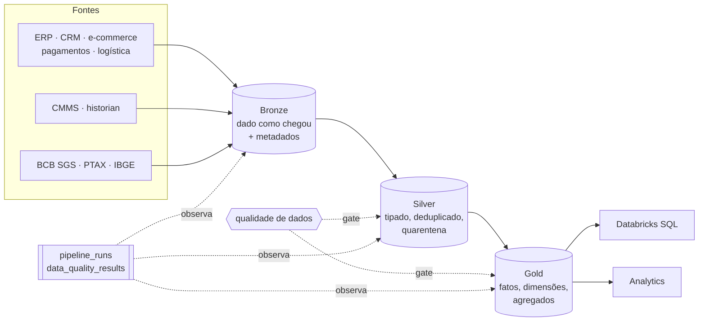

# Databricks Data Engineering Portfolio

[](https://github.com/RenanWRodrigues/Enterprise-Retail-Lakehouse/actions/workflows/ci.yml)

Três Lakehouses construídos com **Python, PySpark, Spark SQL e Delta Lake** para o
**Databricks Free Edition**: varejo com modelagem dimensional, telemetria industrial e dados
macroeconômicos oficiais do Brasil. O código é testado, observável e reproduzível, e cada número
deste README tem evidência.

```
                    DATA SOURCES
                         │
                    INGESTION
                         │
                      BRONZE
                         │
                      SILVER
                         │
                       GOLD
                         │
              ┌──────────┴──────────┐
              │                     │
        Databricks SQL          Analytics
```

## Projetos

| # | Projeto | Problema | Destaque técnico | Estado |
|---|---|---|---|---|
| 01 | [Enterprise Retail Lakehouse](projects/enterprise-retail-lakehouse/README.md) | receita, ticket e entregas confiáveis a partir de 5 sistemas de origem | Silver com quarentena e versões de cliente, esquema estrela, SCD Type 2 com join point-in-time | ponta a ponta ✅ |
| 02 | [Industrial IoT Lakehouse](projects/industrial-iot-lakehouse/README.md) | detectar degradação de equipamentos em telemetria atrasada, duplicada e ruidosa | gerador determinístico em Spark sem UDF, ground truth de falhas | Bronze, Silver e Gold ✅ em escala mínima · volume padrão ⏳ |
| 03 | [Brazilian Financial Data Lakehouse](projects/brazilian-financial-lakehouse/README.md) | juros, inflação, câmbio e atividade a partir de APIs oficiais que revisam dados | ingestão incremental com versões, reamostragem validada contra séries oficiais | ponta a ponta ✅ |

Resumo de cada projeto (problema, arquitetura, pipeline, modelo, desafios, qualidade, testes e
resultados): **[docs/PORTFOLIO_SUMMARY.md](docs/PORTFOLIO_SUMMARY.md)**.

## Resultados comprovados

| Evidência | Resultado |
|---|---|
| Ingestão incremental contra as APIs oficiais (11 indicadores, 2026-10-06) | 1ª execução: 656 observações inseridas; 2ª: 206 recebidas, **2 inseridas** (zero duplicatas) |
| Gold financeira contra agregados publicados pelo BCB/IBGE | Selic do mês, dólar médio e de fim de mês, IPCA 12 meses: **24/24 meses idênticos**; Selic anualizada: **252/252 dias** |
| Landing do Retail gerada | **1.005.095 linhas** em 11 datasets, **4.318 anomalias** intencionais registradas |
| Silver do Retail contra o registro de anomalias do gerador | linhas em quarentena por motivo e duplicatas removidas **iguais** às anomalias injetadas; Silver da landing limpa **idêntica** ao contrato da Gold |

São execuções locais, nenhuma no Databricks. Origem, data e escopo de cada número:
[PORTFOLIO_SUMMARY.md](docs/PORTFOLIO_SUMMARY.md),
[FINAL_AUDIT.md](docs/FINAL_AUDIT.md) e [TEST_REPORT.md](docs/TEST_REPORT.md).

## Testes

Código atual, Windows local, 2026-10-13 ([evidência](docs/audits/test-run-2026-10-13.md)).
As categorias são disjuntas: o total é a soma, sem testes contados duas vezes.

| Categoria | Coletados | Passed | Skipped (não verificados no Windows) | Failed |
|---|---:|---:|---:|---:|
| unit | 688 | 688 | 0 | 0 |
| transformation | 289 | 271 | 18 | 0 |
| data quality | 215 | 204 | 11 | 0 |
| contract | 452 | 396 | 56 | 0 |
| integration (Spark + Delta) | 92 | 1 | 91 | 0 |
| **total** | **1.736** | **1.560** | **176** | **0** |

- **Não verificados localmente:** 91 testes de integração (Delta Lake não roda no Windows sem
  Hadoop) e 83 testes da Gold do Retail (datas 9999-12-31 do SCD2). Rodam no Linux: CI ou
  `docker/tests.Dockerfile`. Outros 2 são notebooks que, por desenho, não importam pacote.
- **0 failed após reexecução isolada:** na passada completa, 23 testes falharam e 54 tiveram erro
  por causas do ambiente local (diretório temporário do PySpark removido; `Python worker failed
  to connect back` com pouca memória). Todos passaram ou foram pulados ao rodar de novo os
  arquivos afetados.
- **CI (Linux):** último run, sobre `d341bc8` (2026-10-12): lint, unit, transformation e data
  quality + contract verdes; **integration falhou** (`Java heap space`, diagnóstico em
  [ci-integration-memory.md](docs/audits/ci-integration-memory.md)); coverage não rodou. O código
  atual ainda não passou pela CI.
- **Cobertura:** sem relatório do código atual. A CI exige o piso de 85% (`make coverage`).
- **Databricks:** nenhum teste nem pipeline executado no workspace até agora
  ([smoke-test-report.md](docs/databricks/smoke-test-report.md)). Os resultados acima são locais.

## Arquitetura



- **Medallion com fronteiras explícitas.** O Bronze não aplica regra de negócio, a Silver valida
  e põe em quarentena, a Gold tem grain documentado.
- **Idempotência.** MERGE por chave, lote já ingerido é pulado, reconstruções determinísticas.
- **Lógica fora dos notebooks.** Transformações são funções puras `DataFrame -> DataFrame`; os
  notebooks só orquestram.
- **Biblioteca comum** ([`shared/`](shared/README.md)) só com código usado por 2+ projetos:
  qualidade, observabilidade, logging estruturado e impressão digital de linha.

## Competências

| Competência | Onde ver |
|---|---|
| Python | clientes HTTP com retry e backoff, geradores determinísticos, mypy strict |
| PySpark | transformações puras, janelas, joins com intervalos, geração em escala sem UDF |
| Spark SQL | consultas Gold com grain e cardinalidade documentados ([Retail](projects/enterprise-retail-lakehouse/sql/gold), [Financial](projects/brazilian-financial-lakehouse/sql/gold)) |
| Delta Lake | MERGE insert-only e upsert, tabelas append-only, histórico |
| Medallion Architecture | Bronze → Silver → Gold nos três projetos |
| Dimensional Modeling | esquema estrela do Retail, SCD Type 2, surrogate keys determinísticas |
| Incremental Processing | checkpoint com lookback, versões de observação, watermark da Silver |
| Data Quality | framework comum PASS/WARNING/ERROR/CRITICAL, quarentena com motivo ([DATA_QUALITY.md](docs/DATA_QUALITY.md)) |
| Testing | 1.736 testes em 5 categorias ([§ Testes](#testes)), CI em cadeia ([TESTING_STRATEGY.md](docs/TESTING_STRATEGY.md), [TEST_REPORT.md](docs/TEST_REPORT.md)) |
| Observability | `pipeline_runs` / `data_quality_results` nos três projetos ([OBSERVABILITY.md](docs/OBSERVABILITY.md)) |
| APIs | BCB SGS, PTAX (OData) e IBGE: timeout, retry, paginação, gzip, falha controlada |
| Time-series Data | frequências diária a trimestral, reamostragem, eventos tardios e fora de ordem (IoT) |

## Como executar

Requisitos: Python 3.12+, Java 17/21 e GNU make. Sem make, os comandos equivalentes estão em
[TESTING_STRATEGY.md §13](docs/TESTING_STRATEGY.md).

```bash
make install            # .venv + dependências de desenvolvimento, do lock (requirements/dev.lock.txt)
make lint               # ruff check, ruff format --check, mypy strict
make test-unit          # Python puro, sem Spark, sem rede
make test               # todos os testes, exceto integration
make test-integration   # Spark + Delta de ponta a ponta (Linux/Docker)
make coverage           # cobertura com piso de 85%
```

A CI (GitHub Actions, sem segredos) roda os mesmos alvos em cadeia: lint → unit →
transformation → data quality → coverage, com integration em job separado.

No Windows, os testes de Delta e da Gold do Retail são pulados com o motivo no relatório
(`pytest -rs`); para rodar tudo, use Linux ou o container `docker/tests.Dockerfile`. Com pouca
memória, rode uma categoria por vez (`pytest -m transformation`, ...).

## Documentação

| Documento | Conteúdo |
|---|---|
| [PORTFOLIO_SUMMARY.md](docs/PORTFOLIO_SUMMARY.md) | os três projetos em detalhe |
| [ARCHITECTURE.md](docs/ARCHITECTURE.md) · [ADR/](docs/ADR/) | layout, convenções, registro de decisões |
| [DATA_QUALITY.md](docs/DATA_QUALITY.md) · [OBSERVABILITY.md](docs/OBSERVABILITY.md) | regras, severidades, métricas de execução |
| [TESTING_STRATEGY.md](docs/TESTING_STRATEGY.md) | categorias de teste, CI, comandos |
| [SECURITY.md](docs/SECURITY.md) · [SECURITY_AUDIT.md](docs/SECURITY_AUDIT.md) | política e auditoria |
| [ROADMAP.md](docs/ROADMAP.md) | fases e próximos passos |
| [CLAUDE.md](CLAUDE.md) | regras de engenharia do repositório |
