# Architecture

## 1. Visão geral

Monorepo com três Lakehouses independentes que compartilham uma biblioteca comum
mínima. Todos seguem a Medallion Architecture sobre Delta Lake e Unity Catalog no
Databricks Free Edition.

```mermaid
flowchart TD
    SRC["Sources<br/>arquivos sintéticos · telemetria simulada · APIs públicas (BCB, CVM)"]
    ING["Ingestion<br/>módulo ingestion/ de cada projeto"]

    SRC --> ING
    ING --> RET["Retail<br/>enterprise-retail-lakehouse"]
    ING --> IOT["IoT<br/>industrial-iot-lakehouse"]
    ING --> FIN["Financial<br/>brazilian-financial-lakehouse"]

    subgraph MEDALLION["Medallion — por projeto (Delta Lake + Unity Catalog)"]
        direction LR
        BRZ["Bronze<br/>raw + metadata"] --> SLV["Silver<br/>validated + standardized"] --> GLD["Gold<br/>business-ready"]
    end

    RET --> BRZ
    IOT --> BRZ
    FIN --> BRZ
    SLV -.-> DQ[("quarentena +<br/>data_quality_results")]
    GLD --> ANL["Analytics<br/>Spark SQL · dashboards · notebooks"]

    COMMON["shared/lakehouse_common<br/>(somente código comprovadamente reutilizável)"] -.-> MEDALLION
```



Cada projeto tem **sua própria** Medallion (catalog/schemas próprios); o diagrama mostra
o padrão comum, não tabelas compartilhadas entre projetos.

## 2. Contrato de cada camada

| Camada | Conteúdo | Escrita | Regras |
|---|---|---|---|
| Bronze | Dado bruto (texto) + `_ingestion_timestamp`, `_source_file` (ou `_source_request` para APIs), `_batch_id`, `_ingestion_date` | append (idempotente por `_batch_id`/arquivo) | sem regra de negócio; schema explícito na leitura |
| Silver | Tipos corretos, nomes `snake_case`, deduplicado, validado | `MERGE` por chave natural | inválidos → tabela `_quarantine`; métricas de qualidade persistidas |
| Gold | Fatos, dimensões, agregados | `MERGE` ou `replaceWhere` por partição | grain documentado; sem `SELECT *`; cardinalidade de joins justificada |

Limites operacionais detalhados: skill `medallion`.

## 3. Layout do repositório

Diretórios sem código ainda contêm apenas `.gitkeep`. Subpacotes Python ganham
`__init__.py` junto com o primeiro módulo (sem arquivos `.py` vazios).

```
.
├── CLAUDE.md                          constituição operacional
├── README.md                          índice do portfólio
├── pyproject.toml                     ferramentas, imports (pythonpath/mypy_path)
├── conftest.py                        marcadores pytest automáticos (todo o monorepo)
├── .claude/
│   ├── settings.json                  guardrails do agente (deny list)
│   └── skills/<skill>/SKILL.md        guias operacionais por tema
├── docs/                              arquitetura e padrões transversais
│   └── ADR/                           ADRs completos (NNNN-titulo.md)
├── tests/
│   └── contract/                      governança do repositório (estrutura, docs, segredos)
├── shared/
│   ├── README.md                      regra de admissão
│   ├── src/lakehouse_common/          runtime: código reutilizável (quality/ implementado)
│   │   ├── logging/  quality/  spark/  observability/
│   ├── src/lakehouse_testing/         somente testes: sessão Spark local, categorias de teste
│   └── tests/<categoria>/             testes de shared/
└── projects/
    ├── enterprise-retail-lakehouse/   pacote retail_lakehouse (+ synthetic/: gerador das fontes)
    ├── industrial-iot-lakehouse/      pacote iot_lakehouse
    └── brazilian-financial-lakehouse/ pacote financial_lakehouse
```

Estrutura de cada projeto (idêntica nos três):

```
projects/<projeto>/
├── README.md              Problem · Architecture · Data · Medallion Layers · Testing · Status · Roadmap
├── config/                configuração por ambiente (sem secrets)
├── notebooks/
│   ├── bronze/  silver/  gold/      orquestração fina (.py formato fonte Databricks)
├── src/<pacote>/
│   ├── ingestion/         leitura de fontes → DataFrame (I/O fino)
│   ├── bronze/            metadados técnicos + escrita Bronze
│   ├── silver/            transformações puras + writer fino
│   ├── gold/              modelos dimensionais/agregados + writer fino
│   ├── quality/           regras de qualidade do domínio
│   └── utils/             helpers do projeto sem regra de negócio
├── sql/                   DDL idempotente e consultas Gold
├── tests/
│   ├── unit/  transformation/  data_quality/  integration/
└── docs/                  documentação específica do domínio (grains, fontes, decisões locais)
```

### Imports

Um único estilo em todo lugar — código, testes e notebooks:

```python
from retail_lakehouse.silver.orders import deduplicate_orders
from lakehouse_common.quality import ...   # somente após a promoção para shared
```

- Imports absolutos a partir da raiz do pacote; sem imports relativos entre camadas.
- Raízes de código-fonte registradas uma vez no `pyproject.toml`
  (`[tool.pytest.ini_options].pythonpath`, `[tool.mypy].mypy_path`, `[tool.ruff].src`).
- Fase 1 torna os pacotes instaláveis (build backend); os imports não mudam.
- Nos notebooks Databricks, o mecanismo (instalação do pacote ou `sys.path`) é decidido
  na Fase 1, após verificar o workspace.

### Fronteiras

```
notebooks ──▶ src/<pacote> ──▶ lakehouse_common
```

- `lakehouse_common` nunca importa de `projects/`; um projeto nunca importa de outro.
- `lakehouse_testing` é importado apenas por testes e `conftest.py` (verificado por teste de contrato).
- `utils/` não é depósito: helper com regra de negócio pertence à camada correspondente;
  helper usado por 2+ projetos segue a regra de admissão de `shared/README.md`.
- Regras completas: skill `architecture`.

## 4. Convenções de nomes (Unity Catalog)

```
<catalog>.<schema>.<table>
```

| Elemento | Convenção | Exemplo |
|---|---|---|
| Catalog | um por projeto | `retail`, `iot`, `financial` |
| Schema | camada | `bronze`, `silver`, `gold` |
| Tabela Bronze | `bronze_<dataset>` | `retail.bronze.bronze_orders` |
| Tabela Silver | entidade no singular/plural consistente | `retail.silver.orders` |
| Tabela Gold | `fact_` / `dim_` / `agg_` | `retail.gold.fact_sales`, `retail.gold.dim_customer` |
| Quarentena | `<tabela>_quarantine` | `retail.silver.orders_quarantine` |
| Colunas técnicas | prefixo `_` | `_ingestion_timestamp`, `_batch_id` |
| Diretório de projeto | `kebab-case` | `enterprise-retail-lakehouse` |
| Pacote Python | `<domínio>_lakehouse` | `retail_lakehouse` |

> Se o Free Edition limitar o número de catalogs, usar um único catalog
> `portfolio` com schemas `<projeto>_<camada>` (ex.: `portfolio.retail_silver`).
> A decisão é tomada na Fase 1, após verificar o workspace.

## 5. Fluxo de execução

1. Notebook (`notebooks/<camada>/`) carrega configuração (`config/<env>.yml` → dataclass tipada).
2. Notebook chama funções de `src/<pacote>/` (ingestão → transformação → escrita).
3. Transformações são funções puras `DataFrame -> DataFrame`, testadas localmente.
4. I/O (leitura de fontes, escrita Delta, MERGE) fica em funções dedicadas e finas.
5. Cada etapa registra: linhas lidas, linhas escritas, linhas em quarentena, duração.

## 6. Restrições do ambiente

- **Databricks Free Edition**: compute serverless, sem clusters customizados,
  cotas limitadas. Datasets devem ser pequenos/médios e gerados de forma determinística.
- **Execução local**: PySpark + delta-spark para testes, com versão alinhada ao runtime
  serverless (definida na Fase 1). Java 17/21 necessário localmente.
- **Sem credenciais pagas**: fontes são dados públicos ou sintéticos.

## 7. Registro de decisões (ADR leve)

Decisões pequenas e reversíveis: uma linha nesta tabela. Decisões com alternativas reais,
custo alto de reversão ou mudança de tecnologia/contrato: ADR completo em
`docs/ADR/NNNN-titulo.md`, com link nesta tabela (critérios e formato na skill `architecture`).

| # | Data | Decisão | Motivo |
|---|---|---|---|
| 001 | 2026-10-05 | Monorepo com `shared/` + `projects/<nome>/` | reaproveitar framework comum sem acoplar projetos |
| 002 | 2026-10-05 | ~~Testes centralizados em `tests/<categoria>/`~~ — **substituída por 009** | — |
| 003 | 2026-10-05 | Notebooks como `.py` (formato fonte Databricks) | diffs legíveis, lint e revisão de código |
| 004 | 2026-10-05 | Ferramentas de dev via PEP 735 (`[dependency-groups]`), sem build backend na Fase 0 | não há pacote para construir ainda; evita configuração especulativa |
| 005 | 2026-10-05 | Documentação em português, identificadores de código em inglês | público do portfólio + convenção da indústria para código |
| 006 | 2026-10-05 | Biblioteca de skills em `.claude/skills/`, validada por `tests/contract/test_skills.py` | guias curtos carregados sob demanda; teste impede deriva do índice |
| 007 | 2026-10-05 | Status de DQ `PASS`/`WARNING`/`ERROR`/`CRITICAL`; FK sem correspondência na Silver = `WARNING` por padrão | dado atrasado não é dado inválido; Gold usa membro "desconhecido" |
| 008 | 2026-10-05 | Surrogate keys determinísticas (hash da natural key) | idempotência: reexecução gera as mesmas chaves |
| 009 | 2026-10-05 | Testes junto do código: `projects/<p>/tests/<categoria>/`, `shared/tests/<categoria>/`; `tests/contract/` da raiz só para governança; marcador derivado do diretório abaixo de `tests/` (`conftest.py` da raiz); pytest `--import-mode=importlib` | cada projeto autocontido e empacotável; nomes de arquivo de teste podem se repetir entre projetos |
| 010 | 2026-10-05 | Nomes definitivos: diretórios `kebab-case` (`enterprise-retail-lakehouse`…), pacotes `retail_lakehouse`/`iot_lakehouse`/`financial_lakehouse`, biblioteca `lakehouse_common`, configuração em `config/` | estrutura definitiva do monorepo |
| 011 | 2026-10-05 | Imports via `pythonpath`/`mypy_path`/`ruff.src` até a Fase 1; diretórios vazios com `.gitkeep`; `__init__.py` só na raiz do pacote até existir o primeiro módulo | imports consistentes sem build backend prematuro; nenhum `.py` vazio |
| 012 | 2026-10-05 | Infraestrutura de teste em `shared/src/lakehouse_testing` (fixture `spark` no `conftest.py` da raiz); asserções nativas `pyspark.testing` | separa código de teste do runtime `lakehouse_common`; evita helpers próprios |
| 013 | 2026-10-05 | `pyspark==4.0.4` apenas no grupo `dev`; `delta-spark` adiado até o primeiro teste `integration` | Spark vem do runtime no Databricks; 4.0 suporta Java 21; Delta baixa JARs |
| 014 | 2026-10-05 | ~~Motor de qualidade inicial em `retail_lakehouse.quality` (genérico, promovido quando o IoT precisar); limiar decide status, não quarentena~~ — **substituída por 016** | — |
| 015 | 2026-10-05 | Nomes de arquivos de teste únicos no monorepo (refina 009) | mypy resolve módulos de teste por nome a partir das raízes `tests/` |
| 016 | 2026-10-05 | Framework de DQ domínio-agnóstico em `lakehouse_common.quality` (8 tipos de check, resultado `CheckResult`, `dq_results` com `check_name`/`rows_checked`/`failed_rows`/`execution_timestamp`); NULL só falha em `not_null`/`custom_condition`; uma ação Spark por execução | decisão explícita do responsável: reutilização pelos 3 projetos é certa; cada defeito contado por um único check |
| 017 | 2026-10-05 | Subpacote `retail_lakehouse/synthetic/` (simulador dos sistemas de origem) fora do layout padrão; contratos de fonte em `ingestion/source_contracts.py` | o gerador não é pipeline nem ingestão; contratos descrevem o que a ingestão lê |
| 018 | 2026-10-05 | Configuração em TOML (`tomllib`, stdlib) | sem dependência nova; resolve "YAML vs. TOML" do ROADMAP |
| 019 | 2026-10-05 | Gerador em Python puro, streaming; anomalias selecionadas por hash da business key e aplicadas só na escrita; fontes serializadas como texto | determinismo byte a byte, independência entre regras, dados limpos idênticos com/sem anomalias; tipagem na Silver |
| 020 | 2026-10-05 | Documentação específica de um projeto em `projects/<p>/docs/` (contratos, fontes, geração); `docs/` da raiz só para temas transversais | documentação junto do código que descreve |
| 021 | 2026-10-05 | Tabelas Bronze `bronze_<dataset>` (substitui `<fonte>_<entidade>`); colunas da fonte como texto + `_ingestion_timestamp`, `_source_file`, `_batch_id`, `_ingestion_date` | nomes pedidos pelo responsável; tipagem e validação de valores ficam na Silver |
| 022 | 2026-10-05 | Bronze: reingestão de `_batch_id` existente é ignorada; tabelas `delta.appendOnly`; criação por CTAS atômico; estrutura divergente do contrato falha a carga (sem `mergeSchema`) | idempotência e proteção contra duplicatas sem sobrescrever histórico; mudança de schema é mudança de contrato |
| 023 | 2026-10-05 | Testes Delta em container Linux (`docker/tests.Dockerfile`); `delta-spark==4.0.1` no grupo `dev` (refina 013) | Delta exige winutils no Windows; Linux espelha Databricks/CI; nenhum binário não oficial no host |
| 024 | 2026-10-05 | Gold implementada sobre o **contrato** da Silver (`silver/schemas.py`) antes da Silver existir; testes geram esse contrato a partir dos dados limpos do gerador | Gold nunca lê Bronze (medallion); permite validar modelo, KPIs e reconciliações agora |
| 025 | 2026-10-05 | Fatos com prefixo `fact_` (substitui `fct_`); grain gravado como `COMMENT` da tabela; reconstrução completa (`createOrReplace`) | nomes pedidos pelo responsável; idempotente com surrogate keys determinísticas |
| 026 | 2026-10-05 | `dim_customer` SCD Type 2 (segment/city/state/region), reconstruída a partir das versões Silver; demais dimensões SCD1; membro desconhecido `-1` em todas | histórico onde a análise precisa do valor da época; fatos nunca perdem linhas |
| 027 | 2026-10-05 | Data de negócio = data de Brasília por aritmética de epoch (UTC−3 fixo), independente do timezone da sessão Spark | resultados idênticos em qualquer configuração de sessão |
| 028 | 2026-10-05 | IoT: leituras geradas em Spark nativo (grade `range × sensores`, sorteios por `xxhash64`); dados mestres e episódios em Python | volume de dezenas de milhões sem materializar no driver; determinismo independente de particionamento |
| 029 | 2026-10-05 | IoT: ground truth separado das fontes (`_ground_truth/`), ligando cada leitura anômala à falha/episódio | fontes realistas e validação posterior objetiva de detectores |
| 030 | 2026-10-05 | IoT com contratos próprios (não promovidos a `lakehouse_common`) | promover exigiria alterar o Retail, vetado nesta fase; pendência registrada |
| 031 | 2026-10-06 | Financial: subpacotes `clients/` (HTTP), `ingestion/` (pipeline), `transformation/` (puro), `storage/` (landing/estado) e `catalog.py` | separação pedida pelo responsável; notebooks sem HTTP; cada camada testável isoladamente |
| 032 | 2026-10-06 | Cliente HTTP só com `urllib` (stdlib), transporte injetável | sem dependência nova; retry/backoff/status/logging explícitos; testes sem rede |
| 033 | 2026-10-06 | Raw = bytes exatos + SHA-256 + manifest por execução + observações em texto; watermark com lookback | auditoria e reprocessamento; revisões das fontes recapturadas; nenhuma tipagem antes da Silver |
| 034 | 2026-10-06 | IPCA pela API do IBGE (fonte primária); EUR/BRL pela PTAX; IPEA não utilizado | fonte primária oficial; somente endpoints confirmados em documentação oficial |
| 035 | 2026-10-06 | Financial Bronze: tabela única `bronze_indicator_observations`, MERGE insert-only por `record_key` = hash do conteúdo; revisão = linha nova | reexecução não duplica; histórico de revisões preservado para a Silver |
| 036 | 2026-10-06 | Checkpoint lógico (última referência confirmada no Bronze), avançado só após o MERGE; lookback de 90 dias / 6 períodos | reexecutar é seguro; revisões das fontes recapturadas sem baixar o histórico |
| 037 | 2026-10-06 | Falha por indicador é isolada, registrada em manifest/métricas e, ao final, a execução levanta `IngestionFailedError` | nenhuma falha silenciosa; os indicadores saudáveis ainda são carregados |
| 038 | 2026-10-06 | Financial Silver: tabela única em formato longo (`silver_indicator_observations`), frequência nativa + `period_start`/`period_end`; reamostragem só na Gold | uma regra de padronização para 11 séries; o período coberto fica explícito e a conversão de frequência é uma decisão analítica |
| 039 | 2026-10-06 | Revisões na Silver: vence a requisição mais recente; valores diferentes na mesma requisição vão para a quarentena (`conflicting_values`); incremental pelas chaves tocadas desde o watermark, relendo todas as versões delas | nada resolvido arbitrariamente; `revision_count` exato sem reprocessar o histórico |
| 040 | 2026-10-06 | Financial Gold reconstruída por inteiro (`CREATE OR REPLACE`) a cada execução | métricas de 12 meses propagam uma revisão por até 12 linhas; a Silver é pequena; exceção documentada ao incremental |
| 041 | 2026-10-06 | Gold em tabelas temáticas (juros, inflação, câmbio, atividade, trabalho) + painel `gold_brazil_macro_monthly`, em vez do esquema estrela planejado (`fact_indicator_value`/`dim_*`) | pedido explícito do responsável; séries macro são poucas e largas, consumidas por tema |
| 042 | 2026-10-06 | Séries de frequências diferentes só se encontram no grain mensal, sobre um calendário consecutivo: diárias agregadas (último, média, capitalização); trimestrais só no último mês do trimestre; trimestre móvel no seu último mês | sem joins com fan-out, sem interpolação; janelas de N linhas = N meses |
| 043 | 2026-10-06 | `real_interest_rate` ex-post por Fisher exato com a Selic diária capitalizada em 12 meses e o IPCA 12 meses; correlações das consultas com `TRY_DIVIDE` (não `CORR`) | mesma janela nos dois termos; `CORR` falha (ANSI) quando a Selic é constante na janela |
| 044 | 2026-10-06 | Observabilidade em `lakehouse_common.observability` (`track_run`, `pipeline_runs`, `DeltaObservabilitySink`), estendendo o framework de DQ existente em vez de criar outro | pedido explícito de camada transversal aos 3 projetos (regra de admissão do `shared/`); sem duplicação |
| 045 | 2026-10-06 | Política de decisão `decide()`: WARNING/ERROR → continua e alerta (`lakehouse.alerts`), CRITICAL → falha antes de gravar; o registro da execução é gravado sempre, inclusive na falha | nenhuma falha silenciosa; quarentena preserva o lote bom |
| 046 | 2026-10-06 | Checks genéricos novos: `SchemaMatches` (avaliado antes dos demais, interrompe a suíte se CRITICAL) e `SequenceGaps` (passo máximo constante ou por coluna); `details` em `data_quality_results`; tabela renomeada de `dq_results` para `data_quality_results` | mudanças de schema e lacunas de séries são comuns aos projetos; o nome segue o pedido |
| 047 | 2026-10-06 | FK órfã = WARNING (ADR 007) com escalada CRITICAL acima de 5% das linhas (mesma regra, dois limiares) | dado atrasado não bloqueia; quebra sistêmica de carga bloqueia |
| 048 | 2026-10-06 | Projetos declaram suítes em `src/<pacote>/quality/suites.py`; `validate_table_name` promovido a `lakehouse_common.naming` (Financial migrado; Retail mantém `validate_namespace` próprio) | o framework decide o como; cada domínio só o quê |
| 049 | 2026-10-06 | CI no GitHub Actions sem segredos (`contents: read`): lint via pre-commit, unit sem Java, matriz Spark (data_quality+contract, transformation, integration) e cobertura combinada com piso 85% | mesmos hooks local/CI; unit prova independência de Spark; Delta roda no runner Linux |
| 050 | 2026-10-06 | Isolamento de testes unitários imposto pelo `conftest.py` raiz (sem fixtures Spark, sem rede) | requisito "unit não depende de Databricks remoto" verificado, não só convencionado |
| 051 | 2026-10-06 | `lakehouse_common.config.load_environment` e `naming.validate_namespace` promovidos (4 carregadores e 2 validadores duplicados em Retail e Financial) | regra de admissão do `shared/`: 2 projetos usam o mesmo comportamento |
| 052 | 2026-10-07 | Financial Bronze (refina 035): entra só o que difere da **última entrega** da chave de versão; da 2ª versão em diante, `record_key` inclui a impressão digital da entrega substituída. A 1ª versão mantém a chave antiga | A → B → A era descartado (chave de A já existia) e a Silver mantinha B; sem migração dos dados gravados |
| 053 | 2026-10-07 | Revisões mais antigas que o lookback: `reprocess_from` explícito (CLI/notebook), sem varredura automática; o checkpoint não recua | releitura de anos é decisão de custo da operação; a regra de versão garante que só o que mudou entra |
| 054 | 2026-10-07 | Gold Financial validada contra agregados oficiais (SGS 4390, 3698, 3696, 1178; IBGE 1737 v2265) com respostas brutas versionadas como fixtures, além dos oráculos sintéticos | oráculo escrito pela mesma leitura da regra não detecta convenção errada; fixtures mantêm o teste sem rede e reproduzível |
| 055 | 2026-10-07 | `pipeline_runs` padronizado nos 3 projetos (`project`, `table`, `started_at`, `finished_at` + colunas existentes); sink obrigatório nos pontos de entrada de orquestração; novo `JsonLinesObservabilitySink` e `Layer.LANDING` | os 3 projetos agora usam a camada (regra de admissão do `shared/` cumprida); JSON Lines permite execução local sem Spark/Hadoop; sink obrigatório impede passo não observado |
| 056 | 2026-10-07 | CI em cadeia (lint → unit → transformation → data quality → coverage) com integration em job separado; cada etapa é um alvo do `Makefile`; instalação numa action composta | uma fonte de verdade para comandos locais e de CI; falha cedo na etapa mais barata; contrato testado em `test_ci_workflow.py` |
| 057 | 2026-10-07 | Código de produção sem APIs de cache/checkpoint (rejeitadas pelo serverless); ações repetidas eliminadas na origem; leituras de texto com schema explícito — [ADR 0001](ADR/0001-spark-without-cache.md) | a Silver falharia no Free Edition; contratos `test_serverless_compatibility.py` e `test_spark_reads.py` |
| 058 | 2026-10-07 | Silver do Retail derivada do contrato de fonte: obrigatório, formato e domínio sobre o texto entregue; regras de negócio declaradas uma vez (`silver_row_rules`) e reusadas pelo gate; quarentena por entidade com a linha original e os motivos | uma fonte de verdade por regra; nada corrigido em silêncio |
| 059 | 2026-10-07 | Nulos tolerados na Silver do Retail onde a Gold tem resposta definida (`products.supplier_id` → fornecedor -1; `customers.birth_date` → faixa `unknown`); PII não carregada (nome, e-mail) não quarentena o cliente | quarentenar o mestre por um atributo opcional tornaria órfãos todos os seus fatos |
| 060 | 2026-10-07 | Versões de cliente: primeira em `registered_at`; mudança em `_ingestion_timestamp` do lote que a revelou (o CRM não informa data de alteração); comparação sempre contra a versão vigente | SCD2 determinístico sem inventar datas; volta a valor anterior é mudança |
| 061 | 2026-10-07 | Watermark da Silver do Retail como tabela de controle Delta de lotes processados (entidade, lote), marcada após as gravações; mesma chave com conteúdo diferente no lote → quarentena `conflicting_values`; tabelas Silver com linhagem (`_ingestion_timestamp`, `_source_file`, `_batch_id`) | incremental exato e idempotente (inclusive para lotes sem versão nova); rastreabilidade Bronze → Silver |
| 062 | 2026-10-08 | Gold do Retail publicada em três passos: staging em `<gold>_staging`, gate `retail_gold_suite` (schema, grain, chaves, todas as FKs: CRITICAL; órfãos: WARNING) sobre todas as tabelas, depois substituição tabela a tabela, dimensões primeiro. Sem transação entre tabelas no Delta: falha de infraestrutura no meio da publicação deixa parte das tabelas novas (dimensões só crescem, chaves determinísticas; reexecução republica). `write_gold` sai de `gold/build.py` (publicação sem gate) para `gold/pipeline.py`, fora do `gold/__init__` (evita ciclo de import com `quality`). Alternativas: `SHALLOW CLONE` do staging (o publicado dependeria dos arquivos do staging) e publicação direta sem staging (validaria um plano recomputado, sem cache no serverless) | `projects/enterprise-retail-lakehouse/docs/DIMENSIONAL_MODEL.md` §6 |
| 063 | 2026-10-08 | Check CRITICAL emite alerta em nível CRITICAL no logger `lakehouse.alerts` antes de falhar o passo (antes, só WARNING/ERROR alertavam); vale para os três projetos | `docs/OBSERVABILITY.md` |
| 064 | 2026-10-08 | Datas fora de `[calendar_start, calendar_end]` (ou ausentes) viram o membro `date_key = -1` na construção dos fatos (`conform_dates`, por intervalo: `dim_date` é contínua); a data do evento é preservada em colunas de data nos 4 fatos (`EVENT_DATES`); `dim_date.year_month` rotula o membro como `UNKNOWN_DATE`; `monthly_sales.sql` passa a `LEFT JOIN` e agrupa por (`period`, `date_classification`). Mudança de contrato da Gold (colunas novas) e do resultado de `monthly_sales`. Alternativas: estender o calendário automaticamente até a maior data (o relatório ficaria correto, mas `dim_date` dependeria dos dados e uma data absurda criaria milhares de dias) e manter o bloqueio CRITICAL de M2 (sem perda, mas sem publicação) | `projects/enterprise-retail-lakehouse/docs/DIMENSIONAL_MODEL.md` §2, §6 |
| 065 | 2026-10-08 | Reconciliação completa da Silver financeira: seis destinos mutuamente exclusivos (`valid`, `quarantine`, `duplicate`, `non_closing_bulletin`, `superseded_revision`, `redundant_latest_version`), cada um contado do próprio DataFrame; equação CRITICAL antes do `MERGE`; evidência em `silver_reconciliation` (versão do Bronze, `run_id`s consumidos) gravada antes do gate; Bronze lido `VERSION AS OF` o último commit. Abstração generalizada em `lakehouse_common.quality.Reconciliation` (o `BatchCounts` do Retail delega a ela). Alternativas: novas colunas em `pipeline_runs` (mudaria o schema compartilhado das tabelas já existentes nos três projetos) e contar a partir de uma coluna de destino única (a equação fecharia por construção, sem detectar perda) | `projects/brazilian-financial-lakehouse/docs/SILVER.md` |
| 066 | 2026-10-08 | Silver financeira progride por versão Delta (Change Data Feed) com checkpoint durável avançado depois da publicação e da reconciliação, no lugar do watermark por `ingestion_timestamp >=`; alertas uma vez por problema (identidade por `record_key` + regra; lacunas só ao lado de chaves novas); Bronze criado com CDF | `docs/ADR/0002-silver-progress-by-delta-version.md` |
| 067 | 2026-10-08 | Preparação para o Databricks: ambiente `smoke` isolado (`workspace.smoke_*`) nos TOML; preflight de capacidades em `lakehouse_common.preflight` (usado pelos dois projetos) com notebook em `shared/notebooks/`; fallback de fontes externas por gravação/replay das respostas HTTP no Volume, com o relógio da gravação; runners `00_run_pipeline.py` por projeto. Alternativas: notebook de preflight duplicado nos projetos (duplicação) e replay a partir dos arquivos da landing (a landing não guarda a URL de cada requisição) | `docs/databricks/` |
| 068 | 2026-10-08 | Bronze do IoT com progresso **por arquivo** (o padrão do Retail é por lote): identidade = SHA-256 dos bytes + caminho relativo; decisões em `bronze_files` (ingerido ou em quarentena com motivo); reparo de append sem registro pelo `_file_id` da tabela; arquivo com problema vai inteiro para a quarentena e os demais seguem; estrutura do CSV validada em Python porque o leitor do Spark descarta campos extras sem erro. Alternativas: controle por lote (perde arquivo tardio em partição antiga; um arquivo ruim derruba o lote) e Auto Loader (exclusivo do Databricks, sem execução local para os testes) | `projects/industrial-iot-lakehouse/docs/BRONZE.md` |
| 069 | 2026-10-08 | Silver do IoT: primeira chegada vence por `reading_id` (ordem total: historian → Bronze → arquivo → conteúdo), dentro e entre execuções; reenvio igual = duplicata, diferente = quarentena `conflicting_resend`; leitura publicada nunca substituída (MERGE insert-only); atraso e fora de ordem são marcas, sem watermark; conversões de unidade só exatas e explícitas, o resto é `unit_mismatch`; progresso por arquivo do Bronze; Silver lida `VERSION AS OF` para não contar o próprio lote como duplicata; alerta só para quarentena nova. Alternativas: última versão vence (resultado dependeria do horário de cada execução) e Structured Streaming com watermark (descartaria eventos fora da janela) | `projects/industrial-iot-lakehouse/docs/SILVER.md` |
| 070 | 2026-10-09 | Gold do IoT: parada não planejada = falha → conclusão da ordem corretiva (o CMMS só registra o instante da falha); planejada = ordem preventiva, nunca falha; paradas unidas por equipamento (sem dupla contagem) e líquidas do planejado; MTBF = operacional / falhas, MTTR = (conclusão − falha) / reparos concluídos, disponibilidade = operacional / programado, NULL com denominador zero; razões do período recalculadas das somas; reconstrução completa da Gold e da Silver do CMMS a cada execução (dados tardios refletidos); sem `fact_sensor_readings` (redundante com a Silver). Alternativas: MTTR por tempo ativo de reparo (início → fim da ordem: ignora a espera até o atendimento) e recálculo incremental por janela (`replaceWhere`; adiado até medir volume) | `projects/industrial-iot-lakehouse/docs/GOLD.md` |
| 071 | 2026-10-09 | Detector de degradação do IoT: baseline explicável (média diária por sensor contra a mediana dos 7 dias anteriores, reiniciada após dia sem leituras), separado das regras de qualidade; avaliação contra o ground truth com casamento um-para-um guloso no tempo (janela: início da degradação até falha + 24 h), métricas por evento e por equipamento-dia, denominador zero = indefinido; limiar calibrado em metade dos equipamentos e avaliado na outra; colunas de rótulo recusadas na entrada (`LeakageError`). Alternativas: modelo estatístico ou de ML (sem evidência de necessidade; menos explicável) e calibração por período (com 30 dias, o baseline consumiria boa parte da janela) | `docs/iot/evaluation/METHODOLOGY.md` |
| 072 | 2026-10-09 | Modo incremental (CDC) do gerador Retail, separado do full (que não muda): plano em TOML com lotes encadeados; o lote N reconstrói os dados mestres da configuração base e reaplica as mudanças dos lotes anteriores (determinístico, sem ler arquivos); saída só com o que mudou ou é novo; transações novas com o lote como espaço de nomes de ID; registro de mudanças com `event_id` determinístico e data real; `batch_fingerprint` do lote. Alternativas: ler o estado anterior da landing (dependeria de arquivos e da ordem de geração) e exportar o cadastro completo a cada lote (a Silver lida com os dois; CDC deixa as mudanças explícitas) | `projects/enterprise-retail-lakehouse/docs/DATA_GENERATION.md` |
| 073 | 2026-10-12 | Retail Silver: impressão digital da linha (`_row_hash`) e do conteúdo por SHA-256 de `concat_ws` com separador `\u001f` e marcador próprio de NULL (`standardize.fingerprint`, o mesmo padrão do `_content_hash` do IoT), no lugar de `xxhash64`, que ignora NULL: `(a, NULL, b)` e `(a, b, NULL)` colidiam e uma linha deslocada sumia como duplicata exata. As impressões gravadas antes (formato decimal) não são migradas: nenhum ambiente foi publicado; um lote anterior interrompido e reprocessado duplicaria a quarentena. Alternativas: `collect_set(struct)` (sem hash, mas sem identidade estável para o MERGE da quarentena) e promover a função para `lakehouse_common` (adiado: mudaria o IoT) | `projects/enterprise-retail-lakehouse/docs/SILVER.md` |
