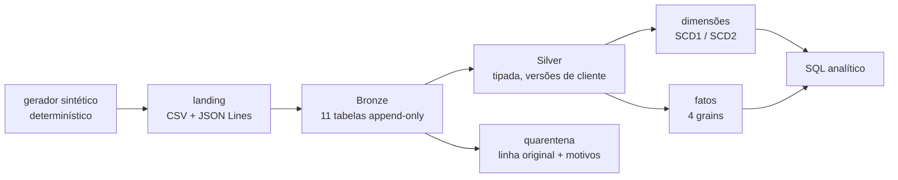
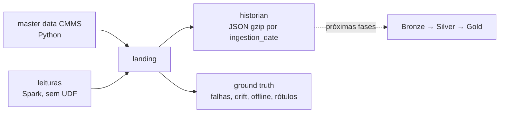
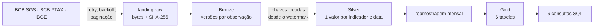

# Portfolio Summary

Resumo técnico dos três Lakehouses: problema, arquitetura, pipeline, modelo, desafios,
qualidade, testes e resultados. Cada número aqui tem evidência citada (execução de teste,
manifest de dados ou execução real documentada). Estimativas de configuração aparecem rotuladas
como tais, nunca como resultado.

Datas de referência: execuções de 2026-10-06 e 2026-10-07.

## Estado de cada projeto

| Camada | 01 Retail | 02 IoT | 03 Financial |
|---|---|---|---|
| Fontes | ✅ gerador sintético, 11 datasets | ✅ gerador sintético (CMMS + historian) + ground truth | ✅ 3 APIs oficiais, 11 indicadores |
| Bronze | ✅ append idempotente por lote | ⏳ | ✅ incremental (checkpoint + lookback + versões) |
| Silver | ✅ 11 entidades + quarentena, clientes por versão | ⏳ | ✅ |
| Gold | ✅ esquema estrela, construída da Silver | ⏳ | ✅ 6 tabelas + 6 consultas |
| Qualidade | ✅ quarentena + gate na Silver | ✅ suíte declarada | ✅ ligada à Silver e à Gold |
| Observabilidade (`pipeline_runs`) | ✅ Bronze, Silver, Gold | ✅ geração da landing | ✅ Bronze, Silver, Gold |

Financial e Retail são ponta a ponta (raw → Bronze → Silver → Gold, testados com Delta em
Linux). O IoT tem a fundação pronta (fontes, contratos, qualidade, observabilidade); as camadas
marcadas ⏳ estão no [ROADMAP](ROADMAP.md).

---

## 01 · Enterprise Retail Lakehouse

**Business problem.** Uma rede varejista precisa de receita, ticket médio, mix de pagamento e
desempenho de entrega confiáveis e históricos. As fontes (ERP, CRM, e-commerce, gateway de
pagamento, logística) chegam com duplicatas, chaves órfãs, datas inválidas, e o cliente muda de
segmento e endereço ao longo do tempo.

**Architecture.**

**Pipeline.**

- Bronze: leitura com schema de contrato em texto, `FAILFAST`.
- Metadados técnicos: `_ingestion_timestamp`, `_source_file`, `_batch_id`, `_ingestion_date`.
- Um lote já ingerido é pulado (idempotência), e as tabelas são `appendOnly`.
- Silver ([SILVER.md](../projects/enterprise-retail-lakehouse/docs/SILVER.md)):
  - regras derivadas do contrato de fonte (obrigatório, formato, domínio) mais regras de negócio;
  - linha reprovada vai para a quarentena com todos os motivos;
  - duplicatas exatas colapsam; mesma chave com conteúdo diferente vai para a quarentena;
  - clientes viram versões (primeira em `registered_at`, mudança no lote que a revelou);
  - SCD1 nas demais entidades; incremental por tabela de controle de lotes;
  - reconciliação `bronze = válidas + quarentena + duplicatas` por lote (CRITICAL).
- Gold: reconstrução determinística a partir da Silver.

**Data model.** Esquema estrela ([DIMENSIONAL_MODEL.md](../projects/enterprise-retail-lakehouse/docs/DIMENSIONAL_MODEL.md)):

| Tabela | Grain | Detalhe |
|---|---|---|
| `dim_customer` | uma versão de cliente | **SCD Type 2** em segmento, cidade, estado e região |
| `dim_product`, `dim_store`, `dim_supplier` | um membro | SCD Type 1 |
| `dim_date` | um dia | calendário brasileiro, Black Friday |
| `fact_sales` | uma linha de pedido | |
| `fact_payments` | um evento de pagamento | |
| `fact_shipments` | uma entrega | |
| `fact_inventory_movements` | um movimento de estoque | |

**Engineering challenges.**

- **Join point-in-time com a SCD2.** O fato liga-se à versão do cliente vigente no instante do
  pedido, em intervalos semiabertos. A sobreposição de intervalos é testada.
- **Surrogate keys determinísticas.** `xxhash64(dimensão, natural key[, valid_from])`: a mesma
  chave em toda reconstrução.
- **Data de negócio independente do timezone da sessão.** A data em Brasília vem de aritmética
  de epoch.
- **Prevenção de double counting.** Fatos de grains diferentes nunca se juntam. As consultas
  agregam antes e documentam a cardinalidade de cada join.
- **Membro desconhecido (-1).** Um fato nunca ganha nem perde linhas por falta de dimensão.

**Quality.**

- Suíte em `retail_lakehouse.quality`, avaliada por lote antes de gravar a Silver.
- FK órfã é WARNING (dado atrasado), escalando para CRITICAL acima de 5% das linhas.
- Unicidade de `(customer_id, effective_from)` para a SCD2.
- Formato, domínio, valores negativos e datas impossíveis são ERROR, com quarentena e motivo.
- PII (nome, e-mail) não entra na Silver; nulos tolerados só onde a Gold tem membro desconhecido.

**Testing.** 486 testes coletados: unit 130, transformation 63, data_quality 63, contract 174,
integration 56. Os testes Gold usam datas 9999-12-31, que o PySpark não converte no Windows,
por isso rodam no Linux (CI).

**Results.**

- Landing gerada com **1.005.095 linhas em 11 datasets** e **4.318 anomalias intencionais**
  registradas por tipo (`data/landing/retail/_manifest.json`; as contagens batem com as linhas
  dos arquivos).
- Ponta a ponta com Delta (Linux, 2026-10-07), `test_silver_build.py`, 15 cenários:
  - linhas em quarentena por motivo **iguais** às anomalias injetadas, segundo o registro do
    gerador;
  - duplicatas removidas iguais aos reenvios injetados;
  - Silver construída da landing limpa **idêntica** ao contrato usado pelos testes da Gold;
  - reexecução sem efeito; segundo lote com novas versões de cliente e SCD1;
  - quebra sistêmica (10% de corrupção) para antes de gravar.
- Os testes rodam sobre amostras menores do mesmo gerador. O volume completo ainda não passou pelo
  pipeline.

---

## 02 · Industrial IoT Lakehouse

**Business problem.** Uma planta monitora equipamentos com 8 tipos de sensor (temperatura,
vibração, pressão, vazão, rotação, corrente, tensão e consumo de energia). As leituras chegam atrasadas, duplicadas, fora de ordem, com spikes,
drift de calibração e valores fisicamente impossíveis. A operação quer detectar degradação antes
da falha.

**Architecture.**

**Pipeline.**

- O gerador produz CMMS (equipamentos, sensores, falhas, ordens de manutenção) e o historian de
  leituras.
- As leituras saem de uma grade `spark.range(passos) × sensores` (broadcast). Cada sorteio é
  `xxhash64(seed, sal, sensor, passo)`, então o resultado independe do particionamento.
- Degradação, drift e períodos offline entram por joins broadcast com intervalos semiabertos.

**Data model.**

- Contratos de fonte para 5 datasets, com limites físicos por tipo de sensor e modos de falha
  ([DATA_CONTRACTS.md](../projects/industrial-iot-lakehouse/docs/DATA_CONTRACTS.md)).
- O ground truth liga cada anomalia à sua causa, e é contra ele que as próximas fases serão
  validadas.

**Engineering challenges.**

- Geração determinística em Spark sem Python UDF e sem `collect()`.
- Eventos tardios: `ingestion_date` depois da data do evento, além do limiar configurado.
- Eventos fora de ordem e reenvios duplicados com o mesmo `reading_id`.
- Janelas de degradação que terminam exatamente na falha, seguidas de parada até o fim do reparo.

**Quality.**

- `iot_lakehouse.quality` declara as regras para a Silver: duplicata de `reading_id` (CRITICAL);
  timestamp inválido ou do futuro além de 5 minutos de tolerância; valor fisicamente impossível,
  NaN ou infinito; unidade divergente do sensor (ERROR).
- Sensor inexistente é WARNING, escalando para CRITICAL acima de 5%.

**Testing.** 110 testes coletados: unit 85, transformation 10, data_quality 11, integration 4.
Cobrem determinismo, contrato, grade de amostragem, degradação antes de toda falha, drift
crescente, ausência de leituras em períodos offline e duplicatas exatas.

**Results.**

- Gerador testado em escala mínima.
- A configuração padrão é dimensionada para ~32,4 milhões de leituras. Isso é uma **estimativa
  da configuração** (120 equipamentos × ~6,25 sensores × 30 dias a cada minuto): esse volume
  ainda não foi executado.

---

## 03 · Brazilian Financial Data Lakehouse

**Business problem.** Comparar juros, inflação, câmbio, atividade e mercado de trabalho no
Brasil a partir de fontes oficiais com frequências diferentes (diária, mensal, trimestral,
trimestre móvel). Essas fontes **revisam** valores já publicados.

**Architecture.**

**Pipeline.**

- **Bronze.** Incremental por checkpoint lógico com lookback (90 dias / 6 períodos), para
  recapturar revisões. `reprocess_from` cobre revisões mais antigas. Um MERGE insert-only grava
  só **versões novas**, inclusive um valor que volta ao anterior (A → B → A).
- **Silver.** Decimal exato, datas validadas pela frequência, a requisição mais recente vence,
  conflitos vão para a quarentena. MERGE incremental pelas chaves tocadas.
- **Gold.** Reconstrução completa (a Silver é pequena e as métricas de 12 meses propagam
  revisões).

**Data model.** Silver em formato longo: `indicator_id, indicator_name, reference_date, value,
unit, frequency, source, updated_at` + período coberto e linhagem. Na Gold:

- tabelas temáticas: juros, câmbio, inflação, atividade, trabalho;
- painel `gold_brazil_macro_monthly`, com uma linha por mês-calendário;
- métricas: `inflation_12m`, `selic_change`, `usd_brl_change`, médias móveis de 3 e 12 meses e
  `real_interest_rate` (Fisher exata, ex-post, com 6 limitações documentadas).

**Engineering challenges.**

- **Frequências diferentes.**
  - Diária → mês: último valor, média ou capitalização, conforme a natureza da série.
  - Trimestral: só no último mês do trimestre.
  - Trimestre móvel: no seu último mês.
  - Sem forward fill; justificativa por caso em [GOLD.md](../projects/brazilian-financial-lakehouse/docs/GOLD.md).
- **Revisões.** Histórico completo no Bronze, versão vigente na Silver.
- **Falha controlada.** Um indicador que falha não para os outros, nunca é silencioso e não
  move o checkpoint.
- **Bugs encontrados por execuções reais e campanhas de teste, cada um com teste de regressão:**
  - gzip não solicitado do IBGE;
  - ids de período trimestral;
  - revisão A → B → A;
  - corrida do watermark da Silver;
  - backfill no meio do mês;
  - `cache()` incompatível com o serverless.

**Quality.**

- Gate CRITICAL antes de gravar: schema do Bronze, chave única, nulls, frequência.
- Regras de linha em ERROR, com quarentena e motivo.
- Lacunas de série e valores implausíveis em WARNING.
- Cada execução grava `pipeline_runs` e `data_quality_results`.

**Testing.** 257 testes coletados: unit 165, transformation 81, data_quality 8, integration 3.
Nenhum acessa a rede: os clientes HTTP usam transporte falso, e as séries oficiais estão
versionadas como fixtures.

**Results (execuções reais contra as APIs oficiais).**

| Evidência | Número |
|---|---|
| Ingestão incremental, 1ª execução (2026-10-06, 11 indicadores) | 656 observações recebidas, 656 inseridas, 14 requisições (1 retry), 23,7 s |
| 2ª execução, mesma janela + lookback | 206 recebidas, **2 inseridas** (zero duplicatas), 19,9 s |
| Execução de 2026-10-07 (2 indicadores) e reexecução | 96/96 e depois 95/0 em `pipeline_runs` |
| Gold contra agregados oficiais do BCB/IBGE | Selic do mês (SGS 4390), dólar médio (SGS 3698) e de fim de mês (SGS 3696), IPCA 12 meses (IBGE 2265): **24/24 meses idênticos**; Selic anualizada (SGS 1178): **252/252 dias** |

Fontes: [INCREMENTAL_STRATEGY.md](../projects/brazilian-financial-lakehouse/docs/INCREMENTAL_STRATEGY.md),
[GOLD.md §7](../projects/brazilian-financial-lakehouse/docs/GOLD.md).

---

## Engenharia transversal

| Tema | Onde |
|---|---|
| Qualidade de dados (framework comum, PASS/WARNING/ERROR/CRITICAL, quarentena) | [DATA_QUALITY.md](DATA_QUALITY.md) |
| Observabilidade (`pipeline_runs`, `data_quality_results`, 3 projetos) | [OBSERVABILITY.md](OBSERVABILITY.md) |
| Estratégia de testes, CI e Makefile | [TESTING_STRATEGY.md](TESTING_STRATEGY.md) |
| Decisões de arquitetura (tabela + ADRs) | [ARCHITECTURE.md §7](ARCHITECTURE.md), [ADR/](ADR/) |
| Segurança | [SECURITY.md](SECURITY.md), [SECURITY_AUDIT.md](SECURITY_AUDIT.md) |

## Validação da suíte completa

| Execução (Linux, alvos do `Makefile`) | Escopo | Resultado |
|---|---|---|
| **Final**, com todas as correções (2026-10-07) | lint (ruff, format, mypy strict) | ok |
| | unit | **465 passed** |
| | transformation | **134 passed** |
| | data quality + contract | interrompida aos 57% pelo Claude Code por falta de memória na máquina; **0 falhas** até ali |
| | integration, cobertura | não executadas (mesmo motivo) |
| **Última completa** (2026-10-07, antes das 3 correções HIGH da auditoria de conformidade) | data quality + contract | **508 passed** |
| | integration (Spark + Delta) | 47 passed, 1 failed (expectativa de alerta ajustada depois, ver [TEST_REPORT.md §3.2](TEST_REPORT.md)) |
| | cobertura combinada (unit + transformation + quality + integration) | **96%** (piso: 85%) |

Testes coletados: **1.162** (unit 465, transformation 134, data_quality 121, contract 394,
integration 48). Depois das correções, os testes afetados foram rodados no Windows: os 4 testes
de leitura JSON do Retail e a suíte de contrato da raiz (§6 de
[CLAUDE_COMPLIANCE_AUDIT.md](CLAUDE_COMPLIANCE_AUDIT.md)). A revalidação completa no Linux está
pendente; para fazê-la, rode `make test-quality`, `make test-integration` e `make coverage`.
