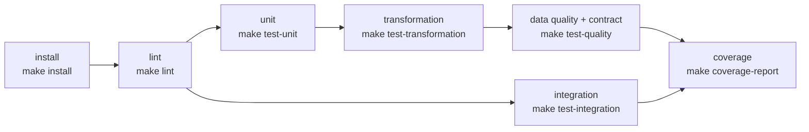

# Testing Strategy

Guia operacional curto: skill `.claude/skills/testing/`. Este documento explica o *porquê*.

## 1. Princípios

- **RED → GREEN → REFACTOR**: o teste que falha vem antes da implementação.
- **Toda correção de bug recebe um regression test quando aplicável**: primeiro um teste
  que reproduz o bug (e falha), depois a correção. O nome do teste descreve o comportamento
  correto, não o número do bug. "Não aplicável" (ex.: erro de digitação em documentação)
  é justificado no relato da tarefa.
- Transformações são funções puras, então são testadas sem Databricks.
- Resultados reportados com números reais da execução.

## 2. Test pyramid

```
            ▲  integration      poucos · lentos · Delta local · pipeline entre camadas
           ▲▲▲ contract         schemas e contratos de tabelas, governança do repositório
         ▲▲▲▲▲ data_quality     regras de qualidade e o motor de avaliação
       ▲▲▲▲▲▲▲ transformation   funções DataFrame -> DataFrame com DataFrames pequenos
    ▲▲▲▲▲▲▲▲▲▲ unit             Python puro: regras de status, parsing, config, calendário
```

A base é grande e rápida; o topo é pequeno e caro. Lógica que pode ser testada como `unit`
(sem Spark) **deve** ser — por isso a resolução de status e a validação dos checks de
`lakehouse_common.quality` são testadas como `unit`, em milissegundos.

| Categoria | Testa | Spark? | Onde |
|---|---|---|---|
| `unit` | Python puro | não | `<área>/tests/unit/` |
| `transformation` | `DataFrame -> DataFrame` | local | `<área>/tests/transformation/` |
| `data_quality` | regras e motor de qualidade | local | `<área>/tests/data_quality/` |
| `contract` | schemas, contratos, governança | depende | `<área>/tests/contract/`, `tests/contract/` |
| `integration` | Bronze → Silver → Gold, reexecução | local + Delta | `<área>/tests/integration/` |

`<área>` = `projects/<projeto>` ou `shared`.

### Markers

Registrados no `pyproject.toml` (`--strict-markers`) e **aplicados automaticamente** pelo
diretório (`conftest.py` da raiz, via `lakehouse_testing.markers.category_of`). Um teste
fora de `<área>/tests/<categoria>/` é **erro de coleta** — todo teste tem categoria.
Decorar com `@pytest.mark.<categoria>` é permitido, mas redundante.

```bash
pytest -m unit                        # só unitários (segundos)
pytest -m "not integration"           # loop de desenvolvimento
pytest -m "transformation or data_quality"
pytest projects/enterprise-retail-lakehouse
```

## 3. Test isolation

- Nenhum teste depende de outro nem da ordem de execução.
- Arquivos só em `tmp_path` / `tmp_path_factory`; nunca no repositório.
- A `SparkSession` é compartilhada (custo de startup), portanto o **estado de sessão não é**:
  não criar temp views globais, não alterar `spark.conf` em testes; se inevitável, restaurar
  no próprio teste (`try/finally`).
- Sem rede, sem workspace Databricks, sem credenciais.
- **Garantido pelo `conftest.py` raiz** para a categoria `unit`: pedir o fixture `spark` ou
  `delta_spark` num teste unitário é erro de coleta, e abrir conexão de rede levanta
  `RuntimeError` (`tests/unit/test_unit_isolation.py`). Testes unitários rodam sem JVM.

## 4. Determinism

| Fonte de não determinismo | Regra |
|---|---|
| Relógio (`now()`) | injetar o instante como parâmetro (ex.: `checked_at` em `split_by_quality`) |
| Aleatoriedade | sem `random` sem semente fixa; geradores de dados com seed explícita |
| Timezone | sessão Spark em UTC; **`collect()` converte timestamps para o fuso local do processo Python** — compare timestamps renderizados pelo Spark (`F.date_format`) ou em UTC explícito |
| Ordem de linhas | nunca assumir; `assertDataFrameEqual` ignora ordem por padrão |
| Paralelismo | `local[2]` com 2 partições de shuffle: expõe código que só funciona com 1 partição |
| Schema inferido | sempre `StructType` explícito em `createDataFrame` |

## 5. Fixtures

Criar fixture **somente** quando há custo de setup, teardown ou estado a gerenciar.
Dados de teste e regras são **constantes ou funções construtoras** no próprio módulo
(mais legíveis e explícitas que fixtures).

| Fixture | Escopo | Onde | Por que existe |
|---|---|---|---|
| `spark` | session | `conftest.py` (raiz) | JVM leva segundos para subir; import tardio: testes `unit`/`contract` não pagam esse custo; Delta habilitado quando suportado |
| `delta_spark` | session | `conftest.py` (raiz) | a mesma sessão, exigindo Delta; **pula** o teste com motivo explícito onde Delta não roda (Windows sem `HADOOP_HOME`) |
| `landing_root`, `landing_rows`, … | session | `projects/enterprise-retail-lakehouse/tests/conftest.py` | landing zone sintética gerada uma vez e reaproveitada por vários módulos |
| `repo_root` | session | `conftest.py` (raiz) | testes de governança leem arquivos do repositório |

Infraestrutura reutilizável de teste vive em `shared/src/lakehouse_testing/` (somente
testes; código de produção nunca a importa — verificado por teste de contrato).

## 6. Mocking

- **Preferir injeção de dependência a mock**: código de I/O recebe o cliente/relógio como
  parâmetro; o teste passa um *fake* simples (classe com o mesmo método). Isso evita
  bibliotecas de mock HTTP e torna o contrato explícito.
- `monkeypatch` (pytest) apenas para variáveis de ambiente ou fronteiras que não aceitam
  injeção.
- Nunca mockar Spark: use DataFrames reais pequenos. Nunca mockar o código sob teste.
- Um mock que exige reproduzir detalhes internos é sinal de design acoplado — refatore.

## 7. Spark tests

- Fixture `spark` (`lakehouse_testing.spark.build_local_spark_session`): `local[2]`,
  shuffle = 2, timezone UTC, UI desligada, warehouse em diretório temporário,
  `PYSPARK_PYTHON` = interpretador do venv.
- Asserções nativas de `pyspark.testing`: `assertDataFrameEqual` (ignora ordem, trata nulls)
  e `assertSchemaEqual` (nomes, tipos, nulabilidade) — sem helpers próprios.
- Estrutura **Arrange / Act / Assert**; 2–10 linhas por DataFrame, cada uma com propósito.
- Cobrir: nulls, string vazia, duplicata, empate de ordenação, valor fora do domínio,
  limites de data/timezone, DataFrame vazio.
- `collect()` é aceitável **somente em testes** sobre DataFrames de poucas linhas.
- Custo: no Windows cada ação Spark cria processos Python (≈ 3 s por ação; ≈ 15 s de
  startup). Em Linux/CI é muito mais rápido. Use `-m unit` no loop curto.

## 8. API tests

- Cliente HTTP é injetável; testes usam um **fake client** que devolve respostas
  pré-definidas por requisição — nenhuma chamada de rede.
- Cenários mínimos (skill `api-ingestion`): sucesso paginado, 429 com `Retry-After`, 5xx que
  se recupera, 5xx que esgota tentativas, 4xx sem retry, envelope inválido, página vazia,
  cursor repetido, watermark que não avança em falha, reexecução sem duplicar.
- Espera de backoff injetada (função `sleep` fake): testes nunca dormem.
- Parsing do payload é função pura → `unit`.

## 9. Data quality tests

- Cada regra: caso que passa, caso que falha, bordas (null, string vazia, limite exato,
  limiar exatamente atingido).
- Motor: `CRITICAL` interrompe, `ERROR` quarentena, `WARNING` não bloqueia, `PASS` sem
  quarentena, DataFrame vazio, regra cuja expressão resulta em NULL (= falha).
- Resolução de status (`resolve_status`) e validação de checks são `unit`; avaliação em
  Spark é `data_quality`; schemas de `data_quality_results` e `pipeline_runs` são `contract` (comparados com
  `DATA_QUALITY.md` e `OBSERVABILITY.md`).
- Matriz mínima por tipo de check: zero falhas, algumas, 100%, NULL, duplicatas,
  fronteiras, dataset vazio.

## 10. Integration tests

- Tabelas Delta reais (`delta-spark==4.0.1`, sessão via `delta_spark`), em namespaces
  isolados por teste.
- Idempotência e incrementalidade:
  1. executar com o lote A → capturar estado;
  2. reexecutar com o lote A → estado idêntico (sem duplicatas);
  3. executar com o lote B (novos + alterados) → apenas o delta aplicado.
- Sempre excluíveis: `pytest -m "not integration"`.

### Docker (ambiente Linux de testes)

Delta (e qualquer escrita de arquivo pelo Spark) exige o `winutils.exe` do Hadoop no
Windows. Em vez de instalar binários não oficiais, a suíte completa roda num container
Linux (`docker/tests.Dockerfile`: Python 3.12, Java 17, dependências do `pyproject.toml`,
JARs do Delta pré-baixados). No Windows, os testes Delta aparecem como `SKIPPED` com o
motivo; no container, rodam todos.

```bash
docker build -f docker/tests.Dockerfile -t lakehouse-tests .
docker run --rm -v "${PWD}:/workspace" lakehouse-tests                 # PowerShell: suíte completa
docker run --rm -v "$(pwd -W):/workspace" lakehouse-tests              # Git Bash
docker run --rm -v "${PWD}:/workspace" lakehouse-tests python -m pytest -m integration
```

No Windows, testes Spark podem falhar esporadicamente com
`Python worker failed to connect back` (criação lenta de processos Python, sem reaproveitamento
de workers no Windows). É instabilidade do ambiente, não do código: repita ou use o container.

## 11. Coverage

```bash
pytest --cov                     # relatório + fail_under (85%, branch coverage)
pytest --cov --cov-report=html   # htmlcov/ (ignorado pelo Git)
```

- Opt-in (não está em `addopts`): rodar um único arquivo não falha por cobertura.
- `fail_under = 85` é **piso, não meta**. Não escrever testes só para subir o número.
- Prioridade de cobertura real: motor de qualidade, transformações Silver/Gold, chaves e
  deduplicação, escrita idempotente, parsing de fontes. Baixa prioridade: código de
  orquestração trivial, `__repr__`, ramos defensivos impossíveis (`# pragma: no cover`
  com justificativa na mesma linha).
- Notebooks não entram na cobertura — por isso não podem conter lógica.
- **Na CI**, cada job grava `.coverage.<suíte>`; o job `coverage` combina tudo e aplica o
  piso. **No Windows**, medir os testes Spark com `--cov` é ~50x mais lento (o PySpark abre um
  processo Python por tarefa); localmente, meça só `-m unit` e deixe o total para a CI.

## 12. CI e pre-commit

| Onde | O que roda |
|---|---|
Cada etapa da CI é um alvo do `Makefile`: o que roda no GitHub é o que roda localmente.
A instalação (`make install`, com Python 3.12 e, nos jobs Spark, Java 21) está na action composta
`.github/actions/setup`.



| Onde | O que roda |
|---|---|
| `pre-commit` (commit) | higiene de arquivos, `detect-private-key`, `ruff check --fix`, `ruff format`, `mypy` strict (+ os dois `tests/conftest.py` de projeto, checados à parte) |
| `pre-commit` (push) | `pytest -m unit` |
| GitHub Actions `lint` | `make lint` + hooks de higiene e de segredos do pre-commit (ruff/mypy já rodaram, por isso o `SKIP`) |
| GitHub Actions `unit` | `make test-unit` sem Java (prova que unit não depende de Spark) |
| GitHub Actions `transformation` | `make test-transformation` (Java 21, Spark local) |
| GitHub Actions `data-quality` | `make test-quality`: `data_quality or contract` (Spark local) |
| GitHub Actions `integration` | `make test-integration`: Spark + Delta locais, em job **separado** da cadeia principal |
| GitHub Actions `coverage` | `make coverage-report`: combina a cobertura dos quatro jobs de teste e aplica `fail_under = 85` |

**Integração separada, sem Databricks e sem API.** Os testes `integration` rodam Spark + Delta
no próprio runner. Nenhum teste chama um workspace Databricks ou uma API pública: HTTP é falso nos
testes, e as séries oficiais usadas na validação da Gold estão versionadas como fixtures. Um teste
que precisasse de workspace ou de rede não poderia entrar nesta CI, porque ela não tem segredos.
A cobertura combinada inclui o job de integração: os caminhos Delta (sinks, `MERGE`, escrita das
tabelas) só são exercitados lá.

Sem segredos: o workflow e a action usam só `contents: read` e não referenciam `secrets.*`
(`tests/contract/test_ci_workflow.py`, que também verifica a ordem das etapas e que cada passo
da CI é um alvo existente do Makefile).

Instalação dos hooks (uma vez, com o `.venv` ativo):

```bash
.venv/Scripts/python -m pre_commit install --install-hooks
```

### Limitações conhecidas no Windows (rodam na CI Linux)

| Sintoma | Causa | Tratamento |
|---|---|---|
| Testes Gold do Retail pulados | o PySpark converte TIMESTAMP para `datetime` pela API de hora local, que no Windows rejeita anos > 3000; a SCD2 termina em 9999-12-31 | fixture `gold_tables` pula no Windows com o motivo; testes de SCD comparam a data-fim no Spark |
| Escrita Delta pulada | Hadoop exige winutils | `delta_spark` pula; Docker ou CI |
| JVM morre ao ler com glob (`*/part-*.jsonl`) | o glob do Hadoop chama código nativo (winutils) | leitores passam a lista explícita de arquivos |
| `check-yaml`/`trailing-whitespace` do pre-commit bloqueados | Smart App Control bloqueia binários nativos do ambiente do hook | rodam na CI |

## 13. Comandos

Com GNU make (`make help` lista; `COV=1` grava `.coverage.<suíte>` em qualquer alvo de teste):

```bash
make install            # .venv + dependências de desenvolvimento, do lock (requirements/dev.lock.txt)
make lint               # ruff check, ruff format --check, mypy strict
make test               # todos os testes, exceto integration (o que a cadeia da CI roda)
make test-unit          # Python puro, sem Spark, sem rede
make test-transformation  # transformações PySpark (Java 17/21)
make test-quality       # data quality + contract (Spark)
make test-integration   # Spark + Delta locais de ponta a ponta (Linux/Docker; pulados no Windows)
make coverage           # unit + transformation + quality com cobertura, fail_under = 85
```

`make coverage` apaga a cobertura anterior, roda as três suítes com cobertura e combina. No
Windows, a cobertura de testes Spark é muito lenta (um processo Python por tarefa); meça lá só
`make test-unit COV=1` e deixe a cobertura completa para a CI ou para Linux.

Sem make, os comandos equivalentes:

```bash
.venv/Scripts/python -m pytest                       # tudo
.venv/Scripts/python -m pytest -m "not integration"  # sem os lentos
.venv/Scripts/python -m pytest -m unit               # loop curto
.venv/Scripts/python -m pytest --cov                 # com cobertura
.venv/Scripts/python -m ruff check .
.venv/Scripts/python -m ruff format --check .
.venv/Scripts/python -m mypy
.venv/Scripts/python -m pre_commit run --all-files   # tudo o que o commit/CI checa
```

### Dependências travadas (lock)

| Arquivo | Papel |
|---|---|
| `pyproject.toml` `[dependency-groups] dev` | intenção: pins exatos das dependências **diretas** |
| `uv.lock` | resolução completa (transitivas incluídas), válida para Linux, Windows e macOS, Python ≥ 3.12 |
| `requirements/dev.lock.txt` | exportado do `uv.lock`, com hashes: o que `make install` e a CI instalam (`pip --require-hashes`) |

- **Instalar:** `make install` (só pip; o uv não é necessário).
- **Mudar uma dependência:** edite o pin no `pyproject.toml` e rode `make lock`. O `uv lock` mantém
  as versões já travadas e só resolve o que mudou.
- **Atualizar uma transitiva de propósito:** `.venv/Scripts/python -m uv lock -P nome==versão`,
  depois `make lock`. Nunca use `uv lock --upgrade` sem rodar a suíte.
- **CI:** o job de lint roda `make lock-check`. Ele falha se o `pyproject`, o `uv.lock` e o lock
  exportado discordarem. `tests/contract/test_lockfile.py` faz as mesmas comparações sem o uv, e
  confere também os hashes e a ausência de caminhos locais e credenciais.
- **Databricks:** fora do lock. `[project].dependencies` é vazio, e o PySpark e o Delta vêm do
  runtime (`docs/databricks/compatibility.md` §5).
