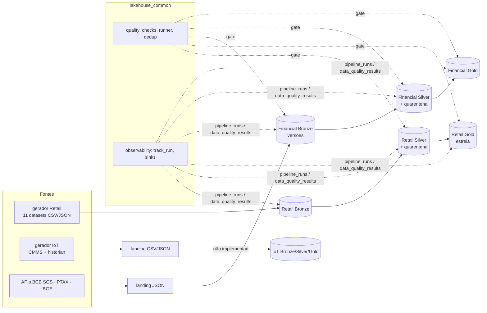
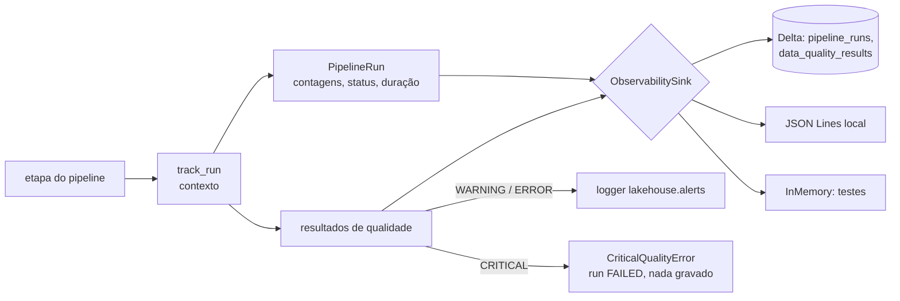

# Architecture Overview

Mapa operacional do repositório em 2026-10-08: onde está cada módulo, quais tabelas Delta existem,
como funcionam observabilidade, quarentena e alertas, e como cada pipeline é executado. As
decisões e convenções continuam em [ARCHITECTURE.md](../ARCHITECTURE.md) (fonte normativa) e em
[docs/ADR/](../ADR/); este documento descreve o estado, não as regras.

## 1. Visão geral

| Projeto | Estado | Pacote |
|---|---|---|
| Enterprise Retail | raw → Bronze → Silver → Gold | `retail_lakehouse` |
| Brazilian Financial | APIs → landing → Bronze → Silver → Gold | `financial_lakehouse` |
| Industrial IoT | só fontes sintéticas, contratos e suíte de qualidade | `iot_lakehouse` |

## 2. Módulos por responsabilidade

| Responsabilidade | Retail | Financial | IoT | Shared |
|---|---|---|---|---|
| Geração de dados | `synthetic/` (generator, master_data, anomalies, seasonality, sinks) | — (fontes reais) | `synthetic/` (master_data, physics, readings, writer) | — |
| Contratos de fonte | `ingestion/source_contracts.py`, `ingestion/readers.py` | `clients/` (http, bcb_sgs, bcb_ptax, ibge) | `ingestion/source_contracts.py` | — |
| Ingestão / Bronze | `bronze/` (ingest, settings, transformations) | `ingestion/pipeline.py`, `storage/` (landing, bronze, watermarks, files), `transformation/` | — | — |
| Silver | `silver/` (standardize, pipeline, schemas, reference) | `silver/` (standardize, pipeline, schemas) | — | — |
| Gold | `gold/` (dimensions, facts, keys, build, schemas) + `sql/gold/*.sql` (7) | `gold/` (resample, metrics, tables, build, pipeline, schemas) + `sql/gold/*.sql` (6) | — | — |
| Qualidade | `quality/suites.py` | `quality/suites.py` | `quality/suites.py` | `lakehouse_common.quality` (checks, runner, results, dedup) |
| Observabilidade | usa shared | usa shared | usa shared (geração) | `lakehouse_common.observability` (runs, sinks) |
| Configuração | `config/{bronze,silver,gold,data_generation}.toml` | `config/{ingestion,medallion}.toml`, `catalog.py` | `config/data_generation.toml` | `lakehouse_common.config`, `naming` |
| Execução | `notebooks/{bronze,silver,gold}/`, CLI `synthetic` | `notebooks/{bronze,silver,gold}/`, CLI `ingestion` | `notebooks/setup/`, CLI `synthetic` | `lakehouse_testing` (sessão Spark e marcadores, só testes) |

## 3. Tabelas Delta

Os nomes completos vêm da configuração (`[local]` usa o catálogo do Spark local; `[databricks]`
usa `catálogo.schema` do Unity Catalog).

### Retail (`retail.bronze`, `retail.silver`, `retail.gold`)

| Camada | Tabela | Chave / grain | Gravação |
|---|---|---|---|
| Bronze | `bronze_<dataset>` (11) | linha como entregue + `_ingestion_timestamp`, `_source_file`, `_batch_id`, `_ingestion_date` | append-only (`delta.appendOnly`); lote já ingerido é pulado |
| Silver | `silver_<entidade>` (11) | chave de negócio (`BUSINESS_KEYS`); clientes: (`customer_id`, `effective_from`) | MERGE: SCD1 nas entidades, insert-only nas versões de cliente |
| Silver | `silver_<entidade>_quarantine` (11) | linha original + `_row_hash`, `_dq_failed_checks`, `_dq_execution_timestamp` | MERGE insert-only por (`_row_hash`, motivos) |
| Silver | `silver_processed_batches` | (entidade, `_batch_id`) | append depois das gravações |
| Gold | `dim_date`, `dim_customer` (SCD2), `dim_product`, `dim_store`, `dim_supplier` | surrogate key (xxhash64), membro desconhecido -1 | reconstrução determinística (`createOrReplace`) |
| Gold | `fact_sales`, `fact_payments`, `fact_shipments`, `fact_inventory_movements` | grain no `COMMENT` "Grain:" | idem; **sem gate em tempo de execução (M2)** |

Contratos: `silver/schemas.py` (`SILVER_SCHEMAS`, `silver_table_schema`), `gold/schemas.py`
(`GOLD_SCHEMAS`, chaves de grain).

### Financial (`financial.bronze`, `financial.silver`, `financial.gold`)

| Camada | Tabela | Chave / grain | Gravação |
|---|---|---|---|
| Landing | JSON por indicador e execução em `/Volumes/financial/landing/files` | — | arquivo novo por requisição |
| Estado | `_state/watermarks.json` na landing | checkpoint lógico por indicador | escrita atômica depois do commit no Bronze |
| Bronze | `bronze_indicator_observations` | (indicador, referência, versão do valor) | MERGE insert-only de versões novas (A → B → A preservado) |
| Silver | `silver_indicator_observations` | (indicador, data de referência) | MERGE incremental (watermark `>=` em `bronze_ingestion_timestamp`) |
| Silver | `silver_indicator_observations_quarantine` | (`record_key`, motivos) | MERGE insert-only |
| Gold | `gold_interest_rates`, `gold_exchange_rates`, `gold_inflation`, `gold_economic_activity`, `gold_labor_market`, `gold_brazil_macro_monthly` | grain em `GOLD_COMMENTS` | reconstrução depois do `gold_suite` (CRITICAL bloqueia) |

### Observabilidade (por projeto, no schema configurado)

| Tabela | Conteúdo |
|---|---|
| `pipeline_runs` | uma linha por execução e etapa: `pipeline_name`, `run_id`, `project`, `layer`, `table`, `started_at`, `finished_at`, `duration_seconds`, `input_rows`, `output_rows`, `rejected_rows`, `status`, `error_message` (mascarada) |
| `data_quality_results` | um resultado por regra por execução, ligado por `run_id` |

### IoT

Nenhuma tabela Delta. A landing (CSV do CMMS, JSON das leituras particionado por data) é gerada
pelo `synthetic`; o contrato das futuras tabelas está em `ingestion/source_contracts.py`.

## 4. `pipeline_runs`, quarentena e alertas

- **`track_run`** (`lakehouse_common.observability.runs`) envolve cada etapa: mede a duração,
  registra contagens, captura a exceção (status `FAILED` com `error_message` mascarada) e grava a
  execução no sink mesmo em falha.
- **Status:** `SUCCEEDED`, `SUCCEEDED_WITH_ALERTS` (algum WARNING/ERROR), `FAILED`.
- **Sinks:** `DeltaObservabilitySink` nos notebooks, `JsonLinesObservabilitySink` na CLI local,
  `InMemoryObservabilitySink` nos testes.
- **Quarentena:** `split_by_quality` (`lakehouse_common.quality`) separa linhas reprovadas em
  regras de linha ERROR/CRITICAL. A linha original vai para a tabela `*_quarantine` com todos os
  motivos; nada é corrigido em silêncio. Regras de conjunto (unicidade, órfãos sistêmicos,
  schema) são o *gate*: CRITICAL interrompe antes de gravar.
- **Alertas:** hoje são só o logger `lakehouse.alerts` (nível WARNING). Nenhum canal externo
  (e-mail, webhook) está ligado.

## 5. Execução

| Ambiente | Como | Observações |
|---|---|---|
| Local (Windows) | `pytest` com Spark local, sem Hadoop | testes Delta e Gold do Retail (datas 9999-12-31) pulam com motivo; `transformation` inteiro passa de 590 s, rodar por área |
| Local (Linux/WSL) e CI | alvos do `Makefile` (`make lint`, `test-unit`, `test-transformation`, `test-quality`, `test-integration`, `coverage-report`) | referência para Delta; mesmas versões fixadas da CI |
| CLIs locais | `python -m financial_lakehouse.ingestion`, `python -m retail_lakehouse.synthetic`, `python -m iot_lakehouse.synthetic` | gravam em `data/` (ignorado pelo Git) |
| Databricks Free Edition | notebooks `.py` em `projects/
/notebooks/`, executados manualmente na ordem bronze → silver → gold | **nunca executado**; sem bundle, jobs ou agendamento; serverless sem cache (ADR 0001) |

Ordem no Databricks:

- Retail: gerar a landing (Volume) → `bronze/01_ingest_bronze` → `silver/01_build_silver` →
  `gold/01_build_gold`.
- Financial: `bronze/01_ingest_bronze` (requer saída à internet) → `silver/01_build_silver` →
  `gold/01_build_gold`.
- IoT: `setup/00_generate_synthetic_sources`.

## 6. Build, dependências e ferramentas

| Item | Onde | Estado |
|---|---|---|
| Dependências | `pyproject.toml` (grupo `dev`), versões exatas | pyspark 4.0.4, delta-spark 4.0.1, pytest 9.1.1, ruff 0.16.10, mypy 2.4.0; transitivas sem lock (M5) |
| Lint / tipos | ruff (check + format), mypy strict | verdes |
| Hooks | `.pre-commit-config.yaml` | mesmo conjunto do job de lint da CI |
| CI | `.github/workflows/ci.yml` + `.github/actions/setup` | lint → unit → data_quality/contract → transformation → integration → cobertura combinada (piso 85%); nunca executada |
| Contêiner | `docker/` + `.dockerignore` | ambiente Linux alternativo ao WSL |
| Governança | `tests/contract/` (216 testes) | segredos, pins, notebooks finos, leitura com schema, compatibilidade serverless, skills, CI |
