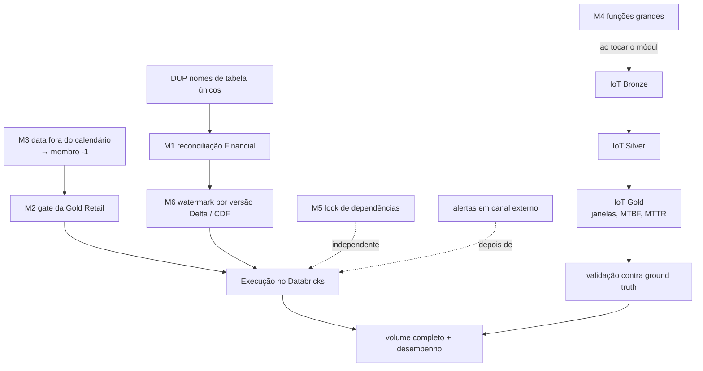

# Improvement Plan

Plano incremental a partir do baseline de 2026-10-08
([BASELINE_AUDIT.md](../audits/BASELINE_AUDIT.md)). Cada item é uma entrega pequena, com teste
RED antes da correção, e respeita as *Evolution Rules* do `CLAUDE.md`.

| Item | Estado |
|---|---|
| M2 | ✅ implementado em 2026-10-08 (feito antes de M3, por pedido explícito); evidências em §5 |
| M3 | ✅ implementado em 2026-10-08; evidências em §5 |
| M6 | ✅ implementado em 2026-10-08 (ADR 0002); evidências em §5 |
| 4.1 IoT Bronze | ✅ implementado em 2026-10-08 (`projects/industrial-iot-lakehouse/docs/BRONZE.md`) |
| 4.2 IoT Silver | ✅ implementado em 2026-10-08 (`projects/industrial-iot-lakehouse/docs/SILVER.md`) |
| 4.3 IoT Gold | ✅ implementado em 2026-10-09 (`projects/industrial-iot-lakehouse/docs/GOLD.md`) |
| 4.4 IoT detecção e avaliação | ✅ 2026-10-09: detector baseline + avaliação reprodutível (`docs/iot/evaluation/`) |
| Lotes incrementais no gerador Retail | ✅ 2026-10-09 (`DATA_GENERATION.md`, "Modo incremental") |
| Etapa 3 (Databricks) | preparação local ✅; execução no workspace **PENDING** (`docs/databricks/EXECUTION_REPORT.md`) |
| M1 | ✅ implementado em 2026-10-08 (DUP, previsto antes, não foi necessário: a reconciliação não usa os nomes duplicados); evidências em §5 |
| demais | pendentes |

Testes previstos por item: [TEST_MATRIX.md](TEST_MATRIX.md). Riscos: [RISK_REGISTER.md](RISK_REGISTER.md).

## 1. Dependências entre os itens

- **M3 e M2:** M2 foi feito primeiro (pedido explícito). Consequência: um fato com data fora do
  calendário, que antes sumia em silêncio de `monthly_sales.sql`, agora **bloqueia a publicação**
  (`fk__date_key__dim_date`, CRITICAL). M3 passa a remover esse bloqueio mapeando essas datas ao
  membro desconhecido; até lá, o calendário de `config/gold.toml` precisa cobrir todas as datas.
- **DUP antes de M1:** M1 mexe nas contagens da Silver financeira, que hoje lê o nome da tabela de
  duas constantes. Unificar primeiro evita corrigir a métrica em um lugar e não no outro.
- **M1 antes de M6:** M6 muda o que é lido a cada execução; a reconciliação completa (M1) é o que
  prova que a troca de watermark não perde nem duplica linhas.
- **Databricks depois de M2 e M6:** a primeira execução na plataforma deve ser a versão sem os
  problemas conhecidos, para que qualquer falha nova seja atribuível ao ambiente.
- **IoT** é independente dos itens Retail/Financial, mas reutiliza `lakehouse_common` sem alterá-lo
  (se precisar alterar, a mudança vem com testes do shared nos três projetos).

## 2. Plano ordenado

### Etapa 1 — Correções Retail (pequenas)

| Ordem | ID | Entrega | Arquivos | Critério de aceite |
|---|---|---|---|---|
| 1.1 | M3 | Datas fora de `[calendar_start, calendar_end]` mapeadas para `date_key = -1` ao construir os fatos | `retail_lakehouse/gold/facts.py`, `gold/keys.py`, `config/gold.toml` (se o intervalo precisar de nome), `docs/DIMENSIONAL_MODEL.md` | teste reproduz a divergência `monthly_sales` × `kpi_summary` antes; depois os totais são iguais |
| 1.2 | M2 | `retail_gold_suite` (schema, grain único, chaves não nulas, FK de cada fato para cada dimensão: CRITICAL) avaliada antes de `write_gold`; execução registrada em `pipeline_runs` | `retail_lakehouse/quality/suites.py`, `gold/build.py`, `notebooks/gold/01_build_gold.py` (só a ligação do sink, se necessário), `docs/DATA_QUALITY.md` | Gold com linha duplicada ou FK órfã falha antes de gravar, run `FAILED`; Gold válida grava igual a hoje |

### Etapa 2 — Correções Financial

| Ordem | ID | Entrega | Arquivos | Critério de aceite |
|---|---|---|---|---|
| 2.1 | DUP | Uma única definição de `BRONZE_TABLE` / `SILVER_TABLE` | `financial_lakehouse/storage/bronze.py`, `silver/pipeline.py`, `quality/suites.py` | contrato de nomes; nenhuma mudança de comportamento |
| 2.2 | M1 | Contagem de exclusões por motivo (boletim PTAX não de fechamento, versão superada) e `reconcile()` CRITICAL por execução | `financial_lakehouse/silver/standardize.py`, `silver/pipeline.py`, `docs/` do projeto | teste com boletins intradiários e revisões reconcilia exatamente; linha perdida de propósito falha |
| 2.3 | M6 | Watermark da Silver pela versão de commit do Bronze (Change Data Feed), substituindo `bronze_ingestion_timestamp >=` | `financial_lakehouse/silver/pipeline.py`, `storage/bronze.py` (habilitar CDF na criação), `docs/ARCHITECTURE.md` §7 ou ADR 0002 | reexecução sem dados novos termina `SUCCEEDED` sem alerta; linhas gravadas durante a execução continuam processadas (regressão do bug original) |

M6 muda o mecanismo incremental (decisão com alternativas reais): exige ADR em `docs/ADR/`.
Tabelas Bronze já existentes precisam de `ALTER TABLE ... SET TBLPROPERTIES
(delta.enableChangeDataFeed = true)`, que é uma alteração de tabela: só com autorização.

### Etapa 3 — Validação no Databricks (exige autorização e workspace)

| Ordem | ID | Entrega | Critério de aceite |
|---|---|---|---|
| 3.1 | NET | Verificar saída à internet no Free Edition (uma requisição pequena ao SGS) | resposta registrada; se bloqueado, plano B: arquivos da landing enviados ao Volume |
| 3.2 | SRV | Rodar os notebooks Retail (landing pequena) e Financial na ordem documentada | `pipeline_runs` da plataforma com status por etapa; diferenças de runtime registradas |
| 3.3 | — | Registrar versões de runtime (Spark, Delta, Python) e ajustar o `CLAUDE.md` se diferirem de PySpark 4.0.4 / Python 3.12 | versões documentadas |

Sem deploy declarativo nesta fase. Um Databricks Asset Bundle só entra se o responsável pedir
(nova dependência de ferramenta).

### Etapa 4 — IoT ponta a ponta

| Ordem | Entrega | Arquivos (novos, nas fronteiras existentes) |
|---|---|---|
| 4.1 | Bronze: ingestão da landing (CSV CMMS, JSON das leituras), idempotente por lote, como o Retail | `iot_lakehouse/bronze/`, `config/bronze.toml`, `notebooks/bronze/` |
| 4.2 | Silver: dedup por `reading_id`, evento tardio aceito, fora de ordem ordenado por `event_time`, quarentena de impossíveis/unidade/timestamp (`iot_readings_suite`) | `iot_lakehouse/silver/`, `config/silver.toml`, `notebooks/silver/` |
| 4.3 | Gold: agregados por equipamento e janela; MTBF, MTTR, disponibilidade com fórmulas documentadas | `iot_lakehouse/gold/`, `sql/gold/`, `docs/` do projeto |
| 4.4 | Validação contra o ground truth do gerador | testes `integration` e `data_quality` |

Durante 4.1, aplicar M4 em `synthetic/readings.py::build_readings` só se o módulo for tocado.

### Etapa 5 — Manutenção e operação

| ID | Entrega | Observação |
|---|---|---|
| M5 | Lock das dependências transitivas | exige justificar a ferramenta (`uv` ou `pip-tools`); CI passa a instalar do lock |
| M4 | Funções acima de 50 linhas (9) | uma por vez, sem mudança de comportamento, testes existentes como rede |
| L2 | Testes das CLIs `synthetic` (Retail, IoT) | configuração mínima em diretório temporário |
| FIX | `official_sgs_432.json`: usar em teste ou remover (remoção só com autorização) | |
| ALR | Alertas WARNING/ERROR em canal externo | depende da Etapa 3 (notificação de job do Databricks) |
| CAL | Calendário de dias úteis no Financial | detecta lacunas em séries diárias |
| VOL | Volume completo e desempenho medido | só com autorização explícita; depois da Etapa 3 |

## 3. Arquivos que precisarão de alterações

| Arquivo | Itens |
|---|---|
| `projects/enterprise-retail-lakehouse/src/retail_lakehouse/gold/facts.py` | M3 |
| `projects/enterprise-retail-lakehouse/src/retail_lakehouse/gold/keys.py` | M3 |
| `projects/enterprise-retail-lakehouse/src/retail_lakehouse/gold/build.py` | M2 |
| `projects/enterprise-retail-lakehouse/src/retail_lakehouse/quality/suites.py` | M2 |
| `projects/enterprise-retail-lakehouse/docs/DIMENSIONAL_MODEL.md`, `docs/DATA_QUALITY.md` | M2, M3 |
| `projects/brazilian-financial-lakehouse/src/financial_lakehouse/storage/bronze.py` | DUP, M6 |
| `projects/brazilian-financial-lakehouse/src/financial_lakehouse/quality/suites.py` | DUP |
| `projects/brazilian-financial-lakehouse/src/financial_lakehouse/silver/standardize.py` | M1 |
| `projects/brazilian-financial-lakehouse/src/financial_lakehouse/silver/pipeline.py` | DUP, M1, M6 |
| `docs/ADR/0002-*.md` (novo) | M6 |
| `projects/industrial-iot-lakehouse/src/iot_lakehouse/{bronze,silver,gold}/` (novos) | IoT |
| `pyproject.toml`, `.github/workflows/ci.yml`, `Makefile` | M5 |
| Testes correspondentes | ver [TEST_MATRIX.md](TEST_MATRIX.md) |
| `README.md`, `docs/FINAL_AUDIT.md`, `docs/PORTFOLIO_SUMMARY.md` | ao fim de cada etapa |

## 4. Fora de escopo deste plano

- Reescrever pipelines existentes ou trocar a arquitetura medallion.
- Novas fontes de dados nos projetos prontos.
- Deploy automatizado, agendamento ou execução remota sem pedido explícito.

## 5. Registro de execução

### M2 — gate de qualidade na Gold do Retail (2026-10-08)

- Código: `retail_lakehouse/gold/schemas.py` (`NATURAL_KEYS`, `ForeignKey`, `FOREIGN_KEYS`,
  `LATE_MASTER_DATA_KEYS`), `quality/suites.py` (`retail_gold_suite`), `gold/pipeline.py`
  (`stage_gold`, `validate_gold`, `write_gold`), `gold/build.py` (`GoldTarget.staging_*`; o
  `write_gold` sem gate foi removido), `lakehouse_common/observability/runs.py` (alerta CRITICAL).
- Decisões: `docs/ARCHITECTURE.md` §7, linhas 062 e 063.
- Testes e resultados: ver o relatório da entrega e `projects/enterprise-retail-lakehouse/docs/DIMENSIONAL_MODEL.md` §6.

### M3 — vendas fora do calendário (2026-10-08)

- Código: `gold/keys.py` (`calendar_key`, `within_calendar`), `gold/build.py` (`conform_dates`),
  `gold/facts.py` (datas do evento nos 4 fatos), `gold/dimensions.py` (`year_month`,
  `UNKNOWN_DATE_LABEL`), `gold/schemas.py` (`EVENT_DATES`, colunas novas),
  `quality/suites.py` (`out_of_calendar__<data>`, WARNING), `sql/gold/monthly_sales.sql`.
- Decisão: `docs/ARCHITECTURE.md` §7, linha 064. Impacto em métricas e dashboards:
  `projects/enterprise-retail-lakehouse/docs/DIMENSIONAL_MODEL.md` §6.

### Execuções de 2026-10-08 (M2 + M3)

| Ambiente | Escopo | Resultado |
|---|---|---|
| Windows | `test_gold_calendar_coverage.py` (novo) | 11 passed |
| Windows | `test_retail_gold_suite.py` (gate M2, em 5 partes) | 56 passed |
| Windows | Retail unit + shared unit + contratos da raiz | 433 passed |
| Windows | Retail contract / transformation / data_quality (sem os dois arquivos acima) | 120 passed, 54 skipped / 45 passed, 18 skipped / 52 passed, 11 skipped |
| Linux (WSL) | `test_gold_kpis`, `test_gold_calendar_coverage`, `test_gold_model`, `test_gold_reconciliation` (Gold sobre dados do gerador, pulados no Windows) | 94 passed |
| Linux (WSL), Delta | `test_gold_build.py`: publicação válida, rerun idempotente, grain duplicado, FK pendente | 4 passed (um por execução) |
| Linux (WSL), Delta | `test_gold_build.py`: chave nula, primeira execução com falha, membro desconhecido; `test_silver_build.py` (15) | **não concluído**: a execução da chave nula foi interrompida por falta de memória; as demais não foram iniciadas |

Lint: ruff e formatação verdes; mypy strict sem erros (170 arquivos).

### M1 — reconciliação completa da Silver financeira (2026-10-08)

- Código: `lakehouse_common/quality/reconciliation.py` (`Reconciliation`, `ReconciliationError`,
  agora compartilhados), `retail_lakehouse/silver/standardize.py` (`BatchCounts` delega),
  `financial_lakehouse/silver/standardize.py` (destinos, `destination_counts`,
  `reconcile_silver`), `financial_lakehouse/silver/pipeline.py` (`bronze_snapshot`,
  `consumed_bronze`, `ReconciliationRecord`, `silver_reconciliation`, gate CRITICAL).
- Decisão: `docs/ARCHITECTURE.md` §7, linha 065. Política:
  `projects/brazilian-financial-lakehouse/docs/SILVER.md`, "Reconciliação".

| Ambiente | Escopo | Resultado |
|---|---|---|
| Windows | `shared/tests/unit/test_reconciliation.py` (novo) | 7 passed |
| Windows | `test_fin_silver_reconciliation.py` (novo: 6 categorias, lote misto, perda, rerun, vazio) | 11 passed |
| Windows | unit (todos os projetos) / contratos da raiz | 477 passed / 216 passed |
| Windows | Financial transformation + data_quality | 88 passed + 1 falha corrigida (ver abaixo) → reexecutado: 1 passed |
| Windows | shared data_quality/contract/transformation + Retail Silver (standardize, versões) | 83 passed |
| Linux (WSL), Delta | `test_fin_silver_gold_delta.py` (evidência gravada; perda no pipeline: `FAILED`, nada publicado) | 2 passed |

Regressão encontrada e corrigida durante a execução: fixar a versão do Bronze antes do check de
schema fazia um Bronze com schema alterado (lido de uma view, não Delta) falhar com erro de
análise em vez do CRITICAL `schema__bronze`. A ordem original (schema primeiro) foi restaurada;
`test_silver_run_with_a_changed_source_fails_and_is_recorded` cobre o caso.

### M6 — progresso da Silver financeira por versão Delta (2026-10-08)

- Código: `financial_lakehouse/silver/progress.py` (novo: checkpoint, intervalo de commits, CDF,
  erros com procedimento), `silver/pipeline.py` (reescrito em etapas: `_standardize`, `_gate`,
  `_publish`, `_consume`), `silver/standardize.py` (`versions_of_touched_keys`, `not_in`;
  `affected_bronze` removido), `quality/suites.py` (plausibilidade e lacunas por evento novo),
  `storage/bronze.py` (Bronze criado com CDF).
- Decisão: `docs/ADR/0002-silver-progress-by-delta-version.md`; `docs/ARCHITECTURE.md` §7, 066.
- Suporte a CDF verificado no Delta 4.0.1 local (Linux): `table_changes`, só `insert` no MERGE
  insert-only, `delete`/`update_*` detectáveis, erros explícitos para intervalo sem change data
  e versão inexistente. **Não verificado no Free Edition.**

| Ambiente | Escopo | Resultado |
|---|---|---|
| Windows | `test_fin_silver_progress.py` (novo, planejamento do intervalo) | 4 passed |
| Windows | Financial data_quality (inclui `test_fin_alert_identity.py`, novo) + `test_fin_silver.py` | 47 passed + 2 com falha de shuffle do Spark no Windows (R16), reexecutados isolados: 2 passed |
| Windows | unit (todos os projetos) / contratos da raiz | 481 passed / 216 passed |
| Linux (WSL), Delta | `test_fin_silver_progress_delta.py` (7 cenários, um por execução) | 7 passed |
| Linux (WSL), Delta | `test_fin_silver_gold_delta.py` + `test_fin_bronze_delta.py` | 4 passed |

Duas expectativas erradas dos testes novos foram corrigidas durante a execução (não eram defeitos
do pipeline): a inserção de março ao lado de fevereiro em quarentena cria uma lacuna **nova**, que
deve alertar uma vez (o teste agora prova isso e que a lacuna não realerta); e uma comparação de
`Decimal` com `pytest.approx`.
