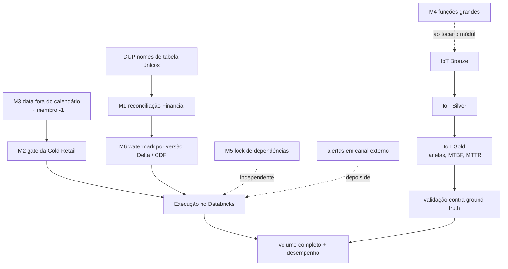

# Improvement Plan

Plano incremental a partir do baseline de 2026-10-08
([BASELINE_AUDIT.md](../audits/BASELINE_AUDIT.md)). Cada item é uma entrega pequena, com teste
RED antes da correção, e respeita as *Evolution Rules* do `CLAUDE.md`.

| Item | Estado |
|---|---|
| M2 | ✅ implementado em 2026-10-08 (feito antes de M3, por pedido explícito); evidências em §5 |
| M3 | ✅ implementado em 2026-10-08; evidências em §5 |
| M6 | ✅ implementado em 2026-10-08 (ADR 0002); evidências em §5 |
| 4.1 IoT Bronze | ✅ implementado em 2026-10-08 (`projects/industrial-iot-lakehouse/docs/BRONZE.md`) |
| 4.2 IoT Silver | ✅ implementado em 2026-10-08 (`projects/industrial-iot-lakehouse/docs/SILVER.md`) |
| 4.3 IoT Gold | ✅ implementado em 2026-10-09 (`projects/industrial-iot-lakehouse/docs/GOLD.md`) |
| 4.4 IoT detecção e avaliação | ✅ 2026-10-09: detector baseline + avaliação reprodutível (`docs/iot/evaluation/`) |
| Lotes incrementais no gerador Retail | ✅ 2026-10-09 (`DATA_GENERATION.md`, "Modo incremental") |
| Etapa 3 (Databricks) | preparação local ✅; execução no workspace **PENDING** (`docs/databricks/EXECUTION_REPORT.md`) |
| M1 | ✅ implementado em 2026-10-08 (DUP, previsto antes, não foi necessário: a reconciliação não usa os nomes duplicados); evidências em §5 |
| demais | pendentes |

Testes previstos por item: [TEST_MATRIX.md](TEST_MATRIX.md). Riscos: [RISK_REGISTER.md](RISK_REGISTER.md).

## 1. Dependências entre os itens

- **M3 e M2:** M2 foi feito primeiro (pedido explícito). Consequência: um fato com data fora do
  calendário, que antes sumia em silêncio de `monthly_sales.sql`, agora **bloqueia a publicação**
  (`fk__date_key__dim_date`, CRITICAL). M3 passa a remover esse bloqueio mapeando essas datas ao
  membro desconhecido; até lá, o calendário de `config/gold.toml` precisa cobrir todas as datas.
- **DUP antes de M1:** M1 mexe nas contagens da Silver financeira, que hoje lê o nome da tabela de
  duas constantes. Unificar primeiro evita corrigir a métrica em um lugar e não no outro.
- **M1 antes de M6:** M6 muda o que é lido a cada execução; a reconciliação completa (M1) é o que
  prova que a troca de watermark não perde nem duplica linhas.
- **Databricks depois de M2 e M6:** a primeira execução na plataforma deve ser a versão sem os
  problemas conhecidos, para que qualquer falha nova seja atribuível ao ambiente.
- **IoT** é independente dos itens Retail/Financial, mas reutiliza `lakehouse_common` sem alterá-lo
  (se precisar alterar, a mudança vem com testes do shared nos três projetos).

## 2. Plano ordenado

### Etapa 1 — Correções Retail (pequenas)

| Ordem | ID | Entrega | Arquivos | Critério de aceite |
|---|---|---|---|---|
| 1.1 | M3 | Datas fora de `[calendar_start, calendar_end]` mapeadas para `date_key = -1` ao construir os fatos | `retail_lakehouse/gold/facts.py`, `gold/keys.py`, `config/gold.toml` (se o intervalo precisar de nome), `docs/DIMENSIONAL_MODEL.md` | teste reproduz a divergência `monthly_sales` × `kpi_summary` antes; depois os totais são iguais |
| 1.2 | M2 | `retail_gold_suite` (schema, grain único, chaves não nulas, FK de cada fato para cada dimensão: CRITICAL) avaliada antes de `write_gold`; execução registrada em `pipeline_runs` | `retail_lakehouse/quality/suites.py`, `gold/build.py`, `notebooks/gold/01_build_gold.py` (só a ligação do sink, se necessário), `docs/DATA_QUALITY.md` | Gold com linha duplicada ou FK órfã falha antes de gravar, run `FAILED`; Gold válida grava igual a hoje |

### Etapa 2 — Correções Financial

| Ordem | ID | Entrega | Arquivos | Critério de aceite |
|---|---|---|---|---|
| 2.1 | DUP | Uma única definição de `BRONZE_TABLE` / `SILVER_TABLE` | `financial_lakehouse/storage/bronze.py`, `silver/pipeline.py`, `quality/suites.py` | contrato de nomes; nenhuma mudança de comportamento |
| 2.2 | M1 | Contagem de exclusões por motivo (boletim PTAX não de fechamento, versão superada) e `reconcile()` CRITICAL por execução | `financial_lakehouse/silver/standardize.py`, `silver/pipeline.py`, `docs/` do projeto | teste com boletins intradiários e revisões reconcilia exatamente; linha perdida de propósito falha |
| 2.3 | M6 | Watermark da Silver pela versão de commit do Bronze (Change Data Feed), substituindo `bronze_ingestion_timestamp >=` | `financial_lakehouse/silver/pipeline.py`, `storage/bronze.py` (habilitar CDF na criação), `docs/ARCHITECTURE.md` §7 ou ADR 0002 | reexecução sem dados novos termina `SUCCEEDED` sem alerta; linhas gravadas durante a execução continuam processadas (regressão do bug original) |

M6 muda o mecanismo incremental (decisão com alternativas reais): exige ADR em `docs/ADR/`.
Tabelas Bronze já existentes precisam de `ALTER TABLE ... SET TBLPROPERTIES
(delta.enableChangeDataFeed = true)`, que é uma alteração de tabela: só com autorização.

### Etapa 3 — Validação no Databricks (exige autorização e workspace)

| Ordem | ID | Entrega | Critério de aceite |
|---|---|---|---|
| 3.1 | NET | Verificar saída à internet no Free Edition (uma requisição pequena ao SGS) | resposta registrada; se bloqueado, plano B: arquivos da landing enviados ao Volume |
| 3.2 | SRV | Rodar os notebooks Retail (landing pequena) e Financial na ordem documentada | `pipeline_runs` da plataforma com status por etapa; diferenças de runtime registradas |
| 3.3 | — | Registrar versões de runtime (Spark, Delta, Python) e ajustar o `CLAUDE.md` se diferirem de PySpark 4.0.4 / Python 3.12 | versões documentadas |

Sem deploy declarativo nesta fase. Um Databricks Asset Bundle só entra se o responsável pedir
(nova dependência de ferramenta).

### Etapa 4 — IoT ponta a ponta

| Ordem | Entrega | Arquivos (novos, nas fronteiras existentes) |
|---|---|---|
| 4.1 | Bronze: ingestão da landing (CSV CMMS, JSON das leituras), idempotente por lote, como o Retail | `iot_lakehouse/bronze/`, `config/bronze.toml`, `notebooks/bronze/` |
| 4.2 | Silver: dedup por `reading_id`, evento tardio aceito, fora de ordem ordenado por `event_time`, quarentena de impossíveis/unidade/timestamp (`iot_readings_suite`) | `iot_lakehouse/silver/`, `config/silver.toml`, `notebooks/silver/` |
| 4.3 | Gold: agregados por equipamento e janela; MTBF, MTTR, disponibilidade com fórmulas documentadas | `iot_lakehouse/gold/`, `sql/gold/`, `docs/` do projeto |
| 4.4 | Validação contra o ground truth do gerador | testes `integration` e `data_quality` |

Durante 4.1, aplicar M4 em `synthetic/readings.py::build_readings` só se o módulo for tocado.

### Etapa 5 — Manutenção e operação

| ID | Entrega | Observação |
|---|---|---|
| M5 | Lock das dependências transitivas | exige justificar a ferramenta (`uv` ou `pip-tools`); CI passa a instalar do lock |
| M4 | Funções acima de 50 linhas (9) | uma por vez, sem mudança de comportamento, testes existentes como rede |
| L2 | Testes das CLIs `synthetic` (Retail, IoT) | configuração mínima em diretório temporário — **feito 2026-10-13** (§5) |
| FIX | `official_sgs_432.json`: usar em teste ou remover (remoção só com autorização) | **usada** em testes 2026-10-13 (§5); mantida |
| ALR | Alertas WARNING/ERROR em canal externo | depende da Etapa 3 (notificação de job do Databricks) |
| CAL | Calendário de dias úteis no Financial | detecta lacunas em séries diárias |
| VOL | Volume completo e desempenho medido | só com autorização explícita; depois da Etapa 3 |

## 3. Arquivos que precisarão de alterações

| Arquivo | Itens |
|---|---|
| `projects/enterprise-retail-lakehouse/src/retail_lakehouse/gold/facts.py` | M3 |
| `projects/enterprise-retail-lakehouse/src/retail_lakehouse/gold/keys.py` | M3 |
| `projects/enterprise-retail-lakehouse/src/retail_lakehouse/gold/build.py` | M2 |
| `projects/enterprise-retail-lakehouse/src/retail_lakehouse/quality/suites.py` | M2 |
| `projects/enterprise-retail-lakehouse/docs/DIMENSIONAL_MODEL.md`, `docs/DATA_QUALITY.md` | M2, M3 |
| `projects/brazilian-financial-lakehouse/src/financial_lakehouse/storage/bronze.py` | DUP, M6 |
| `projects/brazilian-financial-lakehouse/src/financial_lakehouse/quality/suites.py` | DUP |
| `projects/brazilian-financial-lakehouse/src/financial_lakehouse/silver/standardize.py` | M1 |
| `projects/brazilian-financial-lakehouse/src/financial_lakehouse/silver/pipeline.py` | DUP, M1, M6 |
| `docs/ADR/0002-*.md` (novo) | M6 |
| `projects/industrial-iot-lakehouse/src/iot_lakehouse/{bronze,silver,gold}/` (novos) | IoT |
| `pyproject.toml`, `.github/workflows/ci.yml`, `Makefile` | M5 |
| Testes correspondentes | ver [TEST_MATRIX.md](TEST_MATRIX.md) |
| `README.md`, `docs/FINAL_AUDIT.md`, `docs/PORTFOLIO_SUMMARY.md` | ao fim de cada etapa |

## 4. Fora de escopo deste plano

- Reescrever pipelines existentes ou trocar a arquitetura medallion.
- Novas fontes de dados nos projetos prontos.
- Deploy automatizado, agendamento ou execução remota sem pedido explícito.

## 5. Registro de execução

### M2 — gate de qualidade na Gold do Retail (2026-10-08)

- Código: `retail_lakehouse/gold/schemas.py` (`NATURAL_KEYS`, `ForeignKey`, `FOREIGN_KEYS`,
  `LATE_MASTER_DATA_KEYS`), `quality/suites.py` (`retail_gold_suite`), `gold/pipeline.py`
  (`stage_gold`, `validate_gold`, `write_gold`), `gold/build.py` (`GoldTarget.staging_*`; o
  `write_gold` sem gate foi removido), `lakehouse_common/observability/runs.py` (alerta CRITICAL).
- Decisões: `docs/ARCHITECTURE.md` §7, linhas 062 e 063.
- Testes e resultados: ver o relatório da entrega e `projects/enterprise-retail-lakehouse/docs/DIMENSIONAL_MODEL.md` §6.

### M3 — vendas fora do calendário (2026-10-08)

- Código: `gold/keys.py` (`calendar_key`, `within_calendar`), `gold/build.py` (`conform_dates`),
  `gold/facts.py` (datas do evento nos 4 fatos), `gold/dimensions.py` (`year_month`,
  `UNKNOWN_DATE_LABEL`), `gold/schemas.py` (`EVENT_DATES`, colunas novas),
  `quality/suites.py` (`out_of_calendar__<data>`, WARNING), `sql/gold/monthly_sales.sql`.
- Decisão: `docs/ARCHITECTURE.md` §7, linha 064. Impacto em métricas e dashboards:
  `projects/enterprise-retail-lakehouse/docs/DIMENSIONAL_MODEL.md` §6.

### Execuções de 2026-10-08 (M2 + M3)

| Ambiente | Escopo | Resultado |
|---|---|---|
| Windows | `test_gold_calendar_coverage.py` (novo) | 11 passed |
| Windows | `test_retail_gold_suite.py` (gate M2, em 5 partes) | 56 passed |
| Windows | Retail unit + shared unit + contratos da raiz | 433 passed |
| Windows | Retail contract / transformation / data_quality (sem os dois arquivos acima) | 120 passed, 54 skipped / 45 passed, 18 skipped / 52 passed, 11 skipped |
| Linux (WSL) | `test_gold_kpis`, `test_gold_calendar_coverage`, `test_gold_model`, `test_gold_reconciliation` (Gold sobre dados do gerador, pulados no Windows) | 94 passed |
| Linux (WSL), Delta | `test_gold_build.py`: publicação válida, rerun idempotente, grain duplicado, FK pendente | 4 passed (um por execução) |
| Linux (WSL), Delta | `test_gold_build.py`: chave nula, primeira execução com falha, membro desconhecido; `test_silver_build.py` (15) | **não concluído**: a execução da chave nula foi interrompida por falta de memória; as demais não foram iniciadas |

Lint: ruff e formatação verdes; mypy strict sem erros (170 arquivos).

### M1 — reconciliação completa da Silver financeira (2026-10-08)

- Código: `lakehouse_common/quality/reconciliation.py` (`Reconciliation`, `ReconciliationError`,
  agora compartilhados), `retail_lakehouse/silver/standardize.py` (`BatchCounts` delega),
  `financial_lakehouse/silver/standardize.py` (destinos, `destination_counts`,
  `reconcile_silver`), `financial_lakehouse/silver/pipeline.py` (`bronze_snapshot`,
  `consumed_bronze`, `ReconciliationRecord`, `silver_reconciliation`, gate CRITICAL).
- Decisão: `docs/ARCHITECTURE.md` §7, linha 065. Política:
  `projects/brazilian-financial-lakehouse/docs/SILVER.md`, "Reconciliação".

| Ambiente | Escopo | Resultado |
|---|---|---|
| Windows | `shared/tests/unit/test_reconciliation.py` (novo) | 7 passed |
| Windows | `test_fin_silver_reconciliation.py` (novo: 6 categorias, lote misto, perda, rerun, vazio) | 11 passed |
| Windows | unit (todos os projetos) / contratos da raiz | 477 passed / 216 passed |
| Windows | Financial transformation + data_quality | 88 passed + 1 falha corrigida (ver abaixo) → reexecutado: 1 passed |
| Windows | shared data_quality/contract/transformation + Retail Silver (standardize, versões) | 83 passed |
| Linux (WSL), Delta | `test_fin_silver_gold_delta.py` (evidência gravada; perda no pipeline: `FAILED`, nada publicado) | 2 passed |

Regressão encontrada e corrigida durante a execução: fixar a versão do Bronze antes do check de
schema fazia um Bronze com schema alterado (lido de uma view, não Delta) falhar com erro de
análise em vez do CRITICAL `schema__bronze`. A ordem original (schema primeiro) foi restaurada;
`test_silver_run_with_a_changed_source_fails_and_is_recorded` cobre o caso.

### M6 — progresso da Silver financeira por versão Delta (2026-10-08)

- Código: `financial_lakehouse/silver/progress.py` (novo: checkpoint, intervalo de commits, CDF,
  erros com procedimento), `silver/pipeline.py` (reescrito em etapas: `_standardize`, `_gate`,
  `_publish`, `_consume`), `silver/standardize.py` (`versions_of_touched_keys`, `not_in`;
  `affected_bronze` removido), `quality/suites.py` (plausibilidade e lacunas por evento novo),
  `storage/bronze.py` (Bronze criado com CDF).
- Decisão: `docs/ADR/0002-silver-progress-by-delta-version.md`; `docs/ARCHITECTURE.md` §7, 066.
- Suporte a CDF verificado no Delta 4.0.1 local (Linux): `table_changes`, só `insert` no MERGE
  insert-only, `delete`/`update_*` detectáveis, erros explícitos para intervalo sem change data
  e versão inexistente. **Não verificado no Free Edition.**

| Ambiente | Escopo | Resultado |
|---|---|---|
| Windows | `test_fin_silver_progress.py` (novo, planejamento do intervalo) | 4 passed |
| Windows | Financial data_quality (inclui `test_fin_alert_identity.py`, novo) + `test_fin_silver.py` | 47 passed + 2 com falha de shuffle do Spark no Windows (R16), reexecutados isolados: 2 passed |
| Windows | unit (todos os projetos) / contratos da raiz | 481 passed / 216 passed |
| Linux (WSL), Delta | `test_fin_silver_progress_delta.py` (7 cenários, um por execução) | 7 passed |
| Linux (WSL), Delta | `test_fin_silver_gold_delta.py` + `test_fin_bronze_delta.py` | 4 passed |

Duas expectativas erradas dos testes novos foram corrigidas durante a execução (não eram defeitos
do pipeline): a inserção de março ao lado de fevereiro em quarentena cria uma lacuna **nova**, que
deve alertar uma vez (o teste agora prova isso e que a lacuna não realerta); e uma comparação de
`Decimal` com `pytest.approx`.

### Revisão de 2026-10-12 — correções Retail (fingerprint, identidade do cliente, progresso da Silver)

Execuções no Windows, um processo pytest por vez (`.venv/Scripts/python -m pytest ... -p no:cacheprovider`).
Os testes da Gold com `valid_to = 9999-12-31` são pulados no Windows e rodam na CI.

**Fingerprint com NULL** (decisão 073, commit `5461e80`): `xxhash64` ignorava NULL, e uma linha
deslocada sumia como duplicata. Evidências em `docs/audits/ci-integration-memory.md` §9.1: RED
`assert 1 == 0` no código anterior; Silver 40 passed; data quality 108 passed, 11 skipped.

**Pedido anterior ao cadastro** (decisão 074, `docs/ADR/0003-customer-durable-key.md`; sem commit):
`customer_durable_key` em `dim_customer` e nos três fatos de cliente; `customer_sk` continua
point-in-time.

| Escopo | Exit | Resultado |
|---|---|---|
| 3 testes novos em `test_gold_keys_and_scd.py`, antes da correção | 1 | 2 failed (`customer_durable_key` não existe: o modelo não guardava a identidade), 1 passed (o point-in-time já estava correto e é mantido) |
| mesmos testes, depois | 0 | 3 passed |
| `test_gold_keys_and_scd`, `test_incremental_scd2`, `test_gold_calendar_coverage`, `test_gold_kpis` | 0 | 29 passed, 18 skipped (ano 9999) |
| `test_retail_gold_suite`, `contract/test_gold_model` | 1 | 60 passed, 54 skipped, **2 failed por infraestrutura** (`Python worker failed to connect back`, sem asserção) |
| os 2 testes acima, isolados | 0 | 2 passed |
| unit do Retail (contrato de documentação da Gold) | 0 | 144 passed |

**Progresso da Silver em falha parcial** (decisão 075; sem commit): `process_pending` e
`EntityProgress` em `silver/pipeline.py`; notas da exceção em `safe_error_message`.

| Escopo | Exit | Resultado |
|---|---|---|
| `shared/tests/unit/test_observability_runs.py`, 3 testes novos, antes | 1 | failed: as notas eram descartadas do `error_message` |
| shared unit, depois | 0 | 103 passed |
| `tests/unit/test_silver_run_progress.py` (6 cenários), antes | 1 | erro de coleta: API de progresso inexistente |
| mesmo arquivo, depois | 0 | 6 passed |
| `-m unit` (todos os projetos) | 0 | 546 passed |
| ruff, format, mypy strict | 0 | verdes (221 arquivos) |

Limitações: o `run_entity` (MERGE em Delta) só é exercitado de ponta a ponta pelos testes de
integração, que não rodam no Windows e estão bloqueados na CI por `Java heap space`
(`docs/audits/ci-integration-memory.md`). O comportamento anterior (contagens `None` em `FAILED`)
foi confirmado por leitura do código, não por execução. Sem cobertura medida nesta revisão.

**Integridade referencial na Silver** (decisão 076; sem commit): `shipments.order_id → orders`,
`inventory_movements.product_id → products` e `.store_id → stores` no `REFERENCES` e em
`_entity_checks`, com a política de 007/047 (NULL = ERROR, inexistente = WARNING, > 5% = CRITICAL,
avaliada no gate antes do MERGE). `reference_id` fica sem FK. `ReferentialIntegrity(examples=N)` no
shared, com padrão 0 (Financial e IoT sem mudança); o Retail usa 5. A política de quarentena não mudou.

| Escopo | Exit | Resultado |
|---|---|---|
| `test_retail_referential_integrity.py` (10 testes), antes | 1 | 10 failed: `KeyError` em `REFERENCES` (relações não declaradas) |
| mesmo arquivo, depois (e de novo após o ajuste de lint) | 0 | 10 passed |
| shared: 2 testes novos de `examples` (`-k referential`) | 0 | 3 passed |
| `shared/tests/data_quality` + `test_retail_quality_suite.py` | 0 | 63 passed |
| `-m unit` / `tests/contract` / ruff, format, mypy | 0 | 546 passed / 243 passed, 2 skipped / verdes (222 arquivos) |

Não executados: as suítes de data quality do Financial e do IoT (o caminho de código delas não muda:
`examples = 0`) e a integração da Silver com os dados do gerador, que confirmaria que a escalada CRITICAL
não dispara. As taxas de anomalia configuradas que deixam remessas e movimentos órfãos ficam entre
0,1% e 0,5%, bem abaixo de 5%.

**R3 de estoque como gate da Gold** (decisão 077, `docs/audits/inventory-quality-r3.md`; sem commit):
`gold.inventory.inventory_reconciliation` (snapshot × Σ movimentos da Silver até a data de negócio
do snapshot, por natural key) e `inventory_reconciliation_suite` (ERROR por chave, CRITICAL acima de
5%), avaliados em `validate_gold` antes da publicação. O notebook passa a reconciliação, e
`test_gold_r3_wiring.py` protege essa ligação.

| Escopo | Exit | Resultado |
|---|---|---|
| `test_inventory_r3.py`, antes | 2 | erro de coleta: `gold.inventory` inexistente |
| mesmo arquivo, depois (9 testes, incluindo os dados do gerador: 0 divergências) | 0 | 9 passed |
| `test_retail_gold_suite.py` + `test_gold_calendar_coverage.py` | 0 | 73 passed |
| unit do Retail + `tests/contract` / ruff, format, mypy | 0 | 394 passed, 2 skipped / verdes |

**Cliente HTTP do Financial** (decisão 078; sem commit): `IncompleteRead` com retry; gzip/deflate
corrompido ou truncado → `ResponseFormatError`; `max_response_bytes` (32 MiB) no `Content-Length`,
no streaming, na descompressão e no cliente → `ResponseTooLargeError`; `last_status` em
`RetriesExhaustedError`; URLs mascaradas nos logs (`mask_secrets`, exposta pelo shared).

| Escopo | Exit | Resultado |
|---|---|---|
| reprodução no código anterior (script fora do repositório) | — | `IncompleteRead` sem retry (1 chamada); gzip corrompido → `BadGzipFile`; truncado → `EOFError` |
| `test_fin_http_robustness.py`, antes | 2 | erro de coleta: API nova inexistente |
| mesmo arquivo, depois (25 testes) | 0 | 25 passed |
| `-m unit` (todos) / `tests/contract` + unit do Financial / ruff, format, mypy | 0 | 572 passed / 447 passed, 2 skipped / verdes (226 arquivos) |

Limitação: nenhuma execução contra as APIs reais nesta revisão. O transporte real foi exercitado
com `urlopen` simulado.

**Preflight de rede do Financial** (Etapa 3.1 NET, decisão 079; sem commit): módulo
`clients/network_probe.py` e notebook `notebooks/setup/00_network_preflight.py`. Testes:
`test_fin_network_probe.py`, com RED (módulo inexistente) e depois 18 passed; `-m unit` 590 passed;
`tests/contract` 245 passed, 2 skipped. **Execução no workspace: PENDENTE** (aguarda autorização e
workspace); resultados em `docs/databricks/network-preflight.md`.

**Smoke no Databricks (Etapa 3.2 SRV): NÃO EXECUTADO.** Bloqueios e roteiro:
`docs/databricks/smoke-test-report.md` (B1 autorização, B2 rede, B3 código não publicado, B4 CI de
integração, B5 recursos do workspace). Único resultado comprovado: ensaio local, sem Delta, em
2026-10-12, da amostra de smoke do Retail pelos gates da Silver e pela R3 (script fora do
repositório). Nenhum CRITICAL; 3 WARNINGs de órfão (1 linha cada); R3 com ERROR em 1 de 150 chaves.

**Compatibilidade PySpark × Databricks** (`docs/databricks/compatibility.md`; sem commit; **pin
inalterado**, porque a versão real do runtime é desconhecida). `check_runtime` do preflight passa a
registrar Spark do servidor, cliente PySpark e `DATABRICKS_RUNTIME_VERSION` (shared
`test_preflight.py`: RED com `TypeError`, depois 7 passed). Instalação limpa em venv novo (os passos
do `make install`): exit 0 em 51 s, `pip check` limpo; **6 dependências transitivas divergem** do
`.venv` existente (R12 confirmado; nenhuma do Spark). No venv limpo: `-m unit` 591 passed; ruff e mypy
verdes; Spark (shared transformation, `test_quality_checks.py`, `test_inventory_r3.py`) 41 passed.
Versões locais: Python 3.12.7, PySpark 4.0.4, delta-spark 4.0.1, Temurin 21.0.11.

**Descoberta incremental de lotes (Retail) e arquivos (IoT)** (ADR 0004 **aceito em 2026-10-13**, decisão 080;
commit `70c01a8`): `lakehouse_common.incremental` (CDF dos commits após o checkpoint
`silver_discovery_checkpoints`, fallback para varredura com motivo, checkpoint monotônico gravado
depois da marcação), `plan_batches`/`plan_files`, `rediscover` e `reprocess`, Bronze novo com CDF.

| Escopo | Exit | Resultado |
|---|---|---|
| shared `test_incremental_discovery.py`, antes | 2 | erro de coleta: módulo inexistente |
| mesmo arquivo, depois (16: Bronze vazio, novo lote, vários lotes, nada novo, histórico indisponível, CDF desligado, checkpoint à frente, delete no Bronze, rediscovery, parcial, reprocessamento explícito e desconhecido, falha e retry, concorrência) | 0 | 16 passed |
| Retail `test_silver_discovery.py` / IoT `test_iot_silver_discovery.py`, antes → depois | 2 → 0 | erro de coleta → 7 passed / 6 passed |
| `-m unit` (todos) / `tests/contract` / ruff, format, mypy | 0 | 620 passed / 245 passed, 2 skipped / verdes (233 arquivos) |
| `shared/tests/integration/test_incremental_delta.py` (Delta real) | — | **não executado**: pulado no Windows; a integração da CI está bloqueada |

Não verificado: as Silvers do Retail e do IoT com Delta (CDF real, MERGE do checkpoint),
concorrência real entre execuções e custo medido no Databricks. As linhas de cada lote ainda são
lidas por filtro no Bronze (fora do escopo da descoberta; ver ADR 0004, Consequências).

**`run_id` globalmente único** (decisão 081; sem commit): `new_run_id(started)` =
`<UTC ao segundo>Z-<uuid4 hex>` nos 13 geradores dos três projetos, gerado uma vez por execução.
Corrigidas três execuções que recalculavam o id (Financial Bronze: relatório e passo; Financial
Silver: reconciliação e checkpoint; IoT Silver: tabela de processados), que divergiriam com um id
aleatório. Schema de `pipeline_runs` inalterado.

| Escopo | Exit | Resultado |
|---|---|---|
| shared `test_run_ids.py` (formato, fuso, naive recusado, 20.000 no mesmo segundo, 16.000 em 8 threads, ordenação, token injetável, persistência JSON, ids antigos legíveis), antes → depois | 2 → 0 | erro de coleta → 9 passed |
| contrato `tests/contract/test_run_ids.py`, antes → depois | 1 → 0 | 13 geradores só de relógio → 1 passed |
| testes dependentes do formato (3) | 1 → 0 | agora verificam o prefixo legível, o padrão e o id compartilhado na execução |
| `-m unit` / `tests/contract` / ruff, format, mypy | 0 | 629 passed / 246 passed, 2 skipped / verdes (235 arquivos) |

Não executado: integração (Delta), onde o Financial e o IoT Silver passam o id da execução à
reconciliação, ao checkpoint e à tabela de processados.

**Contagens por lote da Silver do Retail** (`docs/performance/spark-count-benchmark.md`; sem
commit). Benchmark **local** (Windows, 32.561 linhas de `order_items`, 3 repetições): 4 `count()`
somaram 5,91–11,69 s e 16 jobs; numa ação única, 4,37–6,49 s e 10 jobs, com contagens idênticas;
o gate custou 17,5–23,5 s (20 jobs), de 2 a 3 vezes as contagens. Aplicado `batch_counts` (uma
ação, cada contagem do seu DataFrame; sem cache; reconciliação independente preservada). Testes:
RED (erro de coleta), depois `test_silver_batch_counts.py` 2 passed; `-m unit` 629 passed;
`tests/contract` 246 passed. **Medição no Databricks: PENDENTE.**

**Logging estruturado e alertas** (decisão 082; sem commit): `lakehouse_common/logging/`
(`structured.py`: JSON com os 12 campos, `log_context`, `configure_logging`; `redaction.py`:
`mask_secrets` movido de `observability` e agora também com e-mails; `alerts.py`: webhook opcional
por `LAKEHOUSE_ALERT_WEBHOOK_URL`, `QueueListener`, até 3 tentativas, sem retry em 4xx,
deduplicação por hora, `setup_logging`). `track_run` correlaciona os logs de cada execução e
registra o resumo com `status`/`duration_ms`/`error_type` (ERROR quando `FAILED`). CLIs dos três
projetos: `setup_logging(os.environ)`, com o texto como padrão e saída igual à anterior.

| Escopo | Exit | Resultado |
|---|---|---|
| `test_structured_logging.py` + `test_alert_webhook.py`, antes | 2 | erro de coleta (pacote vazio) |
| depois (19: JSON, campos, contexto, extras descartados, exceção, segredos e e-mail, correlação de `run_id` no `track_run`, `FAILED` em ERROR, formato texto e idempotência, `setup_logging`, POST JSON, deduplicação, webhook indisponível, 4xx sem retry, só https, fila em background, falha do webhook sem afetar o erro do pipeline) | 0 | 19 passed |
| `-m unit` (inclui CLIs e mascaramento antigo) / `tests/contract` / ruff, format, mypy | 0 | 648 passed / 246 passed, 2 skipped / verdes (242 arquivos) |

Não feito: os notebooks ainda não chamam `setup_logging` (usam o logging do Databricks); nenhum
webhook real foi chamado.

**Registro operacional central** (decisão 083; sem commit): `lakehouse_common/observability/ops.py`
(`OPS_RUNS_SCHEMA`, `ops_record`, `OpsDeltaSink`, `OpsJsonLinesSink`, `FanOutSink`, `standard_sink`,
`legacy_as_ops`, `consolidated_runs`), `shared/config/ops.toml`, `PipelineRun.error_type`; os 8
notebooks Databricks dos três projetos gravam por `standard_sink`.

| Escopo | Exit | Resultado |
|---|---|---|
| `test_ops_runs.py` (unit), antes → depois | 2 → 0 | erro de coleta → 8 passed (sucesso, falha parcial, falha completa, 400 execuções concorrentes em 8 threads, fan-out sem transação, erro do pipeline preservado, namespace por ambiente) |
| `test_ops_consolidation.py` (Spark, Windows) | 0 | 2 passed (três projetos numa consulta, sem duplicar a execução presente nas duas tabelas; histórico sem tabela `ops`) |
| `-m unit` / `tests/contract` / ruff, format, mypy | 0 | 656 passed / 246 passed, 2 skipped / verdes (245 arquivos) |

Não executado: `OpsDeltaSink` com Delta (Linux/CI) e a criação de `workspace.ops` no Databricks
(o catálogo depende do preflight).

**Faixa etária na data do evento** (decisão 084; sem commit): `age_in_years`, `age_band_at` e
`customer_birth_dates` em `gold/dimensions.py`; `fact_sales.customer_age_band` (derivada);
`dim_customer.age_band` continua historizada (início da versão), agora com a mesma regra de
calendário (antes `months_between`).

| Escopo | Exit | Resultado |
|---|---|---|
| `test_age_at_event.py`, antes | 2 | erro de coleta: `age_band_at` inexistente |
| mesmo arquivo, depois (15: aniversário antes, depois e no dia, 29/02 em ano comum e bissexto, sem data de nascimento, faixas, pedido anterior ao cadastro, várias versões SCD2 sem multiplicar linhas, data corrigida) | 0 | 1ª execução: falha de infraestrutura (worker Python sem memória, nenhuma asserção); repetição: **15 passed** |
| unit do Retail (contrato do dicionário de dados) / `tests/contract` / ruff, format, mypy | 0 | 158 passed / 246 passed, 2 skipped / verdes (246 arquivos) |
| regressão (1ª tentativa, 2026-10-12, os três arquivos juntos) | — | encerrada pelo sistema por falta de memória |
| regressão em 2026-10-13, um arquivo por vez: `test_incremental_scd2` / `test_gold_keys_and_scd` / `test_gold_calendar_coverage` | 0 / 0 / 1 | 6 passed / 12 passed / 10 passed e 1 falha de infraestrutura (worker Python, nenhuma asserção) |
| o teste que falhou (`test_every_date_key_of_every_fact_exists_in_dim_date`), isolado | 0 | 1 passed |

Mudança de comportamento a validar: em casos de borda (29/02, fim de mês), a `age_band` da dimensão
pode diferir da calculada por `months_between`.

**Lock de dependências (M5)** (decisão 085; sem commit): `uv.lock` + `requirements/dev.lock.txt`
(hashes); `uv==0.13.0` no grupo `dev`; `make install` pelo lock, `make lock`, `make lock-check`
(CI, job de lint); cache do pip da CI indexado pelo lock. Ferramenta: uv (lê os grupos PEP 735 e
gera um lock universal); pip-tools 7.6.2 não lê `dependency-groups`. Versões transitivas fixadas
nas do `.venv` testado (`uv lock -P` em 6 pacotes que o resolvedor subiria).

| Escopo | Resultado |
|---|---|
| `uv lock --check` / exportado × lock | consistentes |
| instalação limpa (venv novo, `pip install --require-hashes -r requirements/dev.lock.txt`) | exit 0 em 66 s; `pip check` limpo; ambiente igual ao `.venv` mais `uv` |
| venv do lock: `-m unit` / `tests/contract` / lint | 656 passed / 252 passed, 2 skipped / verdes |
| venv do lock: transformation (shared + contagens) / data quality (checks + R3) | 13 passed / 32 passed |
| `tests/contract/test_lockfile.py` (pins × lock × exportado, hashes, sem caminhos locais nem credenciais, Python suportado, runtime vazio) | 6 passed |

Risco R12 mitigado. Não verificado: a CI instalando pelo lock (sem push).

**Pacotes instaláveis** (ADR 0005, decisão 086; sem commit): `[build-system]` com `hatchling==1.32.4`;
o wheel `databricks_lakehouse_portfolio-0.1.0` traz os 4 pacotes de runtime, sem testes e sem
`lakehouse_testing`; `make install` instala em modo editável; `make wheel`; os 13 notebooks trocam o
`sys.path` por `%pip install --no-deps` do wheel num Volume + `restartPython`; o `uv.lock` muda só o
projeto (`virtual` → `editable`), sem nenhuma versão diferente.

| Escopo | Resultado |
|---|---|
| `uv build --wheel` | 133 arquivos: `lakehouse_common`, `retail_lakehouse`, `iot_lakehouse`, `financial_lakehouse` |
| wheel instalado (`--no-deps`) num venv limpo, imports com `python -I` fora do repositório | 6 módulos importados do `site-packages`; `lakehouse_testing` ausente |
| instalação editável no `.venv`, import fora do repositório | resolve para o código-fonte |
| `test_notebook_imports.py` (sem `sys.path`; `%pip` do wheel da versão atual antes de `restartPython` e dos imports) + `test_packaging.py` | 32 passed, 2 skipped (runners) |
| 15 notebooks com `py_compile` | compilam |
| `-m unit` / `tests/contract` / lint / Spark (contagens + consolidação ops) | 656 passed / 271 passed, 2 skipped / verdes / 4 passed |

Não verificado: `%pip` de um Volume seguido de `restartPython` no serverless do Free Edition, e a
CI instalando em modo editável.

**Funções acima de ~50 linhas** (2026-10-13; refatoração estrutural, sem mudança de regra nem de
interface pública; uma função por vez, cada uma com caracterização gravada **antes**):

| Função | Antes | Depois (etapas) | Caracterização (gravada no código anterior) |
|---|---:|---|---|
| Retail `_Transactions._order` | 103 | `_draw_order` (todos os sorteios, mesma ordem) 37, `_lifecycle` 18, `_emit_order_rows`, `_emit_payments`, `_emit_shipment`, `_move_stock`; `_order` 10 | `test_generator_characterization.py`: sha256 do dataset smoke e de todos os lotes incrementais — iguais |
| IoT `build_readings` | 148 | `_grid` 12, `_with_episodes` 46, `_with_values` 50, `_with_arrival` 44; `build_readings` 11 | `test_iot_readings_characterization.py`: schema, 12 206 linhas e checksum de todas as 27 colunas — iguais |
| shared `run_checks` | 77 | `_count_failures` (uma agregação) 16, `_check_result` 51; `run_checks` 30 | `test_runner_characterization.py`: `repr` dos 8 `CheckResult` (com exemplos de RI) e o curto-circuito de schema — iguais |
| Financial CLI `main` | 69 | `_parser`, `_pipeline` (erros de uso → exit 2), `_log_report`; `main` 14 | novo teste das linhas do relatório + os 7 testes de CLI |
| IoT `_build_maintenance` | 66 | `_build_corrective`, `_build_preventive` (mesmo `Random`, mesma ordem) | `test_iot_master_characterization.py`: sha256 de todo o master data — igual |

Avaliadas e **mantidas** (dividir seria artificial): `render_report` (60, template Markdown linear),
`_ingest_one` (55, laço de landing por página), Retail `run_entity` (54) e Financial `run_silver`
(52) (orquestração dentro de `track_run`), `_run` (52, agrega e grava o manifest do mesmo
relatório), `resolve_revisions` (51, uma cadeia de janelas), `_check_result` (51, quase todo o
construtor do resultado). Lint (`ruff check`, `ruff format --check`, `mypy` strict) verde após
cada passo.

**CLIs `synthetic` e fixture SGS 432** (2026-10-13; sem commit):

*CLIs.* Antes, todo erro virava traceback com exit 1 (configuração ausente, TOML inválido, lote
desconhecido, saída não gravável). Testes escritos primeiro (RED: 4 Retail, 5 IoT); depois, a
configuração passa a ser validada antes de gravar/iniciar o Spark (exit 2) e a falha de escrita
vira log + exit 1 (decisão 087). `test_synthetic_cli.py` (Retail, 13 testes, smoke de 300 pedidos
e plano incremental em `tmp_path`): saída criada com pais, arquivos e manifesto, bytes idênticos
para a mesma semente (completo e incremental), dados diferentes com outra semente, argumentos
inválidos, configuração/plano ausente, TOML inválido, lote desconhecido sem gravar nada, saída não
gravável. `test_iot_synthetic_cli.py` (IoT, 10 testes, sessão Spark e `write_landing` falsos: a
gravação real está em `tests/integration/test_iot_landing_write.py`): o que é passado ao
escritor, master data por semente, erros de configuração sem iniciar o Spark, falha de escrita.

| Cobertura (unit dos 3 projetos, mesmo comando) | Antes | Depois |
|---|---:|---|
| `retail_lakehouse/synthetic/__main__.py` | 0% | 97% (falta só `raise SystemExit(main())`) |
| `iot_lakehouse/synthetic/__main__.py` | 0% | 95% (idem) |

*`official_sgs_432.json`.* Resposta real do SGS 432 (Meta Selic = `selic_target`, indicador
ingerido), capturada em 2026-10-07: 731 registros, todos os dias corridos de 2024-2025. Útil e
mantida: `tests/unit/test_fin_sgs_official_payload.py` (5) leva o payload real pelo `SgsClient` e
por `to_bronze_records` (731 dias consecutivos, série `432`, valor como texto) e rejeita o mesmo
payload corrompido (número, chave ausente, chave extra); `test_fin_gold_official_series.py` (+3)
comprova o GOLD.md (meta em todo dia corrido, fins de semana vindos da fonte, sem preenchimento),
o spread de 0,10 p.p. entre meta e Selic efetiva anualizada nos 252 dias úteis do SGS 1178 (três
séries oficiais na mesma linha: o join por data não desloca dia na mudança do Copom) e as 10
mudanças do Copom sinalizadas exatamente nos dias em que a meta mudou (todas numa quinta-feira).
Nenhuma remoção proposta.

| Escopo (2026-10-13) | Resultado |
|---|---|
| unit Retail / IoT / Financial | 173 / 128 / 228 passed |
| `test_fin_gold_official_series.py` | 8 passed |
| lint (`ruff check`, `ruff format --check`, `mypy` strict) | verde |

**Fingerprint compartilhado** (2026-10-13; decisão 088; sem commit). Retail
(`standardize.fingerprint`, nomes de coluna com `CAST AS STRING`) e IoT (`_content_hash`, expressões
já em texto) tinham o **mesmo** algoritmo: SHA-256 hex de `concat_ws(U+001F, coalesce(valor, U+0000))`.
Diferença só na interface (nomes × expressões; o `CAST` de texto é identidade). A implementação
única `lakehouse_common.fingerprint` aceita os dois; as cópias locais saíram. Como `_row_hash` e
`_content_hash` são persistidos e são chaves de MERGE, a migração foi provada byte a byte: hashes
gravados **antes** da troca (`test_silver_fingerprint_compat.py`, `test_iot_content_hash_compat.py`)
continuam iguais depois, e todos os casos de `shared/tests/transformation/test_fingerprint.py` são
comparados com uma referência independente em Python (`hashlib`).

| Escopo (2026-10-13, depois da migração) | Resultado |
|---|---|
| `test_fingerprint.py` (estabilidade, duplicatas reais, registros diferentes, NULL em cada posição e ≠ `""`, ordem, nomes × expressões, delimitadores comuns e Unicode, limitação U+001F/U+0000, tipos, datas e timestamps em UTC, sem colunas) + os 2 de compatibilidade | 22 passed |
| Retail `test_silver_standardize.py` (inclui a regressão do 5461e80, linha deslocada para coluna NULL) | 28 passed |
| IoT `test_iot_silver_standardize.py` | 19 passed |
| unit Retail + IoT + shared / `tests/` da raiz | 457 passed / 274 passed, 2 skipped |
| lint (`ruff check`, `ruff format --check`, `mypy` strict) | verde |

**README factual** (2026-10-13; sem commit). Suíte completa executada por categoria no Windows
local, sobre o código atual (`5461e80` + 133 arquivos não commitados), registrada em
[`docs/audits/test-run-2026-10-13.md`](../audits/test-run-2026-10-13.md): 1.736 coletados (unit 688,
transformation 289, data quality 215, contract 452, integration 92; categorias disjuntas);
consolidado 1.560 passed, 176 skipped, 0 failed, depois de reexecutar isolados os arquivos com
falha de ambiente (23 failed + 54 errors na passada completa: diretório temporário do PySpark
removido; `Python worker failed to connect back`). Os 176 pulados não foram verificados: 91 de
integração (sem Delta no Windows), 83 da Gold do Retail (datas 9999), 2 por desenho. O baseline
informado (1.302 passed, 85 skipped) não tem registro no repositório e não foi reproduzido.

README: métricas de 2026-10-07 (1.212 passed, cobertura ≥ 95%) substituídas por uma seção
*Testes* por categoria com fonte; cobertura sem percentual (não há relatório do código atual);
estado real da CI (run `38253484478`: integração falhou, coverage não rodou); Databricks declarado
como não executado; badge da CI (estado ao vivo); estado do IoT alinhado ao README do projeto
(Bronze/Silver/Gold ✅ em escala mínima); biblioteca comum atualizada (logging, fingerprint);
instruções para Windows (categorias pulam com motivo; Linux/Docker para a suíte completa).
