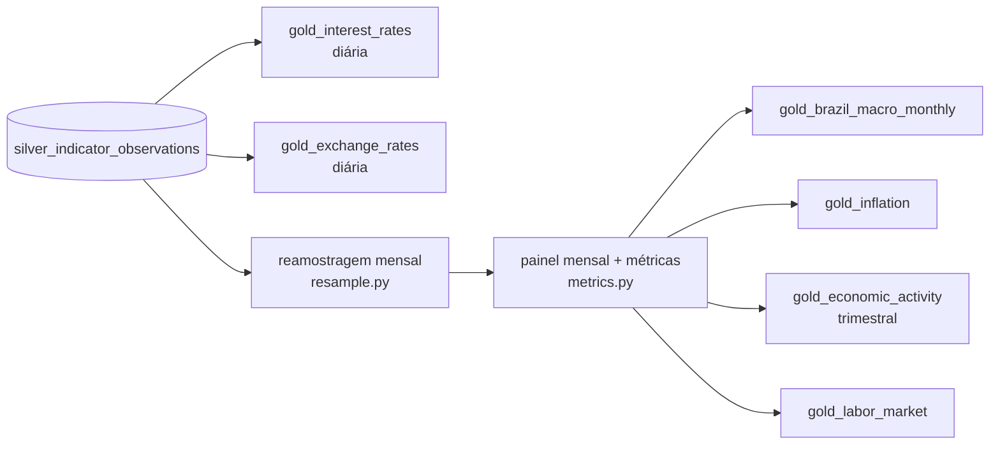

# Gold — tabelas analíticas do Brazilian Financial Data Lakehouse

A Gold lê **somente** `silver_indicator_observations` ([SILVER.md](SILVER.md)) e é reconstruída
por inteiro a cada execução (§5). Código: `src/financial_lakehouse/gold/` (`resample.py`,
`metrics.py`, `tables.py`, `schemas.py`, `build.py`). Consultas: `sql/gold/*.sql`.



## 1. Tabelas e grain

As unidades estão no nome da coluna: `_pct` (%), `_pp` (pontos percentuais), `_pct_year` (% a.a.),
`_pct_day` (% a.d.). Câmbio em R$ por unidade da moeda estrangeira.

| Tabela | Grain | Séries |
|---|---|---|
| `gold_interest_rates` | uma linha por data com meta Selic ou Selic diária | `selic_target`, `selic_daily` |
| `gold_exchange_rates` | uma linha por data com USD, EUR ou reservas | `usd_brl_sell`, `eur_brl_ptax`, `international_reserves` |
| `gold_inflation` | um mês | `ipca_monthly`, `igpm_monthly` |
| `gold_economic_activity` | um trimestre (`reference_quarter` = 1º dia) | `gdp_growth_yoy`, `credit_total`, `monetary_base` |
| `gold_labor_market` | um trimestre móvel, identificado pelo último mês | `unemployment_rate` |
| `gold_brazil_macro_monthly` | um mês-calendário, **todos** os meses do intervalo | todas |

Colunas e tipos: `gold/schemas.py` (`GOLD_SCHEMAS`). O grain também fica no comentário de cada
tabela Delta.

### Joins

- **Tabelas diárias**: full join em `reference_date` **somente entre séries diárias**, cada uma
  única por data (1:1). A meta Selic existe em todos os dias corridos e a Selic diária só em dias
  úteis, por isso o join é full.
- **Demais tabelas**: cada série é primeiro reduzida a **uma linha por mês** (§2) e só então
  ligada a um calendário de meses consecutivos por left join 1:1 em `reference_month`.
- **Nunca** há join direto entre séries de frequências diferentes. Uma série diária ligada a uma
  mensal pela data repetiria o valor mensal em ~21 linhas, ou o descartaria em todos os dias
  exceto o primeiro.
- Os testes verificam a unicidade do grain de todas as tabelas e que o PIB aparece em exatamente
  um mês por trimestre.

## 2. Regras de reamostragem para o mês

| Série (frequência) | Regra para `reference_month` | Coluna em `gold_brazil_macro_monthly` | Por quê |
|---|---|---|---|
| Meta Selic (diária, nível) | **último valor do mês** | `selic_target_pct_year` | é a meta em vigor no fechamento |
| Selic diária (% a.d.) | **capitalização** nos dias úteis: `(∏(1 + r/100) − 1) × 100` | `selic_month_pct`, `selic_business_days` | taxa efetiva do mês; equivale à Selic acumulada no mês do BCB |
| USD/BRL (diária, preço) | **último valor do mês** e **média do mês** | `usd_brl`, `usd_brl_average` | fechamento para variações; média para comparar com fluxos do mês |
| EUR/BRL PTAX (diária) | último valor do mês | `eur_brl` | idem |
| Reservas (diária, saldo) | último valor do mês | `international_reserves_usd_mn` | saldo é estoque: vale o fim do período |
| IPCA, IGP-M (mensal) | o próprio mês | `ipca_pct`, `igpm_pct` | já mensal |
| Base monetária, crédito (mensal, saldo de fim de período) | o próprio mês | `monetary_base`, `credit_total` | já é fim de período |
| PIB (trimestral) | **somente no último mês do trimestre**; NULL nos outros dois | `gdp_growth_yoy_pct` | sem interpolar nem repetir: repetir triplicaria o peso em médias; interpolar inventaria dados |
| Desocupação (trimestre móvel) | o **último mês** do trimestre móvel | `unemployment_rate_pct` | o valor de "jun-jul-ago" é publicado como agosto; é uma média de 3 meses, não o mês isolado |

Regra única para as séries não diárias: o valor é atribuído ao mês em que **termina** o período
que ele cobre (Silver `period_end`).

### Por transição de frequência

| Transição | Séries | Regra | Função (`resample.py`) |
|---|---|---|---|
| diária → mensal, **nível** | meta Selic, EUR/BRL, reservas | último valor observado no mês | `monthly_last` |
| diária → mensal, **preço** | USD/BRL | último valor (fechamento) **e** média dos dias com cotação | `monthly_last`, `monthly_mean` |
| diária → mensal, **taxa** | Selic diária (% a.d.) | capitalização nos dias úteis com dado; `selic_business_days` conta os dias | `monthly_compound` |
| mensal → mensal | IPCA, IGP-M, base monetária, crédito | identidade: o mês de `period_end` (= o próprio mês) | `at_period_end_month` |
| trimestral → mensal | PIB | só o último mês do trimestre; os outros dois ficam NULL | `at_period_end_month` |
| trimestre móvel → mensal | desocupação | o último mês do trimestre móvel | `at_period_end_month` |

Cada série é reduzida a uma linha por mês **antes** de qualquer join, e todas se encontram num
calendário de meses consecutivos (`month_spine`). Por isso uma janela de N linhas é sempre de N
meses.

Média de nível ou de taxa diária não é usada: a média da meta Selic no mês não é uma taxa
praticada, e a média da Selic diária subestimaria o rendimento composto do mês. Soma de taxas
também não é usada; a capitalização é a convenção do BCB (§7).

### Forward fill: não usado

Nenhuma regra repete um valor para períodos em que a fonte não publicou. Onde ele seria tentador:

| Situação | O que a Gold faz | Justificativa |
|---|---|---|
| fins de semana e feriados no câmbio | sem linha nesse dia; a variação diária compara com o **dia útil anterior disponível** | não houve cotação. Uma linha repetida criaria variações 0% e pesaria na média do mês |
| meses do trimestre sem PIB | NULL nos dois primeiros meses | repetir triplicaria o peso do trimestre em médias e janelas; interpolar inventaria crescimento |
| IPCA/PIB/PNAD ainda não publicados | NULL no mês recente; janelas que o incluem ficam NULL | o dado não existe ainda. Repetir o último valor faria o acumulado em 12 meses parecer conhecido |
| mês sem nenhuma observação de uma série | a linha do mês existe (calendário), com NULL na série | lacuna visível em vez de mascarada; as métricas de janela ficam NULL (§3) |

**A meta Selic nos fins de semana não é forward fill nosso.** O SGS 432 publica a meta para
**todo dia corrido**, e a meta está de fato em vigor entre as reuniões do Copom. A Gold usa o que
a fonte entrega e não completa dias faltantes.

Se um dia for necessário um painel diário completo (por exemplo, câmbio em dias corridos para
converter fluxos), a regra precisa ser explícita e com nome próprio (`usd_brl_last_available`),
nunca a coluna original preenchida.

**Mês em andamento**: `is_partial_month` = o mês contém a última data diária disponível e essa data
é anterior ao último dia do mês. Os níveis desse mês são "último disponível até agora"; a Selic
acumulada em 12 meses não é calculada para ele (§3). O critério é conservador: se o mês terminou
num fim de semana, ele continua marcado como parcial até chegar o primeiro dado do mês seguinte.

## 3. Métricas derivadas

As janelas correm sobre o calendário **consecutivo** de meses: N linhas = N meses. Uma métrica de
janela é **NULL se faltar qualquer mês da janela**; nunca se apresenta uma janela parcial como
completa.

| Métrica | Tabela(s) | Definição |
|---|---|---|
| `inflation_12m` | macro, inflation | IPCA acumulado em 12 meses: `(∏ₖ₌₀¹¹(1 + ipcaₜ₋ₖ/100) − 1) × 100` |
| `igpm_12m` | macro, inflation | mesma fórmula com o IGP-M |
| `ipca_moving_average_3m`, `ipca_moving_average_12m` | macro, inflation | média aritmética simples dos últimos 3 / 12 IPCAs mensais |
| `usd_brl_moving_average_3m`, `usd_brl_moving_average_12m` | macro | média dos últimos 3 / 12 fechamentos mensais do USD/BRL |
| `selic_change` | macro | `selic_targetₜ − selic_targetₜ₋₁` (fim de mês, em **p.p.**) |
| `selic_target_change_pp`, `is_copom_change` | interest_rates | variação da meta contra a observação anterior; marca os dias de mudança |
| `usd_brl_change` | macro | `(usd_brlₜ / usd_brlₜ₋₁ − 1) × 100` (fechamentos mensais, em %) |
| `usd_brl_change_pct`, `eur_brl_change_pct` | exchange_rates | idem contra o **dia útil anterior disponível** |
| `selic_daily_annualized_pct_year` | interest_rates | `((1 + r/100)²⁵² − 1) × 100` (convenção de 252 dias úteis do BCB) |
| `selic_12m_pct` | macro | `(∏ₖ₌₀¹¹(1 + selic_monthₜ₋ₖ/100) − 1) × 100`; NULL no mês parcial |
| `eur_usd_implied` | exchange_rates | `eur_brl / usd_brl` no mesmo dia (paridade implícita) |
| `gdp_growth_yoy_moving_average_4q` | economic_activity | média dos 4 últimos trimestres do PIB a/a |
| `credit_total_yoy_pct`, `monetary_base_yoy_pct` | economic_activity | variação contra 12 meses antes (nominal) |
| `unemployment_change_3m_pp` | labor_market | contra o trimestre móvel de 3 meses antes (**sem sobreposição**) |
| `unemployment_change_12m_pp` | labor_market | contra 12 meses antes (mesmo trimestre do ano anterior) |

Não há média móvel de 3 meses da desocupação: o trimestre móvel já é uma média de 3 meses.
Calcular a variação contra o mês anterior compararia trimestres que compartilham 2 meses.

### `real_interest_rate`: juro real ex-post em 12 meses

```
real_interest_rate = ((1 + selic_12m_pct / 100) / (1 + inflation_12m / 100) − 1) × 100
```

Equação de Fisher exata, sem a aproximação `i − π`, que piora com taxas altas: com Selic de 13,25%
e IPCA de 4,5%, a diferença simples dá 8,75 p.p. e Fisher dá 8,37%. Os dois termos cobrem **os
mesmos 12 meses** terminados em `reference_month`: a Selic **efetivamente acumulada** (capitalização
da Selic diária) e o IPCA acumulado.

Limitações:

1. **Ex-post, não ex-ante.** A medida usa a inflação realizada. A decisão de política e o custo
   de oportunidade dependem da inflação **esperada** (juro real ex-ante, por exemplo com as
   expectativas Focus ou a curva de juros), que não é ingerida.
2. **Olha para trás.** O valor descreve os últimos 12 meses, não a postura atual da política
   monetária. Logo após uma mudança da meta, a medida reage devagar.
3. **Sem impostos e custos.** Não é o retorno real de um investidor (IR, taxas, spread).
4. **Taxa básica, não taxa de mercado.** A Selic é a taxa das operações compromissadas com
   títulos públicos; crédito e títulos longos têm outras taxas reais.
5. **Índice de preços.** O IPCA mede o consumidor; deflacionar pelo IGP-M daria outro número.
6. **Exige as duas janelas completas.** O valor é NULL no mês parcial e enquanto faltar qualquer
   um dos 12 meses de Selic ou de IPCA (o IPCA sai por volta do dia 10 do mês seguinte).

A meta Selic no fechamento do mês menos a inflação em 12 meses (`selic_minus_inflation_pp` em
`selic_vs_inflation.sql`) aparece apenas como referência descritiva, rotulada assim: ela mistura
uma taxa prospectiva (meta anual) com uma inflação passada.

## 4. Consultas analíticas (`sql/gold/`)

| Arquivo | Pergunta | Grain do resultado |
|---|---|---|
| `selic_vs_inflation.sql` | Selic, inflação 12m, juro real, correlação em 24 meses, inflação 12 meses depois | mês completo |
| `selic_vs_exchange.sql` | variação da Selic (p.p.) × variação do USD/BRL (%), correlação em 24 meses | mês completo |
| `inflation_over_time.sql` | IPCA e IGP-M acumulados por ano, picos e meses de deflação | ano |
| `exchange_over_time.sql` | fechamento, média, mínimo, máximo, variação e volatilidade anuais | ano |
| `economic_activity.sql` | PIB a/a, média 4 trimestres, crédito nominal e real (aproximado) | trimestre |
| `labor_market.sql` | desocupação, variações sem sobreposição, faixa em 12 meses | trimestre móvel |

**Correlação não é causalidade.** Todas as consultas trazem no cabeçalho por que o co-movimento
mostrado não identifica efeito:

- a Selic reage à inflação e a afeta com defasagens;
- câmbio, inflação e juros respondem a choques comuns (dólar global, risco, commodities, política
  fiscal).

As correlações móveis só aparecem com a janela de 24 meses completa. Colunas defasadas (como
`inflation_12m_one_year_later`) são descritivas: não constituem teste de causalidade, e nenhum
modelo causal é estimado aqui.

## 5. Reconstrução completa (decisão)

As métricas de 12 meses fazem uma revisão em um mês alterar até 12 linhas seguintes, e o PIB
revisado altera a média de 4 trimestres. Rastrear todas as janelas afetadas seria complexo e
frágil. A Silver tem algumas dezenas de milhares de linhas, então a Gold é recalculada inteira com
`CREATE OR REPLACE` a cada execução: mesma Silver, mesma Gold (idempotente). É a exceção
documentada ao processamento incremental (ADR 040).

## 6. Limitações conhecidas

- **Sem calendário de dias úteis.** Lacunas em séries diárias (dia útil sem dado no Bronze) não
  são detectadas. A Selic do mês seria capitalizada com menos dias; `selic_business_days` permite
  auditar.
- **Valores nominais.** Base monetária e crédito estão em unidades monetárias correntes. As
  variações a/a são nominais; a versão real em `economic_activity.sql` é aproximada.
- **Defasagem de publicação.** PIB (~2 meses após o trimestre), PNAD (~1 mês) e IPCA (~10 dias)
  deixam os meses recentes com NULL. Isso é esperado, não uma falha.
- **Revisões.** A Gold sempre reflete a versão vigente na Silver; um relatório gerado antes de
  uma revisão não é reproduzível pela Gold atual (o histórico de versões está no Bronze).
- **Mês parcial nas métricas de nível.** No mês em andamento, `usd_brl_change`, `selic_change` e
  as médias móveis do câmbio usam o último valor disponível, não o fechamento. Só `selic_12m_pct`
  (e por isso `real_interest_rate`) é suprimido. Filtre `is_partial_month` para análises de
  fechamento.
- **Validação oficial cobre 2024–2025.** As transformações do PIB e da PNAD não têm série mensal
  oficial equivalente; para elas valem só os testes sintéticos (§7).

## 7. Validação contra séries oficiais

Os testes sintéticos (`test_fin_gold.py`) comparam o código com oráculos em Python escritos a
partir da mesma leitura das regras: uma convenção errada passaria nos dois. Por isso a Gold
também é comparada com os agregados que o **próprio BCB/IBGE publica**, em
`tests/transformation/test_fin_gold_official_series.py` (sem rede; respostas oficiais brutas
capturadas em 2026-10-07, em `tests/transformation/fixtures/official_*.json`).

| Saída da Gold | Entrada | Agregado oficial | Pontos | Resultado |
|---|---|---|---:|---|
| `selic_month_pct` (diária → mês, capitalização) | SGS 11 | SGS 4390, Selic acumulada no mês (2 casas) | 24 meses | idêntico |
| `usd_brl_average` (diária → mês, média) | SGS 1 | SGS 3698, média mensal (4 casas) | 24 meses | idêntico |
| `usd_brl` (diária → mês, último) | SGS 1 | SGS 3696, fim de período (4 casas) | 24 meses | idêntico |
| `inflation_12m` (mensal → 12 meses) | IBGE 1737 v63 | IBGE 1737 v2265, IPCA acumulado em 12 meses (2 casas) | 24 meses | idêntico |
| `selic_daily_annualized_pct_year` | SGS 11 | SGS 1178, Selic anualizada base 252 (2 casas) | 252 dias | idêntico |

- Nossos valores são arredondados (meio para cima) à precisão publicada antes da comparação.
- A API do SGS não expõe metadados. As séries 3698 e 3696 foram identificadas porque seus valores
  coincidem com a média e com o último valor do SGS 1 em todos os meses (e a 3695 com o último valor
  do dólar de compra, SGS 10813).
- **Sensibilidade**: trocar a capitalização por soma simples (Selic no mês e IPCA em 12 meses)
  faz os dois testes correspondentes falharem. O teste distingue as convenções, não apenas passa.
