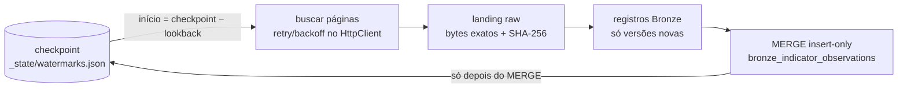

# Estratégia incremental — Bronze do Brazilian Financial Data Lakehouse

Objetivo: **não baixar o histórico inteiro a cada execução**, sem perder revisões feitas pelas
fontes e sem duplicar linhas quando uma janela é relida. O código está em
`src/financial_lakehouse/ingestion/pipeline.py` (`IncrementalIngestion`).

## Fluxo por indicador



1. **Janela**: sem checkpoint → `backfill_start` (config). Com checkpoint → `checkpoint − lookback`.
   Com `reprocess_from` → a janela recua até essa data (revisões tardias, ver abaixo).
2. **Extração**: os clientes paginam e repetem as tentativas (429, 5xx, timeout, erro de conexão).
3. **Raw**: cada resposta é pousada byte a byte. É o que permite reprocessar e auditar.
4. **Bronze**: um registro por observação; entram só as **versões novas** (regra em
   *Idempotência*), via `MERGE ... WHEN NOT MATCHED THEN INSERT`.
5. **Checkpoint**: avança **somente** depois que o Bronze aceitou os registros e nunca retrocede.

## O que cada API permite

| Fonte | Filtro incremental na API | Como usamos | Lookback |
|---|---|---|---|
| BCB SGS | `dataInicial`/`dataFinal` (dd/MM/aaaa; janelas ≤ 10 anos) | janela desde `checkpoint − lookback_days` até hoje (Brasília) | 90 dias |
| BCB PTAX (Olinda) | período em `CotacaoMoedaPeriodo` (`'MM-DD-AAAA'`) | idem, janelas anuais + `$top`/`$skip` | 90 dias |
| IBGE agregados v3 | lista explícita de períodos; `/periodos` informa os disponíveis | só os períodos ≥ o N-ésimo anterior ao checkpoint | 6 períodos |

O IBGE não aceita filtro de data: consultamos `/periodos` (uma requisição barata) e pedimos apenas
os períodos novos e os recentes. Tabelas trimestrais usam ids `AAAATT`. A conversão de
`backfill_start` respeita esse formato (regressão encontrada na execução real, com teste).

### Por que reler com lookback

As fontes **revisam** valores já publicados: base monetária e crédito são preliminares, o PIB
trimestral é revisto e a PTAX publica vários boletins por dia. Reler uma janela recente recaptura
essas revisões. O custo é pequeno: uma requisição por indicador na maioria dos casos.

### Revisões históricas tardias: `reprocess_from`

Uma revisão **mais antiga que o lookback** (ex.: revisão anual do PIB, rebase de série) nunca é
pedida por uma execução normal. Para recapturá-la, a execução aceita `reprocess_from`:

- a janela de cada indicador começa em `min(janela incremental, reprocess_from)`; no IBGE, o
  primeiro período passa a ser o de `reprocess_from`;
- só as observações que **mudaram** entram no Bronze (a regra de versão abaixo); o resto da
  janela relida conta em `records_received`, não em `records_ingested`;
- o checkpoint **não recua** (só avança quando a referência lida é maior que a gravada);
- o manifest registra `reprocess_from`, então a execução de varredura fica auditável.

Não há varredura automática: o custo (uma janela de anos por indicador) é decisão de operação.
Uma cadência razoável é mensal com `reprocess_from` = 2 anos atrás, ou pontual quando a fonte
anuncia revisão. CLI: `--reprocess-from AAAA-MM-DD`; notebook: widget `reprocess_from`.

## Checkpoint lógico

`<landing_root>/_state/watermarks.json`, gravado atomicamente (arquivo temporário + `replace`):

```json
{"igpm_monthly": {"reference": "2026-09-01", "run_id": "20261006T153740Z", "updated_at": "2026-10-06T15:37:40+00:00"}}
```

- `reference` é comparável: data ISO para SGS/PTAX e id de período para o IBGE.
- O checkpoint é **lógico** (última referência confirmada no Bronze), não a hora da execução.
  Rodar duas vezes no mesmo dia ou repetir uma execução que falhou é seguro.
- Uma falha, inclusive na escrita do Bronze, deixa o checkpoint intacto: a próxima execução
  repete a mesma janela.

## Idempotência

Regra de versão (`transformation/bronze_versions.py`, aplicada pelos três sinks):

- **chave de versão** = `source`, `series_id`, `reference` + atributos de identidade (`tipoBoletim`
  na PTAX, `localidade` no IBGE);
- **entrega** = o que uma execução gravou para essa chave (mesmo `ingestion_timestamp`);
- o lote recebido para uma chave entra **só se** o conjunto de conteúdos difere da **última
  entrega** gravada; se difere, entra a entrega inteira.

| Situação | Resultado |
|---|---|
| reexecução, sobreposição do lookback | mesmo conteúdo da última entrega → **0** linhas |
| duplicata exata na mesma resposta | colapsa: entra uma vez |
| valor revisado (A → B) | linha nova; histórico preservado; a Silver escolhe a mais recente |
| valor que **volta** (A → B → A) | linha nova para a volta de A, que passa a ser a versão vigente |
| dois valores para a mesma chave na mesma resposta | ambos entram (a Silver põe em quarentena como `conflicting_values`); repetir a resposta insere 0 |
| raw por `run_id` | arquivos nunca são sobrescritos entre execuções |

`record_key`:

- 1ª versão: `sha256(source, series_id, reference, value, attributes)`, a mesma fórmula de antes
  da regra de versão, então os dados já gravados não precisam de migração;
- versões seguintes: o mesmo hash acrescido da impressão digital da entrega substituída, para que
  a volta de A nunca colida com a linha antiga de A.

A chave não usa `run_id` nem timestamps, então reexecuções não duplicam. O `MERGE` por
`record_key` continua como rede de segurança.

**Por que não bastava o hash do conteúdo** (bug corrigido, com teste de regressão): na sequência
A → B → A, a segunda leitura de A tinha a mesma chave da primeira e era descartada. A Silver
(vence a requisição mais recente) ficava com B, um valor que a fonte já tinha desfeito.

No Delta, as versões existentes são lidas só para as chaves do lote (semi-join com as chaves
recebidas). O `collect` é limitado à janela de um indicador vezes suas revisões, e vem vazio no
primeiro backfill.

## Silver: progresso por versão Delta

A Silver consome os commits do Bronze, não o horário de ingestão
([ADR 0002](../../../docs/ADR/0002-silver-progress-by-delta-version.md)):

1. `silver_checkpoints` guarda, por (pipeline, tabela Bronze), a última versão publicada e
   reconciliada;
2. a execução captura a última versão do Bronze (`end`) e lê, pelo Change Data Feed, só os
   commits `(checkpoint, end]`; sem checkpoint, lê o Bronze inteiro `VERSION AS OF end`;
3. o checkpoint avança depois da publicação e da reconciliação.

| Falha | Erro | O que fazer |
|---|---|---|
| checkpoint depois da última versão do Bronze | `CheckpointAheadError` | conferir a tabela; apagar a linha do checkpoint; reexecutar |
| Bronze sem CDF | `ChangeFeedDisabledError` | `ALTER TABLE ... SET TBLPROPERTIES (delta.enableChangeDataFeed = true)` (com autorização); apagar a linha do checkpoint; reexecutar |
| change data indisponível (retenção, `VACUUM`) | `ChangesUnavailableError` | apagar a linha do checkpoint; reexecutar (relê o Bronze inteiro; os `MERGE`s são idempotentes) |
| `update`/`delete` no Bronze | `BronzeContractError` | restaurar as linhas ou, se a mudança é intencional, reconstruir a Silver |

Todos param antes de ler dados, registram `FAILED` e emitem alerta CRITICAL; a mensagem traz o
procedimento.

## Tabela Bronze: `bronze_indicator_observations`

| Coluna | Tipo | Conteúdo |
|---|---|---|
| `record_key` | STRING | hash do conteúdo (+ entrega substituída, a partir da 2ª versão); chave do MERGE |
| `source` | STRING | `bcb_sgs`, `bcb_ptax`, `ibge_agregados` |
| `series_id` | STRING | código SGS, moeda PTAX ou `agregado/variavel[/classificacao]` |
| `indicator_id` | STRING | id do catálogo (`ipca_monthly`...) |
| `reference` | STRING | referência como a API entregou (`01/02/2025`, `202602`, `2025-01-02 10:10:25.056`) |
| `reference_date` | DATE | data derivada: dia (SGS/PTAX) ou 1º dia do mês/trimestre (IBGE) |
| `value` | STRING | valor **em texto, exato** (tipagem decimal é Silver) |
| `attributes` | STRING (JSON) | demais campos (boletim PTAX, localidade IBGE) |
| `request_timestamp` | TIMESTAMP | instante UTC da requisição que trouxe o dado |
| `ingestion_timestamp` | TIMESTAMP | instante UTC da execução |
| `run_id`, `raw_file`, `raw_sha256` | STRING | linhagem até a resposta raw exata |

Uma referência fora do formato esperado (por exemplo, `202413` ou `2025-12-31` no SGS) gera
`ResponseSchemaError`: o indicador falha e nada dele entra no Bronze.

Sinks: `DeltaBronzeSink` (Databricks/Linux, MERGE Delta), `LocalBronzeSink` (JSON Lines, para
execução local no Windows sem Hadoop) e `InMemoryBronzeSink` (testes).

## Falhas: controladas e nunca silenciosas

| Cenário | Comportamento | Status | Teste |
|---|---|---|---|
| HTTP 429 | retry com `Retry-After` (com teto) | `succeeded` se recuperar | `test_transient_failures_are_retried_and_counted[429]` |
| HTTP 500/502/503/504 | retry com backoff exponencial + jitter | idem | `...[500]` |
| Timeout | retry; se esgotar, `RetriesExhaustedError` | idem / `failed` | `...[timeout]`, `test_timeouts_that_never_recover_fail_the_run` |
| API indisponível (conexão recusada) | retries esgotados; os demais indicadores continuam | `failed` | `test_api_unavailable_fails_in_a_controlled_and_visible_way` |
| Payload vazio (SGS 404 "Value(s) not found", IBGE `[]`) | aviso no log; checkpoint não se move | `no_data` | `test_empty_payload_is_reported_not_silenced_and_not_a_failure` |
| Schema inesperado | `ResponseSchemaError`; nada parcial no Bronze | `failed` | `test_unexpected_schema_fails_without_loading_partial_data` |
| Falha ao gravar o Bronze | checkpoint preservado | `failed` | `test_bronze_write_failure_keeps_the_checkpoint` |

A cada execução, mesmo com falhas, o pipeline:

1. registra o erro (`logger.exception`) e o resultado do indicador;
2. grava manifest e métricas;
3. levanta `IngestionFailedError` com o relatório anexado. O CLI sai com código 1, e o notebook
   falha (o job do Databricks fica vermelho).

`raise_on_failure=False` existe só para quem quer inspecionar o relatório programaticamente.
Erros inesperados (bugs) **não** são capturados por indicador e propagam imediatamente.

## Métricas

Por indicador (`IndicatorResult`) e por execução (`RunMetrics`), gravadas em
`_manifests/<run_id>.json` e `_metrics/<run_id>.json`:

| Métrica | Origem |
|---|---|
| `requests` | toda tentativa HTTP, inclusive os retries |
| `successful_requests` | tentativas com resposta 2xx |
| `failed_requests` | tentativas sem 2xx: status de erro, timeout, conexão. O SGS 404 "Value(s) not found" conta aqui, embora o indicador termine como `no_data` |
| `records_received` | observações devolvidas pela API na janela |
| `records_ingested` | versões **novas** inseridas no Bronze (0 em reexecução) |
| `execution_time_seconds` | relógio monotônico (injetável nos testes) |
| `indicators_succeeded`, `indicators_no_data`, `indicators_failed` | só por execução: desfecho de cada indicador |

O manifest também registra `settings` e `reprocess_from` da execução.

Cada execução também vira **uma linha de `pipeline_runs`** (`financial_bronze`, camada `bronze`):
`input_rows` = recebidos, `output_rows` = versões novas, `rejected_rows` = 0, `FAILED` se algum
indicador falhou. Local: `data/observability/financial/pipeline_runs.jsonl`; Databricks:
`financial.bronze.pipeline_runs` ([OBSERVABILITY.md](../../../docs/OBSERVABILITY.md) §4).

A diferença `records_received − records_ingested` mostra quanto do lookback já estava no Bronze.

## Execução real (validação, 2026-10-06)

Duas execuções seguidas contra as APIs oficiais, com `backfill_start = 2026-07-01`,
`lookback_days = 30` e `lookback_periods = 2`:

| Indicador | 1ª: recebidos / inseridos | 2ª: recebidos / inseridos |
|---|---:|---:|
| selic_target | 98 / 98 | 31 / 0 |
| selic_daily | 68 / 68 | 20 / 0 |
| ipca_monthly | 2 / 2 | 3 / 1 ¹ |
| igpm_monthly | 3 / 3 | 2 / 0 |
| gdp_growth_yoy | `no_data` ² | `no_data` |
| usd_brl_sell | 68 / 68 | 20 / 0 |
| eur_brl_ptax | 343 / 343 | 103 / 0 |
| international_reserves | 68 / 68 | 20 / 0 |
| monetary_base | 2 / 2 | 2 / 0 |
| credit_total | 2 / 2 (1 retry) | 2 / 0 |
| unemployment_rate | 2 / 2 | 3 / 1 ¹ |
| **Execução** | 14 req. (1 falha), 656 / 656, 23,7 s | 13 req., 206 / 2, 19,9 s |

¹ O lookback de 2 períodos alcançou um mês anterior ao `backfill_start` (`202606`), que entrou
como linha nova. É o comportamento esperado para a janela de releitura.
² O 3º trimestre de 2026 ainda não foi publicado pelo IBGE, então não havia período disponível.

Na segunda execução, 204 das 206 observações já estavam no Bronze: zero duplicatas. A primeira
execução revelou o bug de período trimestral (`AAAAMM` comparado com `AAAATT`), corrigido com
teste de regressão.

## Como executar

```bash
PYTHONPATH="projects/brazilian-financial-lakehouse/src;shared/src" \
  .venv/Scripts/python -m financial_lakehouse.ingestion --env local [--indicator ipca_monthly]
```

Revisões mais antigas que o lookback: acrescente `--reprocess-from 2024-01-01`.

Databricks: `notebooks/bronze/01_ingest_bronze.py` (Delta, `financial.bronze.bronze_indicator_observations`;
widget opcional `reprocess_from`).
O acesso de saída à internet no Free Edition ainda não foi confirmado (`data_sources.md` §3).

## Cenários exigidos e onde são testados

Todos em `tests/unit/test_fin_bronze_incremental_scenarios.py`: pipeline inteiro, transporte
falso, relógio que avança a cada execução.

| Cenário | Comportamento verificado |
|---|---|
| first load | janela desde `backfill_start`; todas as observações; raw byte a byte; checkpoint = maior referência |
| incremental load | janela = `checkpoint − lookback` (limitada pelo `backfill_start`); só a linha nova entra; checkpoint avança |
| rerun | mesma resposta → 0 inserções, mesmas chaves, checkpoint intacto (inclusive `run_id`) |
| duplicate response | observação repetida na resposta → recebidas 4, inseridas 3; repetir → 0 |
| late historical revision | dentro do lookback: versão nova. Fora dele: invisível à execução normal, recapturada com `reprocess_from` sem recuar o checkpoint. A → B → A: a volta de A vira a versão vigente, e repeti-la é idempotente |
| empty response | SGS 404 "Value(s) not found" após uma carga → `no_data`, nada apagado, checkpoint intacto; IBGE sem período novo → nenhuma requisição de valores |
| API failure | 5xx esgotando retries → nada no Bronze, checkpoint intacto, `IngestionFailedError`; a execução seguinte repete a mesma janela |

## Testes

| Arquivo | Cobre |
|---|---|
| `tests/unit/test_fin_bronze_incremental_scenarios.py` | os 7 cenários acima + métricas de execução (requisições, sucesso, falha, registros, duração, desfecho por indicador) |
| `tests/unit/test_fin_bronze_versions.py` | regra de versão: 1ª versão com a chave antiga, reexecução, revisão, volta ao valor anterior, duplicatas, conflito no lote, boletins PTAX, revisão só de atributo |
| `tests/transformation/test_fin_bronze_to_silver_revisions.py` | Bronze local (3 execuções A, B, A) → Spark → Silver publica A com `revision_count = 3` |
| `tests/unit/test_fin_bronze_records.py` | colunas obrigatórias, `reference_date` por fonte e frequência, referências inválidas, `series_id`, chave estável e baseada em conteúdo |
| `tests/unit/test_fin_bronze_sinks.py` | MERGE insert-only (memória e local): reexecução insere 0, revisão vira linha nova, volta ao valor anterior, duplicatas no lote, persistência entre processos |
| `tests/unit/test_fin_bronze_pipeline.py` | 6 cenários de falha, retry contado nas métricas, incremental com lookback, idempotência, histórico de revisões, checkpoint, manifest/métricas, ids trimestrais |
| `tests/integration/test_fin_bronze_delta.py` | MERGE Delta real, incluindo A → B → A (roda no container Linux / CI; pulado no Windows) |
