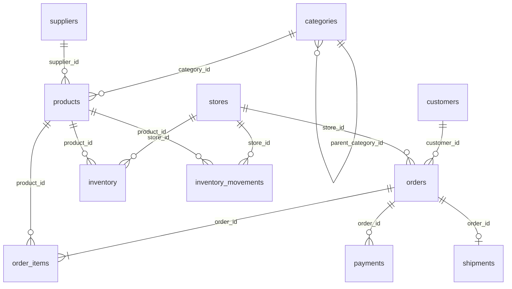

# Data Contracts — Enterprise Retail Lakehouse (fontes)

Contratos das **fontes** (landing zone), antes da Bronze. A fonte da verdade executável é
`retail_lakehouse/ingestion/source_contracts.py`; este documento é verificado contra ela
por `tests/unit/test_source_contracts.py` (todo dataset e toda coluna precisam aparecer aqui).
Convenções de serialização: [SOURCE_SYSTEMS.md](SOURCE_SYSTEMS.md).

**Nulável** descreve o contrato. Violações (NULL em coluna obrigatória, chave duplicada,
FK órfã, valor fora do domínio) são **anomalias intencionais**, registradas em `_anomalies_<batch_id>.csv`.

## Relações

| Relação | Cardinalidade | Observação |
|---|---|---|
| `products.category_id` → `categories.category_id` | N:1 | sempre uma categoria-folha (subcategoria) |
| `categories.parent_category_id` → `categories.category_id` | N:1 | 2 níveis: departamento (sem pai) → subcategoria |
| `products.supplier_id` → `suppliers.supplier_id` | N:1 | |
| `orders.customer_id` → `customers.customer_id` | N:1 | cliente cadastrado antes do pedido |
| `orders.store_id` → `stores.store_id` | N:1 | pedidos `online`/`app` → loja `online` (CD de e-commerce) |
| `order_items.order_id` → `orders.order_id` | N:1 | todo pedido tem ≥ 1 item |
| `order_items.product_id` → `products.product_id` | N:1 | produtos ativos, do sortimento da loja |
| `payments.order_id` → `orders.order_id` | N:1 | **não** 1:1: tentativa recusada + aprovada, ou aprovado + estorno |
| `shipments.order_id` → `orders.order_id` | 1:0..1 | só pedidos `online`/`app` enviados |
| `inventory.(store_id, product_id)` → `stores`, `products` | N:1 cada | foto do estoque em `end_date` |
| `inventory_movements.(store_id, product_id)` → `stores`, `products` | N:1 cada | `reference_id` = `order_id` em vendas/devoluções |

**Invariante de estoque**: para cada `(store_id, product_id)`,
`inventory.quantity_on_hand = Σ inventory_movements.quantity` (movimentos com sinal).

## Datasets

Tipos lógicos: `string`, `integer`, `decimal(12,2)`, `date`, `timestamp`, `boolean`.
PII = dado pessoal (sintético, mas tratado como real — skill `security`).

### categories — `erp` · CSV · ~38 linhas

Grain: uma categoria. Business key: `category_id`.

| Coluna | Tipo | Nulável | Domínio / regra |
|---|---|---|---|
| `category_id` | string | não | `CAT-NNN` |
| `category_name` | string | não | |
| `parent_category_id` | string | sim | NULL = departamento |

### suppliers — `erp` · CSV · ~100 linhas

Grain: um fornecedor. Business key: `supplier_id`.

| Coluna | Tipo | Nulável | Domínio / regra |
|---|---|---|---|
| `supplier_id` | string | não | `SUP-NNNN` |
| `supplier_name` | string | não | fictício |
| `email` | string | não | e-mail comercial válido (`@example.net`) |
| `city` | string | não | |
| `state` | string | não | UF |
| `lead_time_days` | integer | não | 2–30 |
| `created_at` | date | não | anterior a `start_date` |

### stores — `erp` · CSV · ~30 linhas

Grain: uma loja. Business key: `store_id`.

| Coluna | Tipo | Nulável | Domínio / regra |
|---|---|---|---|
| `store_id` | string | não | `STR-NNN`; a última é a loja `online` |
| `store_name` | string | não | |
| `store_type` | string | não | `physical`, `online` |
| `city` | string | não | |
| `state` | string | não | UF |
| `region` | string | não | `Norte`, `Nordeste`, `Centro-Oeste`, `Sudeste`, `Sul` |
| `opened_at` | date | não | |

### products — `erp` · CSV · ~2.000 linhas

Grain: um produto. Business key: `product_id`.

| Coluna | Tipo | Nulável | Domínio / regra |
|---|---|---|---|
| `product_id` | string | não | `PRD-NNNNNN` |
| `sku` | string | não | único |
| `product_name` | string | não | |
| `category_id` | string | não | FK → `categories` (folha) |
| `supplier_id` | string | não | FK → `suppliers` |
| `brand` | string | não | marca fictícia |
| `list_price` | decimal(12,2) | não | > 0 |
| `cost_price` | decimal(12,2) | não | > 0 e < `list_price` |
| `is_active` | boolean | não | inativos não são vendidos |
| `created_at` | timestamp | não | |
| `updated_at` | timestamp | não | ≥ `created_at` |

### customers — `crm` · CSV · ~50.000 linhas

Grain: um cliente. Business key: `customer_id`. **PII**: `first_name`, `last_name`, `email`, `birth_date`.

| Coluna | Tipo | Nulável | Domínio / regra |
|---|---|---|---|
| `customer_id` | string | não | `CUS-NNNNNNN`, crescente com `registered_at` |
| `first_name` | string | não | PII |
| `last_name` | string | não | PII |
| `email` | string | não | PII; e-mail válido em domínio reservado (`example.com/.org/.net`) |
| `birth_date` | date | não | PII; idade 18–80 em `start_date` |
| `city` | string | não | |
| `state` | string | não | UF |
| `segment` | string | não | `standard`, `premium` |
| `registered_at` | timestamp | não | ≤ `end_date` |

### orders — `ecommerce` · JSON Lines · ≥ 100.000 linhas

Grain: um pedido. Business key: `order_id`.

| Coluna | Tipo | Nulável | Domínio / regra |
|---|---|---|---|
| `order_id` | string | não | `ORD-NNNNNNNN`, crescente com `order_timestamp` |
| `customer_id` | string | não | FK → `customers` |
| `store_id` | string | não | FK → `stores` |
| `channel` | string | não | `store`, `online`, `app` |
| `order_status` | string | não | `created`, `paid`, `shipped`, `delivered`, `cancelled`, `returned` |
| `order_timestamp` | timestamp | não | dentro de [`start_date`, `end_date`] |
| `currency` | string | não | `BRL` |
| `freight_amount` | decimal(12,2) | não | 0 em `store` e acima de R$ 299; = `shipments.freight_amount` |

### order_items — `ecommerce` · JSON Lines · ≥ 300.000 linhas (~325.000)

Grain: uma linha de pedido. Business key: (`order_id`, `line_number`).

| Coluna | Tipo | Nulável | Domínio / regra |
|---|---|---|---|
| `order_id` | string | não | FK → `orders` |
| `line_number` | integer | não | 1..N dentro do pedido |
| `product_id` | string | não | FK → `products`; produtos distintos por pedido |
| `quantity` | integer | não | ≥ 1 |
| `unit_price` | decimal(12,2) | não | > 0 (preço de lista do produto) |
| `discount_amount` | decimal(12,2) | não | 0 ≤ desconto < `quantity × unit_price` |

### payments — `payments` · JSON Lines · ~103.000 linhas

Grain: um evento de pagamento. Business key: `payment_id`.

| Coluna | Tipo | Nulável | Domínio / regra |
|---|---|---|---|
| `payment_id` | string | não | `PAY-NNNNNNNN` |
| `order_id` | string | não | FK → `orders` |
| `payment_method` | string | não | `credit_card`, `debit_card`, `pix`, `boleto`, `cash` |
| `installments` | integer | não | 1–10 (só cartão de crédito > 1) |
| `amount` | decimal(12,2) | não | > 0; aprovado = Σ itens líquidos + `orders.freight_amount` |
| `payment_status` | string | não | `approved`, `declined`, `refunded` |
| `processed_at` | timestamp | não | ≥ `order_timestamp` |

### shipments — `logistics` · CSV · ~38.000 linhas

Grain: uma remessa. Business key: `shipment_id`.

| Coluna | Tipo | Nulável | Domínio / regra |
|---|---|---|---|
| `shipment_id` | string | não | `SHP-NNNNNNNN` |
| `order_id` | string | não | FK → `orders` (`online`/`app`); único |
| `carrier_id` | string | não | `CAR-01`..`CAR-04` (transportadoras fictícias) |
| `shipment_status` | string | não | `in_transit`, `delivered`, `returned` |
| `shipped_at` | timestamp | não | ≥ `order_timestamp` |
| `delivered_at` | timestamp | sim | NULL se `in_transit`; ≥ `shipped_at` |
| `freight_amount` | decimal(12,2) | não | ≥ 0 (grátis acima de R$ 299) |

### inventory — `erp` · CSV · ~30.000 linhas

Grain: um produto em uma loja na data da foto. Business key: (`snapshot_date`, `store_id`, `product_id`).

| Coluna | Tipo | Nulável | Domínio / regra |
|---|---|---|---|
| `snapshot_date` | date | não | = `end_date` |
| `store_id` | string | não | FK → `stores` |
| `product_id` | string | não | FK → `products` |
| `quantity_on_hand` | integer | não | ≥ 0; = Σ movimentos |
| `reorder_point` | integer | não | ≥ 0 |

### inventory_movements — `erp` · CSV · ~356.000 linhas

Grain: um movimento de estoque. Business key: `movement_id`.

| Coluna | Tipo | Nulável | Domínio / regra |
|---|---|---|---|
| `movement_id` | string | não | `MOV-NNNNNNNNN` |
| `store_id` | string | não | FK → `stores` |
| `product_id` | string | não | FK → `products` |
| `movement_type` | string | não | `opening_balance`, `purchase_receipt`, `sale`, `return` |
| `quantity` | integer | não | ≠ 0; negativo em `sale`, positivo nos demais |
| `movement_timestamp` | timestamp | não | |
| `reference_id` | string | sim | `order_id` em `sale`/`return`; NULL nos demais |

## Evolução dos contratos

- Mudança compatível (nova coluna nulável no fim): atualizar `source_contracts.py` e este
  documento no mesmo trabalho.
- Mudança incompatível (renomear/remover/mudar tipo ou business key): exige ADR e nova
  versão de contrato.
