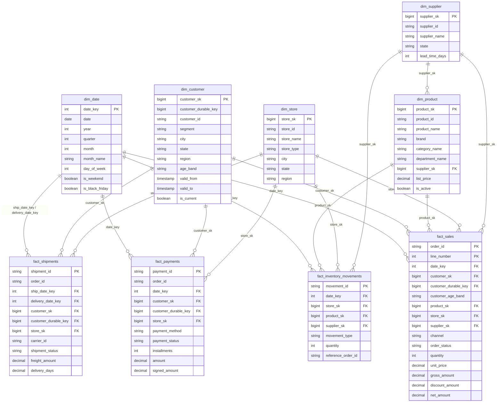

# Dimensional Model (Gold) — Enterprise Retail Lakehouse

Modelo estrela (Kimball) sobre a Silver. Definições de métricas: [BUSINESS_RULES.md](BUSINESS_RULES.md).
Colunas: [DATA_DICTIONARY.md](DATA_DICTIONARY.md). Código: `src/retail_lakehouse/gold/`.
Consultas: `sql/gold/`.

> **Entrada**: a Gold lê **somente** a Silver (contrato tipado em
> `src/retail_lakehouse/silver/schemas.py`), produzida pela Silver ([SILVER.md](SILVER.md)). Os
> testes da Gold usam esse contrato gerado dos dados limpos do gerador; o teste de integração
> prova que a Silver construída da landing limpa é idêntica a ele.

## 1. Grain de cada fato (definido antes da implementação)

| Fato | Grain — uma linha representa… | Chave do grain | Linhas = |
|---|---|---|---|
| `fact_sales` | **uma linha de pedido** (um produto em um pedido), qualquer status | (`order_id`, `line_number`) | linhas de `silver.order_items` |
| `fact_payments` | **um evento de pagamento** (tentativa recusada, aprovação ou estorno), já deduplicado | `payment_id` | linhas de `silver.payments` |
| `fact_shipments` | **uma remessa** de um pedido online/app | `shipment_id` | linhas de `silver.shipments` |
| `fact_inventory_movements` | **um movimento de estoque** de um produto em uma loja | `movement_id` | linhas de `silver.inventory_movements` |

Consequências do grain:

- `fact_sales` **não** carrega valores de nível de pedido (frete, valor pago): repeti-los em
  cada linha causaria double counting. Frete vive em `fact_shipments`; dinheiro em `fact_payments`.
- Status do pedido é atributo degenerado em `fact_sales` (filtrado pelas métricas), não filtro
  na carga: o fato guarda tudo que aconteceu.
- Cada fato tem exatamente o número de linhas da entidade Silver de origem — verificado por teste
  (nenhum join pode multiplicar linhas).

## 2. Dimensões

| Dimensão | Grain | Natural key | Surrogate key | Histórico |
|---|---|---|---|---|
| `dim_customer` | uma versão de cliente | `customer_id` (+ `valid_from`) | `customer_sk` (versão); `customer_durable_key` (identidade) | **SCD Type 2** em `segment`, `city`, `state`, `region` |
| `dim_product` | um produto | `product_id` | `product_sk` | SCD Type 1 |
| `dim_store` | uma loja | `store_id` | `store_sk` | SCD Type 1 |
| `dim_supplier` | um fornecedor | `supplier_id` | `supplier_sk` | SCD Type 1 |
| `dim_date` | um dia do calendário | `date` | `date_key` (`yyyymmdd`) | estática |

Regras comuns:

- **Surrogate keys determinísticas**: `xxhash64(nome_da_dimensão, natural key[, valid_from])`
  (BIGINT). Reconstruir a Gold gera as mesmas chaves (idempotência; ADR 008).
- **Membro desconhecido**: toda dimensão tem a linha `sk = -1` (`date_key = -1`). FK sem
  correspondência (ex.: cliente órfão mantido pela Silver como `WARNING`) aponta para ele —
  o fato nunca perde a linha.
- **Faixa etária: atributo historizado × atributo derivado.** `dim_customer.age_band` é **historizada**:
  a faixa no início da versão (`valid_from`), que fica fixa enquanto a versão vale. Uma versão aberta
  em 2010, aos 19 anos, continua `18-24` num pedido de 2024. `fact_sales.customer_age_band` é **derivada**
  por pedido: a idade na data de negócio do pedido. É ela que a análise de vendas por idade usa. Mesma
  regra para as duas (`dimensions.age_band_at`): anos completos pelo calendário (o aniversário conta no
  próprio dia; quem nasceu em 29/02 faz aniversário em 1º/03 nos anos comuns), faixas `18-24` … `65+`,
  `unknown` sem data de nascimento ou com idade < 18. A data de nascimento vem da versão mais recente que a
  tem na Silver (é um fato da pessoa, e uma correção vale para todos os pedidos), por `customer_id` (N:1,
  sem multiplicar linhas), e não é gravada na Gold (PII). Pedido anterior ao cadastro também recebe a
  faixa. Os outros fatos não têm a coluna: pagamento e entrega não são analisados por idade.
- **Evento antes da primeira versão do cliente** (ADR 0003): a primeira versão começa em
  `registered_at` (cadastro) e não é estendida para trás, porque os atributos daquele instante
  não são conhecidos. O fato fica com `customer_sk = -1` (versão desconhecida, contado no
  WARNING `unknown_member__customer_sk`) e com `customer_durable_key` do cliente, que é o mesmo
  em todas as versões. Cliente inexistente: as duas chaves são `-1`. Um evento nunca recebe uma
  versão posterior a ele; `valid_from` é inclusivo.
- **PII**: `dim_customer` não tem nome, e-mail nem data de nascimento; guarda apenas faixa
  etária (skill `security`).
- **Datas de negócio** em horário de Brasília: `date_key` é a data local do evento.
- **Datas fora do calendário** (antes de `calendar_start`, depois de `calendar_end` ou sem
  data): o `date_key` do fato vira `-1` e a data do evento fica na coluna de data do fato
  (`order_date`, `payment_date`, `ship_date`, `delivery_date`, `movement_date`; mapa
  `EVENT_DATES`). Nenhuma linha some e nenhum `date_key` fica sem linha em `dim_date`. Em
  `dim_date`, o membro `-1` tem `year_month = 'UNKNOWN_DATE'` e `year`/`month` NULL: não é
  confundido com janeiro, mês zero nem com um nulo sem significado.

## 3. Diagrama

## 4. Cardinalidade dos joins na carga

| Join | Cardinalidade | Garantia |
|---|---|---|
| `order_items` → `orders` | N:1 | `order_id` único na Silver |
| fato → `dim_customer` | N:1 | versão vigente no instante do evento (`valid_from ≤ t < valid_to`): intervalos sem sobreposição (testado) |
| fato → identidade do cliente (`customer_durable_key`) | N:1 | pares distintos (`customer_id`, `customer_durable_key`): uma chave durável por cliente (testado) |
| fato → `dim_product` / `dim_store` / `dim_supplier` | N:1 | natural key única (SCD1) |
| `dim_product` → `dim_supplier` | N:1 | idem |

Todos os joins são `left`: a falta de correspondência vira membro desconhecido, nunca perda de linha.

## 5. Medidas por aditividade

| Medida | Fato | Aditividade |
|---|---|---|
| `quantity`, `gross_amount`, `discount_amount`, `net_amount` | `fact_sales` | aditiva |
| `unit_price` | `fact_sales` | não aditiva (média ponderada = Σ gross / Σ quantity) |
| `amount`, `signed_amount` | `fact_payments` | aditiva (`signed_amount`: estorno negativo, recusa zero) |
| `freight_amount` | `fact_shipments` | aditiva |
| `delivery_days` | `fact_shipments` | não aditiva (usar média) |
| `quantity` (movimento) | `fact_inventory_movements` | aditiva; o **saldo** derivado é semi-aditivo (nunca somar saldos no tempo) |

## 6. Carga

Reconstrução completa e determinística a cada execução (`createOrReplace`), viável com os
volumes do portfólio e idempotente por construção (mesmas surrogate keys). Carga incremental
(MERGE por grain) fica para quando houver lotes incrementais.

### Publicação segura e gate de qualidade

`retail_lakehouse.gold.pipeline.write_gold` publica em três passos:

1. **Staging.** As 9 tabelas candidatas são gravadas em `<gold>_staging` (schema separado: quem
   consulta a Gold nunca vê uma candidata). O gate e a publicação leem essas tabelas
   materializadas, então o que é publicado é exatamente o que foi validado.
2. **Gate** (`retail_lakehouse.quality.retail_gold_suite`), sobre todas as tabelas antes de
   publicar qualquer uma; um registro em `pipeline_runs` (`<gold>_staging.*`):

   | Regra | Check | Severidade |
   |---|---|---|
   | schema (colunas e tipos) = `GOLD_SCHEMAS` | `schema__<tabela>` | CRITICAL |
   | grain único (`GRAIN`) | `grain__<tabela>` | CRITICAL |
   | chaves obrigatórias: grain e FKs | `not_null__<coluna>` | CRITICAL |
   | natural key de toda linha de dimensão, exceto o membro desconhecido (-1, natural key NULL por construção) | `natural_key__<coluna>` | CRITICAL |
   | integridade referencial de **todas** as relações (`FOREIGN_KEYS`: as 16 FKs dos fatos, incluindo `fact_sales.date_key → dim_date`, e `dim_product.supplier_sk → dim_supplier`) | `fk__<coluna>__<dimensão>` | CRITICAL |
   | fato ligado a cliente, produto ou loja desconhecido (-1): órfão mantido pela Silver (ADR 007) | `unknown_member__<coluna>` | WARNING |

   O membro desconhecido é uma linha real de cada dimensão, então `-1` passa na integridade
   referencial. Data desconhecida (não enviado / não entregue) e fornecedor desconhecido
   (`supplier_id` nulo na Silver, decisão 059) são estados normais e não geram alerta.
3. **Publicação.** Cada tabela é substituída (uma transação Delta por tabela), dimensões antes de
   fatos, e recebe o comentário com o grain; um registro em `pipeline_runs` por tabela.

Se algum check CRITICAL falha: nada é publicado e as tabelas Gold ficam na versão anterior; o
registro do gate fica `FAILED` com `error_message` (checks e contagens) e os resultados em
`data_quality_results`; um alerta CRITICAL sai em `lakehouse.alerts`; as candidatas ficam em
`<gold>_staging` para diagnóstico até a próxima execução.

**Limite de atomicidade.** O Delta não tem transação entre tabelas. Se a infraestrutura falhar
*durante* o passo 3 (depois do gate), parte das tabelas já foi substituída. Consequências e
mitigação:

- as dimensões são publicadas primeiro e só crescem (a Silver não apaga), e as surrogate keys
  são determinísticas: um fato antigo continua encontrando suas chaves nas dimensões novas;
- a tabela que falhou registra `FAILED` em `pipeline_runs`, com o erro original;
- reexecutar republica tudo a partir da Silver (idempotente).

Um consumidor que precise de um retrato consistente entre tabelas durante uma publicação pode
ler cada tabela na versão do último `run_id` com sucesso (`VERSION AS OF`).

**Datas fora do calendário (M3, 2026-10-08).** Antes, um fato com data fora de
`[calendar_start, calendar_end]` recebia um `date_key` sem linha em `dim_date` e sumia em
silêncio de `monthly_sales.sql` (INNER JOIN), embora continuasse em `kpi_summary.sql`. Agora:

- `build_gold` aplica `conform_dates`: a chave fora do intervalo vira `-1`, a data do evento
  fica na coluna de data do fato;
- o gate reporta essas linhas como WARNING (`out_of_calendar__<coluna de data>`): é sinal de
  que o calendário em `config/gold.toml` precisa ser estendido;
- `fk__date_key__dim_date` continua CRITICAL: só um bug na construção produziria uma chave
  pendente.

#### Impacto em métricas e dashboards

`monthly_sales.sql` mudou de grain e de colunas:

| Antes | Depois |
|---|---|
| uma linha por (`year`, `month`) | uma linha por (`period`, `date_classification`) |
| `INNER JOIN dim_date`: vendas fora do calendário ausentes | `LEFT JOIN`: toda linha de `fact_sales` conta uma vez |
| — | `period`: `yyyy-MM` ou `UNKNOWN_DATE` |
| — | `date_classification`: `IN_CALENDAR`, `OUT_OF_CALENDAR` (data conhecida, fora de `dim_date`) ou `UNKNOWN_DATE` (sem data, p. ex. pedido em quarentena) |

- A soma de `monthly_sales` em todas as linhas é igual a `kpi_summary` (receita bruta,
  desconto, receita líquida, quantidade, pedidos), com os mesmos filtros de status.
- Um gráfico mensal deve filtrar `date_classification = 'IN_CALENDAR'` **e** mostrar à parte o
  total das linhas `UNKNOWN_DATE`: escondê-las reintroduz a diferença com o KPI total.
- Nenhum mês real muda de valor por causa disso: as vendas fora do calendário nunca estiveram em
  um mês do relatório; agora aparecem num grupo próprio.
- `kpi_summary.sql` não muda.
- Quem lia `monthly_sales` por (`year`, `month`) precisa tratar as linhas com `year`/`month`
  NULL (usar `period`) e a nova coluna `date_classification`.
