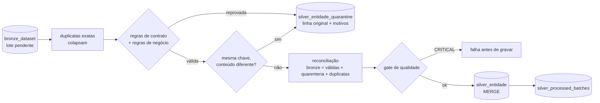

# Silver — entidades padronizadas do Retail

Entrada: as 11 tabelas `bronze_<dataset>` ([BRONZE.md](BRONZE.md)), texto como entregue.
Saída: `silver_<entidade>` tipadas e deduplicadas, uma linha por chave de negócio (clientes: uma
linha por **versão**), e `silver_<entidade>_quarantine` com cada linha inválida e o motivo.
A Gold lê a Silver ([DIMENSIONAL_MODEL.md](DIMENSIONAL_MODEL.md)).

Código:

- `src/retail_lakehouse/silver/standardize.py`: funções puras `DataFrame -> DataFrame`;
- `silver/pipeline.py`: I/O, MERGE, observabilidade;
- `silver/schemas.py`: o contrato;
- `quality/suites.py`: as regras.

Notebook: `notebooks/silver/01_build_silver.py`.



## Contrato de saída

`SILVER_SCHEMAS` (o que a Gold lê) + a linhagem de cada linha: `_ingestion_timestamp`,
`_source_file` e `_batch_id`. Toda linha da Silver é rastreável até o lote e o arquivo do
Bronze. Mudanças em relação à fonte:

| Entidade | Fica de fora | Entra |
|---|---|---|
| `customers` | `first_name`, `last_name`, `email` (PII: minimização) | `region` (da UF), `effective_from` (início da versão) |
| `suppliers` | `email`, `created_at` | — |
| `products` | `sku`, `created_at`, `updated_at` | — |
| `orders` | `currency` (contrato aceita só `BRL`) | — |

## Regras, na ordem em que atuam

### 1. Duplicatas exatas

A mesma linha entregue duas vezes no lote (mesmo conteúdo em todas as colunas da fonte) colapsa
numa só e conta como duplicata. É o padrão dos reenvios do gerador (`duplicate_record`,
`duplicate_payment`).

### 2. Regras de contrato (texto entregue) → quarentena

Derivadas do contrato de fonte (`ingestion/source_contracts.py`), só para as colunas que chegam à
Silver:

| Motivo | Regra |
|---|---|
| `missing__<col>` | coluna obrigatória nula ou só com espaços |
| `invalid__<col>` | formato que não converte: inteiro, decimal com 2 casas que cabe em `DECIMAL(12,2)`, data `AAAA-MM-DD` real, timestamp `AAAA-MM-DDThh:mm:ss±hh:mm` real (`2025-02-30` e `05/03/2025 10:15` falham), booleano `true`/`false` |
| `out_of_domain__<col>` | fora dos valores aceitos do contrato; `state` precisa ser uma das 27 UFs |

**Nulo tolerado.** A fonte exige `products.supplier_id` e `customers.birth_date`, mas a Silver
aceita NULL nos dois, porque a Gold tem resposta definida para cada caso: fornecedor desconhecido
(-1) e faixa etária `unknown`. Quarentenar o produto ou o cliente tornaria órfãos todos os pedidos
dele.

**PII não carregada não quarentena.** Um e-mail inválido não remove o cliente: o e-mail não entra
na Silver.

### 3. Regras de negócio (valores tipados) → quarentena

Declaradas uma vez em `silver_row_rules` e reaproveitadas pelo gate:

| Entidade | Motivo |
|---|---|
| products | `negative__list_price`, `negative__cost_price` |
| orders | `negative__freight_amount` |
| order_items | `non_positive__quantity`, `negative__unit_price`, `negative__discount_amount`, `discount_exceeds_line` |
| payments | `negative__amount`, `non_positive__installments` |
| shipments | `negative__freight_amount`, `delivered_before_shipped` |
| customers | `future__birth_date` (nascimento depois do cadastro) |
| suppliers | `negative__lead_time_days` |
| inventory | `negative__quantity_on_hand`, `negative__reorder_point` |
| inventory_movements | `zero__quantity` (movimentos têm sinal; zero não movimenta nada) |

Uma linha reprovada vai para a quarentena com **todos** os motivos, nunca corrigida em silêncio.

### 4. Conflitos

Mesma chave de negócio com conteúdo diferente no mesmo lote: **todas** as versões vão para a
quarentena (`conflicting_values`), sem escolha arbitrária. Linhas que diferem só em colunas que a
Silver não guarda (por exemplo, o e-mail) colapsam e contam como duplicata.

### 5. Tipagem

- Texto: aparado; vazio vira NULL.
- Timestamps com fuso: instantes UTC (`2025-03-05T10:15:00-03:00` → 13:15 UTC).
- Decimais exatos (`DECIMAL(12,2)`); datas de calendário.

### 6. Chaves estrangeiras

Uma referência inexistente (cliente, produto ou pedido) **não** é defeito de linha. A linha fica
na Silver e o gate registra `unknown_<ref>` como WARNING (ADR 007: dado mestre pode chegar
atrasado); a Gold a liga ao membro desconhecido. Acima de 5% das linhas,
`unknown_<ref>_systemic` é CRITICAL: a carga do mestre provavelmente falhou.

## Versões de cliente (entrada da SCD Type 2)

O CRM exporta o cadastro sem data de alteração. Por isso:

- **primeira versão** de um cliente: `effective_from = registered_at`;
- **mudança** (qualquer atributo da Silver difere da versão **mais recente** gravada): nova versão
  com `effective_from = _ingestion_timestamp` do lote que a revelou;
- observação igual à versão vigente: nada é inserido.

Voltar a um valor anterior também é mudança (a comparação é sempre contra a versão vigente). A
Gold compacta as versões pelos atributos rastreados (`segment`, `city`, `state`, `region`).

## Incremental, idempotência e reconciliação

| Mecanismo | Garantia |
|---|---|
| Tabela de controle `silver_processed_batches` (entidade, lote) | só lotes pendentes são lidos; o lote é marcado **depois** das gravações |
| Clientes: MERGE insert-only em (`customer_id`, `effective_from`) | versão nova entra uma vez |
| Demais: MERGE por chave de negócio | lote mais novo com conteúdo diferente atualiza (SCD1); conteúdo igual não muda nada |
| Quarentena: insert-only por (impressão digital da linha, motivos); impressão = SHA-256 dos valores entregues e do lote, NULL com marcador próprio (`standardize.fingerprint`) | reprocessar o lote não duplica; linhas que diferem só na posição de um NULL não colapsam |
| `BatchCounts.reconcile()` | `linhas do Bronze = válidas + quarentena + duplicatas`, cada parcela contada do seu próprio DataFrame; divergência é CRITICAL e para antes de gravar |

Um lote interrompido antes de ser marcado é processado de novo; os MERGEs ignoram o que já têm.

As entidades rodam em ordem de dependência:

```
categories → suppliers → stores → products → customers → orders → order_items → payments → shipments → inventory → inventory_movements
```

As referências são checadas contra a Silver atual.

## Gate de qualidade e observabilidade

- Por lote, antes do MERGE: `retail_entity_suite`.
  - CRITICAL: schema = contrato, chave não nula, chave única, órfãos sistêmicos.
  - WARNING: órfãos.
  - As regras de negócio já foram aplicadas, então passam.
- Uma linha de `pipeline_runs` por entidade (`retail_silver`): `input` = linhas do Bronze,
  `output` = linhas válidas, `rejected` = quarentena, `duplicate` = duplicatas. Os resultados vão
  para `data_quality_results`.
- Sem cache: o serverless rejeita as APIs de cache (ADR 0001). Os lotes são pequenos.

## Como executar

Databricks: `notebooks/silver/01_build_silver.py` (configuração em `config/silver.toml`).

## Testes

| Arquivo | Cobre |
|---|---|
| `tests/unit/test_silver_reference.py` | 27 UFs nas 5 regiões do contrato, coerência com o gerador, reconciliação |
| `tests/transformation/test_silver_standardize.py` | tipagem e UTC, linhagem, duplicatas, conflitos, cada motivo de quarentena por entidade, PII, região, nulos tolerados, FK órfã mantida |
| `tests/transformation/test_silver_customer_versions.py` | cliente novo, inalterado, alterado; comparação com a versão mais recente |
| `tests/data_quality/test_retail_quality_suite.py` | as regras e o gate de uma entidade só |
| `tests/integration/test_silver_build.py` | raw → Bronze → Silver → Gold com Delta: reconciliação por entidade, quarentena e duplicatas iguais ao registro de anomalias do gerador, órfãos mantidos, Gold construída da Silver, reexecução sem efeito, segundo lote (versões e SCD1), quebra sistêmica para antes de gravar, landing limpa igual ao contrato usado pelos testes da Gold |
