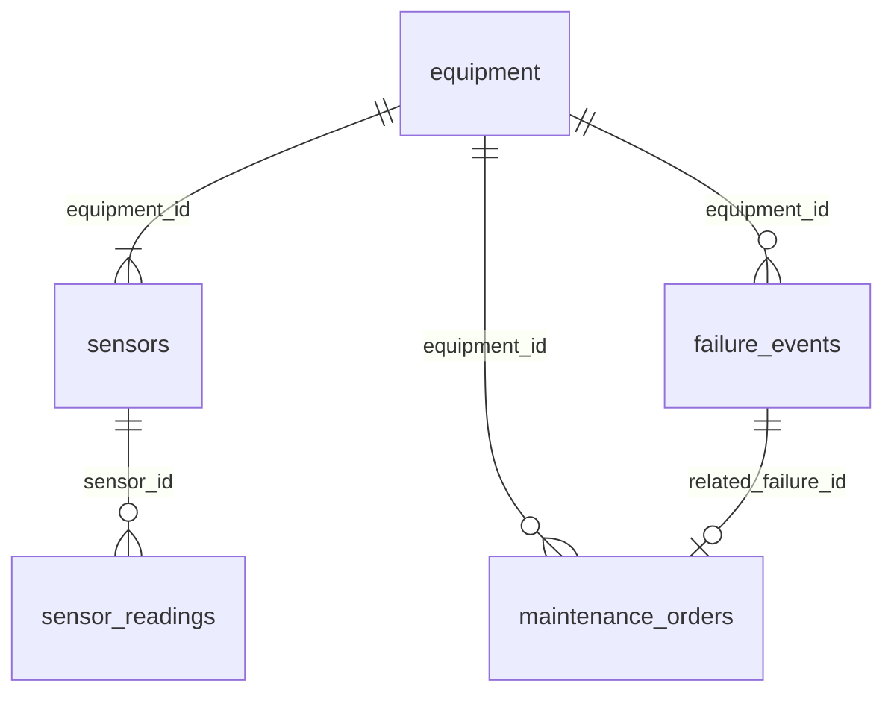

# Data Contracts — Industrial IoT Lakehouse (fontes)

Contratos das fontes (landing zone), antes da Bronze. Fonte executável:
`src/iot_lakehouse/ingestion/source_contracts.py` (colunas, tipos, chaves) e
`src/iot_lakehouse/synthetic/physics.py` (limites físicos e perfis de operação). Sincronia
verificada por `tests/unit/test_iot_contracts.py`. Geração: [DATA_GENERATION.md](DATA_GENERATION.md).

## Sistemas de origem

| Sistema | Código | Datasets | Formato |
|---|---|---|---|
| CMMS / cadastro de ativos | `cmms` | `equipment`, `sensors`, `failure_events`, `maintenance_orders` | CSV |
| Historian (gateway IoT) | `historian` | `sensor_readings` | JSON Lines gzip, particionado por `ingestion_date` |

Timestamps em UTC, ISO 8601 com `Z`. Plantas no Brasil (UTC−3 para padrões diurnos).

## Relações

## Datasets

### equipment — `cmms` · CSV

Grain: um equipamento. Business key: `equipment_id`.

| Coluna | Tipo | Nulável | Regra |
|---|---|---|---|
| `equipment_id` | string | não | `EQ-NNNN` |
| `equipment_type` | string | não | `pump`, `electric_motor`, `compressor`, `hydraulic_system` |
| `model` | string | não | modelo fictício |
| `manufacturer` | string | não | fabricante fictício |
| `site_id` | string | não | `SITE-NN` |
| `site_name` | string | não | planta |
| `state` | string | não | UF |
| `installed_at` | date | não | anterior à janela |
| `rated_power_kw` | double | não | > 0 |

### sensors — `cmms` · CSV

Grain: um sensor instalado. Business key: `sensor_id`.

| Coluna | Tipo | Nulável | Regra |
|---|---|---|---|
| `sensor_id` | string | não | `SN-NNNNNN` |
| `equipment_id` | string | não | FK → `equipment` |
| `sensor_type` | string | não | ver tabela de limites físicos |
| `unit` | string | não | unidade do tipo de sensor |
| `physical_min` | double | não | limite físico inferior |
| `physical_max` | double | não | limite físico superior |
| `sampling_interval_seconds` | integer | não | ≥ 60 |

### sensor_readings — `historian` · JSON Lines gzip

Grain: uma leitura enviada pelo gateway. Business key: `reading_id` (**não garantida**:
o gateway reenvia leituras).

| Coluna | Tipo | Nulável | Regra |
|---|---|---|---|
| `reading_id` | string | não | `<sensor_id>-<passo>`; reenvios repetem o id |
| `sensor_id` | string | não | FK → `sensors` |
| `event_timestamp` | timestamp | não | instante da medição |
| `ingestion_timestamp` | timestamp | não | chegada ao historian (≥ `event_timestamp`) |
| `reading_value` | double | não | dentro dos limites físicos — exceto leituras impossíveis (anomalia) |
| `unit` | string | não | = `sensors.unit` |

### failure_events — `cmms` · CSV

Grain: uma falha registrada. Business key: `failure_id`.

| Coluna | Tipo | Nulável | Regra |
|---|---|---|---|
| `failure_id` | string | não | `FL-NNNNN` |
| `equipment_id` | string | não | FK → `equipment` |
| `failure_mode` | string | não | modos por tipo de equipamento (abaixo) |
| `failure_timestamp` | timestamp | não | parada do equipamento |
| `severity` | string | não | `minor`, `major`, `critical` |

### maintenance_orders — `cmms` · CSV

Grain: uma ordem de manutenção. Business key: `maintenance_order_id`.

| Coluna | Tipo | Nulável | Regra |
|---|---|---|---|
| `maintenance_order_id` | string | não | `MO-NNNNNN` |
| `equipment_id` | string | não | FK → `equipment` |
| `order_type` | string | não | `corrective`, `preventive` |
| `related_failure_id` | string | sim | FK → `failure_events` (só `corrective`) |
| `opened_at` | timestamp | não | |
| `started_at` | timestamp | não | ≥ `opened_at` |
| `completed_at` | timestamp | sim | NULL se `in_progress` |
| `status` | string | não | `completed`, `in_progress` |

## Limites físicos (leitura fora deles é impossível)

| Sensor | Unidade | Mínimo | Máximo |
|---|---|---:|---:|
| `temperature` | degC | -40 | 200 |
| `vibration` | mm/s | 0 | 50 |
| `pressure` | bar | 0 | 350 |
| `flow_rate` | m3/h | 0 | 500 |
| `rpm` | rpm | 0 | 6000 |
| `current` | A | 0 | 500 |
| `voltage` | V | 0 | 690 |
| `power_consumption` | kW | 0 | 1000 |

## Perfis de operação normal (valor nominal ± desvio do ruído)

| Equipamento | temperature | vibration | pressure | flow_rate | rpm | current | voltage | power_consumption |
|---|---|---|---|---|---|---|---|---|
| `pump` | 55 ± 1.2 | 2.8 ± 0.25 | 6.0 ± 0.15 | 120 ± 3 | 1750 ± 8 | 32 ± 0.8 | 380 ± 2 | 18.5 ± 0.5 |
| `electric_motor` | 65 ± 1.5 | 2.2 ± 0.2 | — | — | 1780 ± 6 | 45 ± 1.0 | 380 ± 2 | 22 ± 0.6 |
| `compressor` | 85 ± 2.0 | 4.0 ± 0.35 | 8.5 ± 0.2 | — | 2950 ± 10 | 65 ± 1.5 | — | 37 ± 1.0 |
| `hydraulic_system` | 48 ± 1.0 | 1.8 ± 0.15 | 180 ± 3 | 60 ± 1.5 | — | — | — | 22 ± 0.6 |

`—` = o equipamento não tem esse sensor. Pump: 8 sensores; motor e compressor: 6; hidráulico: 5.

## Modos de falha (efeito relativo no momento da falha)

| Equipamento | Modo | Efeito nos sensores |
|---|---|---|
| `pump` | `bearing_wear` | vibration +250%, temperature +25% |
| `pump` | `cavitation` | vibration +120%, pressure −35%, flow_rate −30% |
| `pump` | `seal_leak` | pressure −30%, flow_rate −25%, power_consumption +20% |
| `electric_motor` | `bearing_wear` | vibration +200%, temperature +20% |
| `electric_motor` | `winding_insulation` | temperature +40%, current +25%, power_consumption +20% |
| `compressor` | `valve_failure` | pressure −30%, power_consumption +20%, temperature +15% |
| `compressor` | `overheating` | temperature +35%, current +15% |
| `hydraulic_system` | `pump_wear` | pressure −25%, flow_rate −30%, vibration +100% |
| `hydraulic_system` | `fluid_leak` | pressure −40%, flow_rate −20% |

Todos os efeitos mantêm os valores dentro dos limites físicos (verificado por teste): uma falha
real é anômala, mas fisicamente possível.
